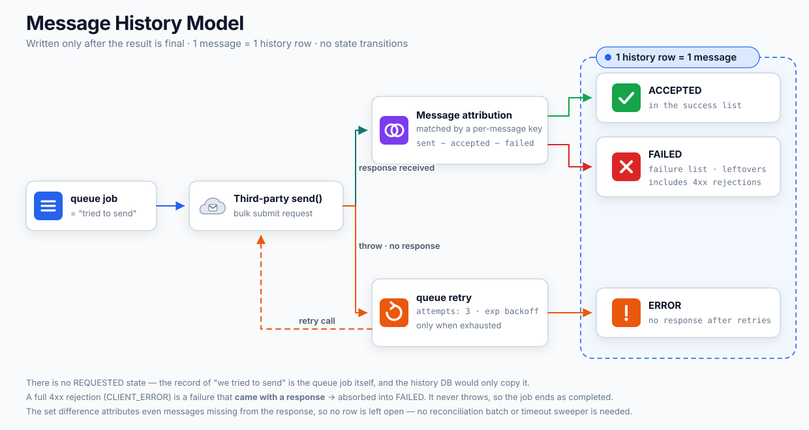
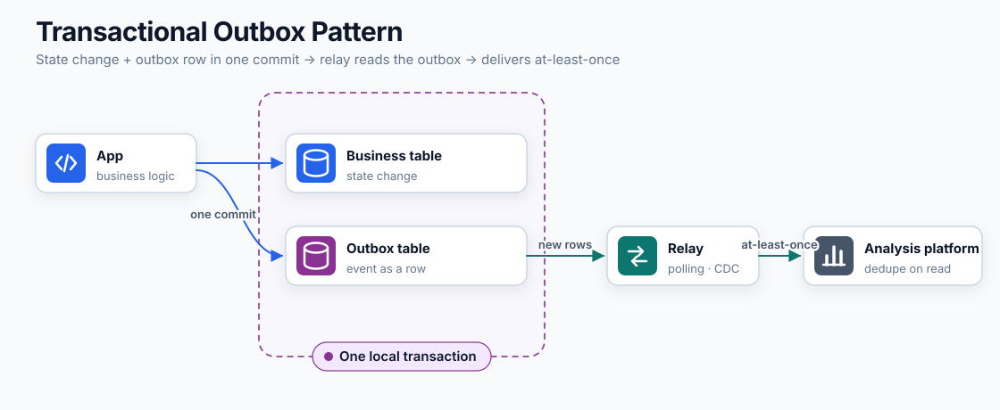
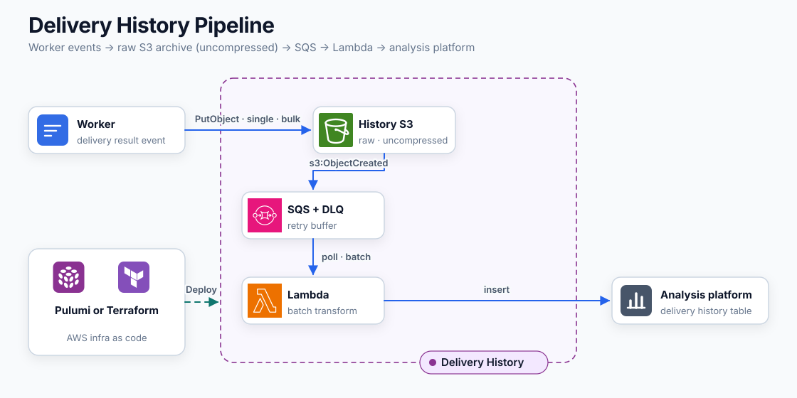
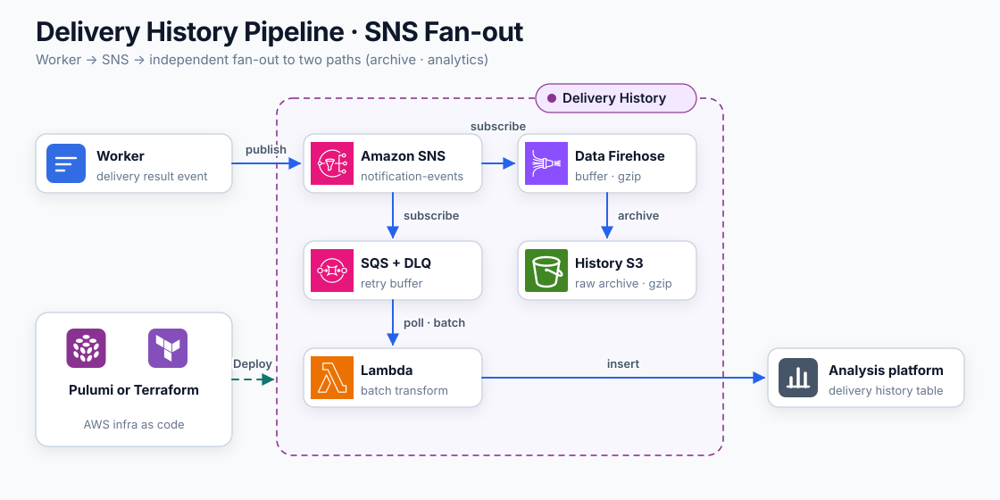
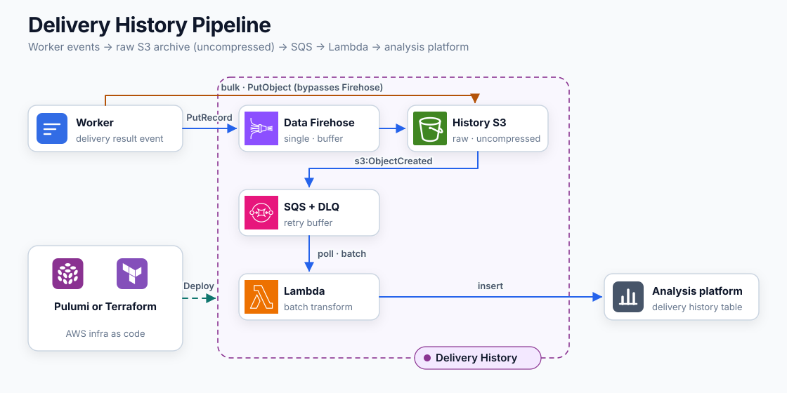
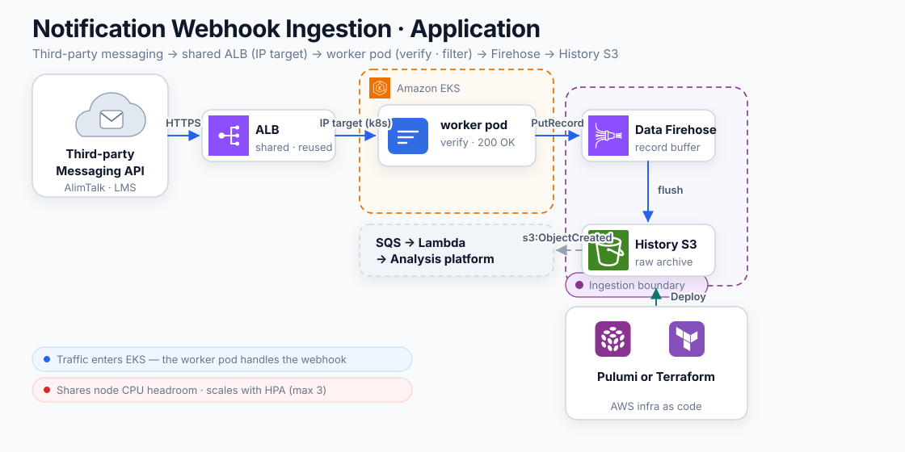
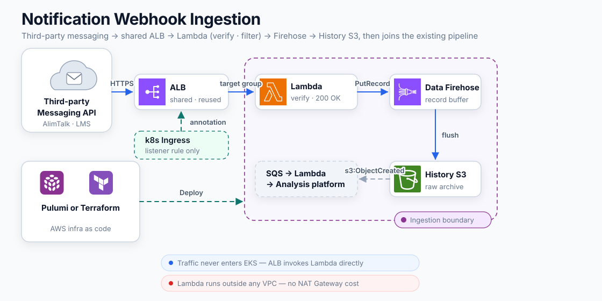
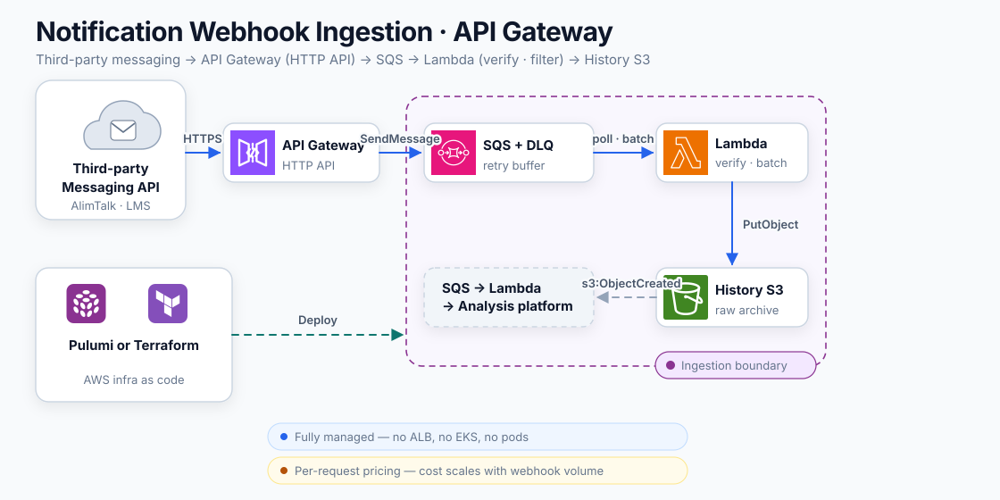

## Introduction

[Part 1](/blog/notification-server-part-1-delegating-delivery) and [Part 2](/blog/bullmq-notification-part-2-rate-limit) were about how to get sends out. Part 3 is about what comes after they are sent.

What was sent, when, to whom, and with what result has to be recorded somewhere. The external API's console keeps a history too, but there are questions it alone cannot answer. This post first sorts out what needs to be recorded, then weighs it as three questions.

1. When and in what shape to record history
2. Where to store history
3. Where to receive delivery results

The order is problem, data, design, then storage. Storage is the implementation, so I think it should be chosen last.

## What the console alone cannot answer

The external API does the sending for us, and the history stays in its console too. You might think that with good use of the console there is no reason to store the data separately. Suppose the service from Part 1 is sending sign-up welcomes, payment follow-ups, and announcements. Rely on the console alone and the questions below become hard to answer.

- <strong>We cannot see "what went to this user, and when" on our side.</strong> The console can search by the message ID the external API assigned, but not by our member ID. Every time a CS inquiry comes in, a person has to cross-reference the console against the operational DB.
- <strong>We cannot aggregate failure rates over a period.</strong> The list of failures is in our hands only at response time. If we do not record it then, we cannot reconstruct even yesterday's failure rate. Calls that threw outright because of network issues or a 4xx/5xx have no history even on the external API's side, so they do not even enter the denominator.
- <strong>We cannot check what content went out.</strong> If the console's export leaves out template variables, the text that actually went out cannot be reconstructed.
- <strong>We are bound by the retention period and the query limit.</strong> If retention is six months, the data is gone the moment you want to compare against the same period last year. Hook the query API up to an admin screen and you meet the 429s from Part 2 in lookups too.

<strong>Delegate the act, but never the data.</strong>

## What needs to be recorded

What data, stored how, would solve the problems above?

First, <strong>the unit of record is one recipient</strong>. A single submission request carries several recipients, and if the request is the unit, the first problem cannot be answered. A CS inquiry always needs to check the full history of one person. Some information is known only at the request level, though, so there are two layers: group and entry.

The data to keep falls out of the problems above one by one.

| Problem | Data to keep |
| --- | --- |
| Cannot search by user | Our recipient identifier, send time |
| Cannot count failure rates by period | Final result and failure reason per message |
| Thrown calls missing from the denominator | A failure record we write ourselves even without a response from the external API |
| Cannot see what went out | The content after variable substitution |
| Cannot split by template or channel | Template and channel identifiers |

Some conditions do not map to data fields. Suppose comparing against the same period last year takes <strong>a retention period of at least two years</strong>. And without affecting the operational DB, <strong>the history must be able to join with the user table in the operational DB.</strong> That is for weighing per-channel performance and retention. Last comes <strong>a place to archive the raw original</strong>. Once the history is transformed into our schema and loaded, we need a source to return to when the transformation was wrong or a new question comes up. Only while the original survives are backfill and reprocessing possible.

The query patterns will usually look like this.

- Failure rates and reason distributions by period
- Performance by template and channel
- Response and retention analysis joined with the user table
- Per-recipient history lookups for CS inquiries

Aggregations and bulk reads dominate. Writes are bulk appends, and reads will mostly be scans.

## When and in what shape to record history

There are three things to settle about how this data is stored. All three can be answered without assuming any particular storage, and each answer stacks up one more property to demand of the storage. The reverse direction exists too, of course. If a storage offers a property attractive enough, an answer made here can be taken back. That review happens in the section where the storage is chosen.

### 1. Whether to tie sending and history into one flow

Sending a notification and monitoring outcomes through history are different concerns. Sending is about getting this message out right now, and it must not fail. History is about collecting the results to ask questions later. Its consumers are CS tracing, failure-rate aggregation, and performance analysis, so minutes of delay are fine, and on the rare occasion one is lost, what is lost is one record. The two have opposite requirements.

<strong>Tie them together and you gain completeness.</strong> Write the history within the same flow and finish the send only after confirming the write succeeded, and the state "sent successfully but no history" cannot arise at all. In exchange, a by-product's failure spreads into the main function. If the history store dies, sending stops too, and AlimTalk messages stop going out because the analysis platform got slow.

<strong>Cut them apart and you get the opposite.</strong> The worker only publishes the send result as an event and does not wait for storage to succeed. If publishing fails, sends keep going out, and the failed event is retried outside the send flow. If even the retries fail, a window remains where the send happened but the event is missing. Results that got a response can be backfilled from the external API's console, but thrown calls have no history even on the other side, so not even that works. Cutting with events brings something along too. The responsibility of reshaping data into the storage's schema also leaves the sending code.

Tying them fits when writing history is a precondition of sending. If the communication falls under a regulation where "no record of sending means it was not sent," you tie them and gain completeness. Cutting them fits when history exists for after-the-fact analysis and CS, so rare record loss is acceptable.

Suppose that for this post's service, history is not a precondition of sending. Follow the cutting side, and a condition on the storage emerges. It must accept events from outside the send path and write them, and sending must continue even when a write fails.

### 2. When to write the record

There are two roads: create a row at submission time and transition its state, or write once after the result is finalized.



The state-transition approach can observe in-flight sends. How many are waiting for submission right now and which group is stuck show up directly in the history. Above all, <strong>even when the call itself throws, a "we tried to send" row is already there.</strong> The thrown calls that fell out of the denominator are simply caught here. In exchange, unresolved rows appear. A row that never gets a response stays `REQUESTED`, and cleaning those up takes a sweep.

The record-after-finalization approach ends with one message as one history row and no state transitions. No unresolved rows means no sweep, and volume does not multiply by the number of states. In exchange, in-flight status is invisible in the history, and thrown calls are recorded only after retries are exhausted.

State transitions fit when in-flight sends must be visible directly in the history, or when thrown calls must enter the denominator before retries finish. Record-after-finalization fits when something else already holds the fact of submission. With a queue in place as in Part 1, the queue's job already holds the fact of submission. If the history DB copied it, volume would only grow and the two records could drift apart. Progress can be watched on the queue's dashboard.

This post follows record-after-finalization. Three statuses are recorded.

| Status | Meaning | Published when |
| --- | --- | --- |
| `ACCEPTED` | Submission succeeded | Matched in the response's success list |
| `FAILED` | Submission failed | Matched in the response's failure list |
| `ERROR` | The external API call itself threw | Retries exhausted or not retryable |

There is one thing to point out. All three are <strong>outcomes up to submission</strong>. Even `ACCEPTED` means the external API accepted the request, not that the message reached a device. Actual delivery is a separate event the external API reports much later via webhook, and <strong>that result is also recorded in the history from the webhook.</strong> The method is the same. Instead of editing an already-written row, the finalized result is appended as a separate event. The no-state-transition principle holds even when the webhook arrives. Where to receive that webhook is weighed in the third question.

Record-after-finalization comes with one invariant to keep. <strong>After processing one response, every message sent in that request must end up with a terminal status.</strong> The moment a message lands in none of the response's lists and stays unresolved, the sweep we said we did not need is back. So the matching rules are set to attribute everything, with nothing left over. The concrete matching depends on the external API's response format and is an implementation matter, so the design stops at this invariant.

A request rejected wholesale with a 4xx is still a failure that received a response, so it is absorbed as `FAILED` and does not throw. The queue's job ends as a success. As seen in Part 2, the point is not to spend retry attempts on failures whose result retrying will not change. Only when no response arrives at all does it throw, and when the queue exhausts its retries, `ERROR` is recorded.

All the storage needs is append. No UPDATE, and no batch that scans for unresolved rows.

### 3. Where to filter duplicates in the history

Retries are everywhere. The queue can run a job again, and the same event can flow twice through the middle of a pipeline. Each time, the same send can be written into the history twice. What is settled here is <strong>history idempotency</strong>. One send must be one record in the history too. Send idempotency, not sending the same message twice, is a separate problem and comes back in the section where the storage is chosen. There are broadly two places to filter: mid-flow and the final history.

Making exactly-once in the middle of a pipeline needs one more stateful store that remembers processed keys. That store becomes a new point of failure, and eventually you are back at the question of who deduplicates the deduplicator. Filtering mid-flow fits when several places read the history and none of them can filter duplicates on its own.

Filter at the final history, and delivery can stay at-least-once as long as one message reads as one row when the history is read. However many times the same event flows through the middle does not matter. The storage decides the means. If the storage can enforce a uniqueness constraint, a PK or UNIQUE settles it at load time, and if it cannot enforce one, filter at query time. This side fits when you can control reading the history through a single surface. This post follows filtering at the final history.

Either way, there is one premise. However many times the same send is retried, <strong>its identifier must not change.</strong> If the identifier cannot serve as a key, no layer can recognize a duplicate.

The condition on the storage is a means of guaranteeing uniqueness. Per message or per send group, either works.

### Projecting the decisions onto the data

Settle the three and the data's shape follows. The abstract items from the requirements section become concrete fields here for the first time. The recipient identifier is `user_id`, the final result `status`, the failure reason `status_code`, and the sent content `variables`.

```typescript
export type NotificationHistoryGroup = {
  group_id: string;   // based on the queue's job id; unchanged across retries
  sent_at: Date;
  template_type: string;
  notification_type: string;
  entries: NotificationHistory[];
};

// entry in a group = one recipient's result
type NotificationHistory = {
  message_id: string;
  user_id: number;
  status: 'ACCEPTED' | 'FAILED' | 'ERROR';
  status_code?: string;
  variables?: Record<string, string>;
};
```

The decisions just made are embedded all over this shape. `REQUESTED` missing from `status` is the result of decision 2, writing only after finalization. `message_id` as the idempotency key is the result of decision 3. Fixing `group_id` to the job id follows the same thread. Only when the group identifier stays the same across repeated runs of the same job can any layer recognize a duplicate. Had the decisions gone the other way, this type would carry `REQUESTED` and state-transition timestamps.

The shape itself adds one more condition on the storage. <strong>The nested group-and-entries structure must be flattenable into two units.</strong> This single condition later eliminates one option outright.

### What the design demands from storage

With the three settled, this is what remains to ask of the storage.

- Writable from outside the send path
- Can flatten the two-layer group/entry structure into two units
- Append-only is enough (no UPDATE, no sweep)
- Has a means of per-message uniqueness (a constraint, or a controlled query surface)
- Has a place to archive the raw original
- Plus aggregation scans, two-year retention, and joining the user table, from the initial conditions

## Where to store history

Four options, one yardstick. On top of the conditions above, I add three things whose values differ by storage: when the storage splits in two, whether divergence fixes itself (consistency); how long it takes for a write to show up in queries (freshness); and how many things there are to manage and how the cost grows (operational burden).

### 1. A relational database

<pre class="mermaid">

flowchart LR
    accTitle: A dedicated relational DB for history
    accDescr: The worker writes a message row with REQUESTED status right before calling the external API, then adds the closing status and the external API identifiers after the response. Analytics requires moving the data again into the analysis platform through a separate pipeline.
    W["Worker"] --&gt;|"before the call"| M[("message<br/>status: REQUESTED")]
    W --&gt;|"after the response"| S[("status: ACCEPTED · FAILED · ERROR<br/>external API groupId · messageId")]
    M --&gt; SQL["SQL queries<br/>CS · ops"]
    S --&gt; SQL
    SQL -. "re-load for analytics" .-&gt; AP["Analysis platform"]

</pre>

By the previous section's decisions, this option starts at a disadvantage. There is still a reason to examine it in detail as the first candidate. It is <strong>the only candidate that lets design decisions 1 and 2 be answered the other way</strong>. The other three do not offer that choice. So what to look at here is whether it pays enough to take those decisions back.

Write the message row with `REQUESTED` right before the external API call and close it after the response, and even a call that throws wholesale leaves a trace. No waiting for retries to run out. Idempotency is caught by a constraint, too.

```sql
UNIQUE KEY uk_message_id_status (message_id, status)
```

If an `INSERT IGNORE` of `REQUESTED` inserts zero rows, this send was already attempted. Cut the queue's retries on the spot (with `UnrecoverableError` in BullMQ) and duplicate sending is blocked at the source. Filtering duplicate history is something every option can do. But <strong>preventing duplicate sends themselves</strong> is possible only when you record before sending, into a store with constraints.

On top of that, a single store means consistency problems cannot arise at all, and writes are readable right away, so freshness is the best too. It is familiar, has migration tooling, and queries are SQL.

There are three prices to pay in exchange.

#### The closing UPDATE becomes a bottleneck

Each message gets a different identifier back from the external API, so after the response you end up issuing an UPDATE per row. I measured on local MySQL 8.4, assuming 20,000-message chunks.

| Closing method | `flush_log=1` | `flush_log=2` |
| --- | --- | --- |
| 19,000 per-row UPDATEs | 8.8 s | 6.6 s |
| 19 multi-row INSERT chunks | 0.56 s | 0.56 s |

Relaxing `innodb_flush_log_at_trx_commit` shaved only 25%. That is because <strong>the bottleneck was not fsync but the number of commits</strong>. It is the difference between 19,000 commits and 19.

There is a fix. Stack the external API's identifiers insert-only into a separate table with `UNIQUE(message_id)`, and closing becomes a single multi-row INSERT, with duplicate responses filtered by the key. But that is only if you design it that way. UPDATE the message rows as first drawn, and bulk sends hit the bottleneck as they are.

#### You clean up unresolved rows yourself

This is the price of recording before sending. If the call went out but the worker died before writing the response, the row stays `REQUESTED`. We cannot tell from our side whether the submission was accepted, so automatic resending is dangerous too.

Hence a sweep. For example, every 10 minutes, look over the last 24 hours for rows 30 minutes past `REQUESTED` with neither a closing status nor an external API identifier row, and raise them as metrics. A person checks the external API console for whether the send actually went out and re-enqueues only the ones that did not. <strong>The operational burden comes from this cycle, not from code.</strong>

#### You end up owning another instance

Keeping it in the operational DB is the option that comes to mind first. Joins work, and foreign keys can be added. The catch is volume. Suppose millions of messages go out a day on days when announcements pile up. Over a year that comes to hundreds of millions of message rows, and status rows run past twice that. These writes compete with sign-up and payment transactions for buffer pool and IOPS.

There is one more reason to separate. `flush_log=2` in the table above is <strong>an instance-wide setting</strong> and cannot be split per table. If history loses about a second of writes, it can be backfilled from the external API console, but payments cannot. With both workloads on one instance, relaxing durability for history alone is not even an available choice.

So you stand up a separate instance, and schema migrations, purge batches, and the personal-data deletion pipeline all land on that instance. Suppose only 12 months are kept online. In MySQL the partitioning key must be part of every UNIQUE key, so monthly partitioning collides with the UNIQUE key used as the idempotency guard. Then you have to go with a batch that deletes in PK-range chunks. Settle one thing and another follows, and it keeps growing.

There is also a small one that shows the option's character well. Put the raw error message thrown by an external API call into `error_message VARCHAR(500)`, and the attached URL and response-body fragments easily push it past 500 characters. In strict mode that is not a truncation but a failed INSERT. <strong>The INSERT that records an error fails because of the error message's length.</strong> With fixed-schema storage, you have to plug these holes one by one.

#### When this option still fits

The query-pattern problem stays to the end. Three of the four patterns are aggregations, so indexes hold out for a while, the data eventually gets moved once more into the analysis platform, and then the relational DB becomes a waypoint. Even so, if the following applies, this option is the simplest.

- You need immediately consistent reads right after sending. If some screen is in trouble when a sent message is not in the list yet, minutes of delay are unacceptable.
- History is a precondition of sending. If writing history is itself duplicate-send prevention, as with the `INSERT IGNORE` guard, the answer to design decision 1 changes.
- Volume is small. If plain SQL is enough for the aggregations at your scale, there is no reason to split storage in two.
- The organization has no analytics platform. Without a separate analysis platform, the double-loading downside does not even exist.

> #### Aside — why the transactional outbox is not a candidate
>
> The transactional outbox, which Part 1 looked at as a candidate for handing off send requests, binds a state change and an event publish into one local transaction. If the commit happened, the event is guaranteed to go out, so the dual-write problem, where the state changed but the event alone was lost, disappears.
>
> 
>
> To use it for history, the state change being bound has to be a local transaction. But the event the history records is an external API call, which cannot go inside a transaction. Using an outbox would mean bringing a transactional store into the send path first, and then the dependency cut in decision 1 would be back.
>
> If you choose the relational DB option, though, the pattern follows naturally. The message row is the outbox row, and the re-loading that moves data to the analysis platform is the relay. What I called a waypoint above is this structure.

### 2. A serial S3 pipeline



The worker's part ends at writing the event to S3, and object-created notifications flow through SQS to Lambda, then on to the analysis platform. Loading sits outside the send path, Lambda flattens the nested structure into two tables, and aggregation is the analysis platform's job. It fits the design's conditions as they are.

<strong>S3 as the single source of truth</strong> is the heart of this structure. The two stores cannot drift apart, and if the analysis-platform side loses data, replaying the objects backfills it. Nobody has to cross-reference anything by hand.

There is a reason SQS sits in the middle. S3 can send events only to SNS, SQS, Lambda, or EventBridge, and <strong>with default settings, SNS and Lambda drop an event once retries are exhausted, keeping nothing.</strong> In an environment that occasionally hits the Lambda concurrency limit, that becomes silent loss. To keep the failures you end up attaching SQS as a DLQ anyway, so putting SQS in the path from the start is the better move. With up to 14 days of retention and a DLQ on top, it becomes the retry buffer.

Making S3 the source brings a decision along with it. Objects are effectively never edited, so personal-data deletion requests are handled by deleting rows on the analysis platform, and the originals are covered by lifecycle expiry. The cost the relational DB option pays as a deletion pipeline, this structure pays as the time the original lingers until it expires.

What it gives up is that, being serial, when the front clogs, everything behind falls behind with it. But it slows rather than stops, and once recovered it catches up on the backlog by itself.

This option fits when consumers are mostly after-the-fact analysis that can accept seconds to minutes of delay, and the archived original and the analysis tables must always agree. If real-time is a requirement, look at the next option.

### 3. SNS fan-out



The worker publishes to SNS, and SNS splits it between the archive path and the analysis path. Being cut from sending is the same as in the previous option, and on top of that comes a new property: <strong>the two paths are independent</strong>. An S3 outage does not block analysis-platform loading, and freshness drops to seconds.

What it gives up is consistency. If only one side fails, S3 and the analysis platform stay divergent, and someone has to run a backfill script. What was "falls behind, then catches up" in the serial option becomes "stays divergent" here. There is one more resource to manage, and the cost grows by SNS publishing and delivery. SNS messages are capped at 256KB by default, so logic to split bulk-send events is needed too. Since September 2026 you can raise a topic's `MaximumMessageSize` to send up to 1MiB, but such a topic accepts only SQS, Firehose, and Lambda subscriptions.

This option fits when failure rates must show up on a real-time dashboard, or anomalies must be caught within seconds. <strong>In the end it is a question of buying freshness or buying completeness.</strong> If the consumers are all after-the-fact analysis, there is little reason to pay with consistency and manual backfills to get second-level freshness.

### 4. Going through Firehose



It sits alongside the previous two but is a slightly different kind of thing. It only changes how data gets into S3, so <strong>it can be inserted in front of either the serial or the fan-out structure.</strong>

The reason to insert it is cost. S3 has no API for uploading several objects at once, so with many single-recipient sends, one job becomes one object. Say there are 10 million single-recipient sends a month. Writing straight to S3 means 10 million PUTs, and at the S3 Standard PUT price ($0.005 per 1,000 requests in us-east-1), the PUTs alone come to $50. Each object also brings an SQS message and Lambda processing with it.

Buffer and batch them and this gap disappears, and with Firehose you do not have to build that buffering yourself. But <strong>it bills every record rounded up to the next 5KB.</strong> If one record is 0.5KB, it is billed as 5KB, ten times over. At 10 million records, data that is actually under 5GB becomes about 48GB on the bill, which at $0.029 per GB comes to about $1.4.

| 10 million single sends a month | Direct S3 PUT | Via Firehose |
| --- | --- | --- |
| Write charges | $50 (10 million PUTs) | About $1.4 (about 48GB billed) |
| S3 objects | 10 million | One per buffer flush |
| Per-object SQS · Lambda | 10 million times | Drops to the number of objects |

Even with the 5KB rounding, Firehose is far cheaper in absolute terms. Three factors keep the cheaper side from being the pick.

- One more thing to manage. Stream configuration, buffer size, and flush interval all become operational surface.
- It waits for the buffer to fill, so freshness lags by the buffer interval. Set it to 60 seconds and that is a minute, and set it to 900 seconds and it is fifteen minutes.
- <strong>Files cannot be split per send group.</strong> With nested NDJSON, dynamic partitioning does not apply. Bulk sends are already batches, so they are better off bypassing Firehose, and then the path forks in two. That is the shape in the picture above.

This option fits when many single-recipient sends have made the PUT bill grow, and S3 is used purely for archiving, so one object need not correspond to one send group. If, conversely, one object must correspond to one send group, you pay the PUT bill in exchange for that simplicity.

### The four side by side

| Criterion | Relational DB | Serial S3 | SNS fan-out | Via Firehose |
| --- | --- | --- | --- | --- |
| Aggregation queries | Indexes hold, then hit a wall | Analysis platform's job | Analysis platform's job | Analysis platform's job |
| Coupling to sending | Propagates if synchronous | Cut | Cut | Cut |
| History idempotency | At load time, by constraint | Dedup at query time | Dedup at query time | Dedup at query time |
| Duplicate-send guard | Possible by recording before sending | None | None | None |
| Unresolved rows | Sweep needed | None | None | None |
| Consistency | Single store | Self-healing | Manual backfill | Self-healing |
| Freshness | Immediate | Seconds to minutes | Seconds | Buffer interval (1–15 min) |
| Things to manage | Instance · sweep · purge · deletion pipeline | S3 · SQS · Lambda | Those + SNS | Those + the stream |
| What cost scales with | Instance size and uptime | Object count | Object count and publish count | Data volume (5KB rounding) |

The cost ranking changes depending on where volume grows. With few objects, serial S3 is cheaper than the relational DB, which is billed for as long as it is running. When single-recipient sends pile up and the object count grows, PUT charges make up most of the bill, and inserting Firehose in that range cuts the object count down to one per buffer interval. The relational DB has to grow its instance as volume grows.

### Choosing where to store history

None of the four always wins. Choose by how closely history must be tied to sending, how quickly consumers need to see it, and where volume grows.

- <strong>If history is a precondition of sending, or you must query it right after sending, a relational DB fits.</strong> What you gain is recording before sending, which blocks even duplicate sends. What you give up is a sweep, one more instance, and re-loading for analytics.
- <strong>If consumers are after-the-fact analysis and the original and the analysis tables must always agree, serial S3 fits.</strong> What you gain is that S3 alone is the source, so it catches up by itself even when it falls behind. What you give up is seconds to minutes of delay, and the lack of a pre-send guard. You have to accept duplicate sends in the rare case where a worker dies after the call but before recording the result.
- <strong>If you need to see failure rates within seconds, SNS fan-out fits.</strong> What you gain is freshness. What you give up is that a person has to backfill when the two paths diverge.
- <strong>If many single-recipient sends push up the PUT bill, insert Firehose in front.</strong> What you gain is cost. What you give up is a delay of one buffer interval and files that cannot be split per group. Serial or fan-out, only the front gets swapped, so it is not too late to add it once volume grows.

### Two options that did not make the table

<strong>The analysis platform's managed ingestion service</strong> keeps everything up to S3 and delegates periodic loads to it. Zero lines of code and almost no cost. But because it loads files as they are, it cannot flatten the nested structure settled on earlier into two tables, so it fails one of the conditions the design set. A loading delay of at least 15 minutes, and platform-side configuration that requires knowing AWS, also have to be factored in. If your events have no nesting, this is the cheapest and simplest answer.

<strong>Caching over the external API's query API</strong> inherits the problems listed earlier as they are. It stays bound by the retention period and the query limit, and thrown calls have no history on the other side to begin with. For simple point lookups, though, such as showing one user's recent sends, this side actually does better. The analysis platform charges in proportion to query volume, so backing a frequently opened screen with scans is waste. The two have different roles and do not replace each other.

## Where to receive delivery results

Decision 2 settled that delivery results arrive by webhook and are recorded as separate events. What remains is the receiving side. Where everything so far was a flow we send outward, a webhook is inbound, with the external API calling us. An HTTP endpoint has to be opened.

Start with the workload's shape. It is <strong>low-volume and spiky</strong>, near-silent normally and then a burst right after a bulk send. And the external API resends the same result if it gets no response. That means duplicates can arrive, but by decision 3's principle they are filtered at the history layer, so the receiver does not have to care. The receiver's job narrows to three things: validate the request, keep only terminal statuses and drop intermediate ones, and return 200 immediately and hand off loading asynchronously.

The destination already exists. Put validated, filtered events into the history S3, and the pipeline built above takes it from there as it is. This is what the design with S3 as the single source brings. <strong>One more inflow changes nothing downstream.</strong> So all that is weighed is the front, from HTTPS to S3, and as seen above, Firehose can be inserted if buffering is needed.

### 1. From the ALB you already use to the application



Receive webhooks in plain service code too. The ALB routes straight to pods in the cluster, and the pod validates, filters, and loads. Deployment, logging, and observability are the same as the existing service, and if validation or filtering ever needs domain logic, the code is reused as it is.

In exchange, spikes contend with the service for resources. Webhooks surge exactly right after a bulk send, when the workers are busy too, and until HPA scales out, they share node CPU. This option fits when webhook handling needs the service's code and data, or when you do not want more managed pieces.

### 2. From the ALB you already use to Lambda



Keep the ALB and swap the target from pods to Lambda. <strong>Traffic never enters the cluster.</strong> Lambda validates, returns 200 immediately, and hands off to S3. Run it outside the VPC and there is no NAT Gateway cost either.

What it gives up is ownership that spans two sides. Routing rules are managed as Kubernetes Ingress annotations and the Lambda as IaC, so the boundary is split across two places. This option fits when you already have an ALB in use and want to isolate the receive load from service resources.

### 3. Receive through API Gateway



This option leaves the service infrastructure entirely. API Gateway's native SQS integration puts requests straight onto the queue. <strong>There is no compute at ingestion time.</strong> Lambda pulls batches, validates them, keeps only terminal statuses, and writes them to S3. With no load balancer and no cluster, everything is managed and billed per request, so SQS absorbs spikes and baseline cost converges to zero.

In exchange, validation moves behind the queue. A request with a bad signature still enters the queue first and is filtered only at consumption time. This option fits when there is no infrastructure to reuse, or you want the receiver fully separated from the sending infrastructure.

### Choosing where to receive them

In all three options a single webhook costs little, so cost is not decisive. The axes that split them are <strong>who absorbs the spike</strong> (pods, Lambda concurrency, or the queue) and where the management points appear.

- <strong>If validation needs the service's code and data, receive in the application.</strong> What you gain is using the existing deployment and observability as they are. What you give up is taking the spike right after a bulk send together with the workers.
- <strong>If you have an ALB in use and want to isolate the receive load, receive with Lambda.</strong> What you gain is handling it outside the cluster. What you give up is a management boundary split across two places.
- <strong>If there is no infrastructure to reuse, receive through API Gateway.</strong> What you gain is no compute at ingestion time and a queue that absorbs the spike. What you give up is validation moving behind the queue.

Whichever path you choose, something has to be sorted out first. <strong>Webhooks arrive per account.</strong> Results of sends that left outside the system, that is, sends made by hand from the console or through external tool integrations, arrive at the same endpoint too. A result with no history to match piles up only as an orphan row with no content. Part 2 weighed ways to divide the limit when several parties share an account, and history carries the same problem. Bringing the send paths together into the system comes first.

## Wrapping up

Part 3 broke "where to store delivery history" into three questions.

- <strong>When and in what shape to record history</strong> — whether history is a precondition of sending is the first thing to settle. If it is not, cut it from sending, write once after the result is finalized, and filter duplicates at the final history.
- <strong>Where to store history</strong> — if you need a pre-send guard and immediate reads, use a relational DB, and if after-the-fact analysis is the center, make S3 the source. Add SNS if you need freshness, and Firehose if many single-recipient sends drive up cost.
- <strong>Where to receive delivery results</strong> — choose by who absorbs the spike and where the management points appear. Either way, bring the send paths together first.

With the problem and the design drawn first, picking the storage becomes, if anything, mechanical. Hold the conditions up one by one and the candidates narrow by themselves. Pick the storage first, on the other hand, and the history model gets pulled toward whatever that storage does well.

The design decisions themselves hang on conditions, of course. <strong>Are sending and history the same concern</strong> is the first thing to settle among them. Answer "the same," meaning history is a precondition of sending, and the options narrow while the guarantees strengthen. The relational DB blocking duplicate sends with a single `INSERT IGNORE` is that guarantee. The moment you answer "different," delay and duplicates become acceptable, and the options widen while you have to build that guarantee yourself. The order is to answer this question first and weigh the rest after.

[Part 4](/blog/bullmq-notification-part-4-reading-history) covers how to read the stored history. With S3 as the source, history piles up as one JSON file per job. What remains is how to reshape these files, which are hard to query as they are, so they can be read.

## References

- [Transactional outbox pattern](https://microservices.io/patterns/data/transactional-outbox.html)
- [Amazon S3 Event Notifications](https://docs.aws.amazon.com/AmazonS3/latest/userguide/EventNotifications.html)
- [Amazon S3 pricing](https://aws.amazon.com/s3/pricing/)
- [Amazon Data Firehose pricing](https://aws.amazon.com/firehose/pricing/)
- [Amazon SNS now supports message payloads up to 1 MiB](https://aws.amazon.com/about-aws/whats-new/2026/09/amazon-sns-1mib-support/)
- [MySQL `innodb_flush_log_at_trx_commit`](https://dev.mysql.com/doc/refman/8.4/en/innodb-parameters.html#sysvar_innodb_flush_log_at_trx_commit)
- [MySQL Partitioning Keys, Primary Keys, and Unique Keys](https://dev.mysql.com/doc/refman/8.4/en/partitioning-limitations-partitioning-keys-unique-keys.html)
