## Introduction

A LiteLLM proxy with Postgres attached shows who spent how much. Whether the gateway is healthy, and what the conversations contained, only show up with other tools. Once the LLM calls of several services flow through one proxy, there are things you have to keep an eye on.

1. Who spent how much, and how much are they allowed to spend.
2. Is the gateway healthy. What are the failure rate and the latency, and does fallback actually happen.
3. What was exchanged, and was the answer any good.

The Admin UI built into LiteLLM answers the first and shows part of the second. Seeing the second as time series with alerts takes Prometheus and Grafana, and the third needs a tracing tool such as Langfuse. This post is a record of running all three locally, sending the same traffic through them, and checking on screen what each one shows.

> Versions: LiteLLM v1.102.0, Grafana 13.2, Langfuse v4.36.

## Test conditions

I brought up three Docker Compose stacks.

| Stack | Containers | Role |
| --- | --- | --- |
| LiteLLM | litellm, postgres | Gateway, virtual keys and the usage DB |
| Grafana | prometheus, grafana | Scraping `/metrics`, dashboards and alerts |
| Langfuse | langfuse-web, langfuse-worker, postgres, clickhouse, redis, minio | Traces, sessions and evaluation |

Everything ran without provider API keys. Put `mock_response` in `litellm_params` and the proxy returns that string instead of calling the provider, while token and cost accounting go through the same path as a real call. To vary the answer and the delay per request I passed `mock_response` and `mock_delay` in the request body. Per-request mock parameters are blocked by default, so `general_settings.dangerously_allow_mock_testing_request_params: true` has to be on.

```yaml
model_list:
  - model_name: claude-sonnet
    litellm_params:
      model: anthropic/claude-sonnet-5
      api_key: sk-fake
      mock_response: "This is a mock response."
  - model_name: claude-opus
    litellm_params:
      model: anthropic/claude-opus-5
      api_key: sk-fake
      mock_response: "Opus mock response."
  - model_name: gpt-4o-mini
    litellm_params:
      model: openai/gpt-4o-mini
      api_key: sk-fake
      mock_response: "gpt-4o-mini mock response."
  - model_name: claude-sonnet-ha          # routing group for the fallback test
    litellm_params:
      model: anthropic/claude-sonnet-5
      api_key: sk-fake
      api_base: http://127.0.0.1:9        # nothing listens here
    model_info:
      id: sonnet-dead
  - model_name: claude-sonnet-ha
    litellm_params:
      model: anthropic/claude-sonnet-5
      api_key: sk-fake
      mock_response: "Response from the live deployment."
    model_info:
      id: sonnet-alive

litellm_settings:
  callbacks: ["prometheus", "langfuse_otel"]

general_settings:
  master_key: os.environ/LITELLM_MASTER_KEY
  database_url: os.environ/DATABASE_URL
  store_model_in_db: true
  store_prompts_in_spend_logs: true
  dangerously_allow_mock_testing_request_params: true

router_settings:
  num_retries: 2
  allowed_fails: 3
  cooldown_time: 30
```

The data came from two teams, platform and data-lab, four users and six keys, filled by running a traffic generator for 14 minutes. Four threads send requests at 0.2 to 2 second intervals in the mix below.

| Share | Traffic | Why it is there |
| --- | --- | --- |
| 70% | Chat from three users through the claude-code, cli and notebook apps | Cost and latency per user and session |
| 15% | Agent runs that go through four steps, plan → search → answer → review | Grouping several calls into one trace |
| 10% | Calls to `claude-sonnet-ha`, which includes a dead deployment | Fallback and cooldown |
| 5% | Calls from the batch-job key, whose budget is only $0.02 | Blocking on budget overrun |

By the generator's count, 130 of 1,481 requests failed: 79 over budget, 40 over the RPM limit and 11 from the dead deployment.

## What the LiteLLM Admin UI shows

Without a DB the proxy only routes, with a single master key. Attach Postgres and the following appear.

| Feature | With Postgres |
| --- | --- |
| Auth | Virtual keys per person or app, with expiry and allowed models |
| Users and teams | User, team and organization hierarchy with roles |
| Usage | Key, user, model, tokens and cost per request in `LiteLLM_SpendLogs`, plus daily rollups |
| Budgets | `max_budget` per key, user or team, periodic reset, blocking on overrun |
| Rate limits | TPM/RPM per key, user or team |
| Admin UI | Login at `/ui`, dashboard, Logs, key, user and team management |
| Body storage | `store_prompts_in_spend_logs`, off by default |

The screens and numbers in this chapter come from the stage before the traffic generator, when I was creating keys and testing the limits.

### Keys, budgets and limits

Virtual keys are the center of it. Only the proxy holds the provider's real API key; users get keys the proxy issues. Each key carries allowed models, a budget with a reset period, and TPM/RPM limits.

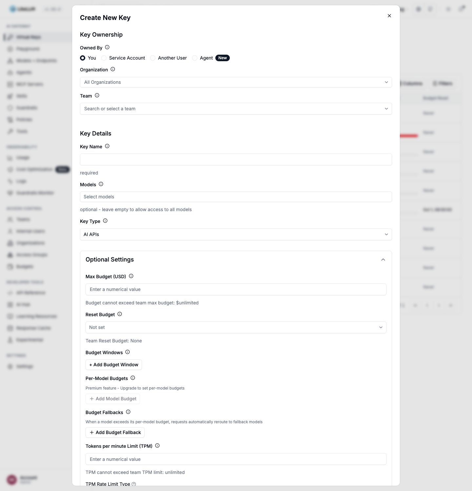

The key list shows spend against budget and the last-used time per key on one line. batch-job, which overran its budget, has a red bar, and dave-unused, issued but never used, shows Last Active as Unknown. Adoption reads off this one column.

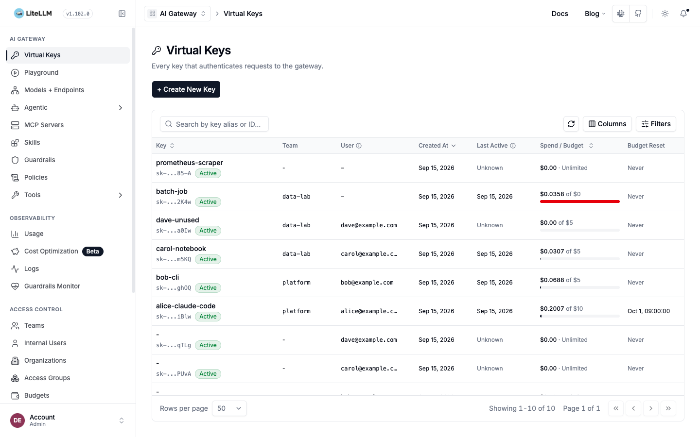

I deliberately crossed three limits to see what happens.

| Limit | Setting | Result |
| --- | --- | --- |
| RPM | `rpm_limit: 20` on the bob-cli key | 20 of 32 requests got 200, 12 got 429 |
| Budget | `max_budget: 0.02` on the batch-job key | 429 `budget_exceeded` from the third request on |
| Allowed models | bob-cli key limited to `claude-sonnet` | 403 `key_model_access_denied` on a `claude-opus` request |

```json
{"error":{"message":"Budget has been exceeded! Key=batch-job (sk-...2K4w) Current cost: 0.03581, Max budget: 0.02",
          "type":"budget_exceeded","param":null,"code":"429"}}
```

The budget check happens before the request. batch-job got through two requests, spent $0.0358, and was blocked from the third. Blocked requests still land in `SpendLogs` as failures, and the Logs screen shows the reason.

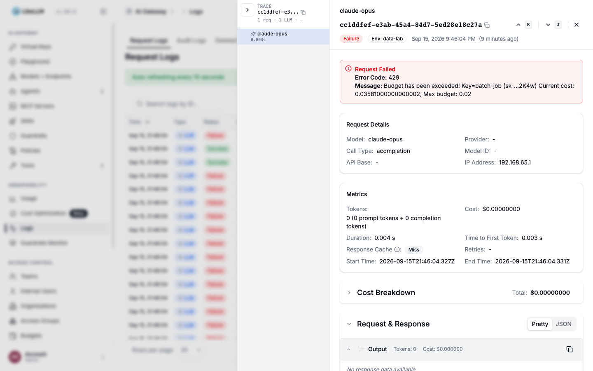

### Routing and fallback

Several deployments under the same `model_name` form a routing group. I grouped a dead and a live deployment under `claude-sonnet-ha` and sent 20 requests with `num_retries: 2` and `allowed_fails: 3`.

| Item | Result |
| --- | --- |
| Responses the client received | 19 × 200, 1 × 500 |
| Attempts that went to the dead deployment | 5 |
| Dead deployment state | cooldown |

Of the five attempts that went to the dead side, only one came back to the client as a 500; the rest were retried onto the live side and succeeded. As failures accumulated, the dead deployment went into cooldown and every later request went to the live one. `SpendLogs` keeps only what the client received; the five retries show up in Prometheus's deployment metrics. That gap is one of the reasons Grafana is needed.

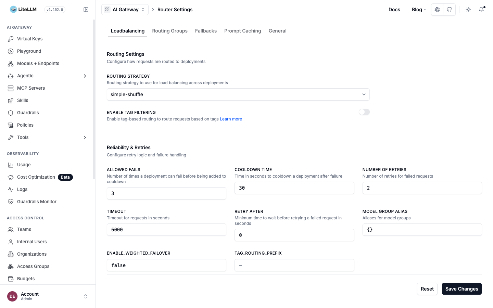

### Usage dashboard

Pick a period and it shows request count, successes and failures, average cost per request, token totals, daily spend, requests per endpoint, and the top keys and models on one screen.

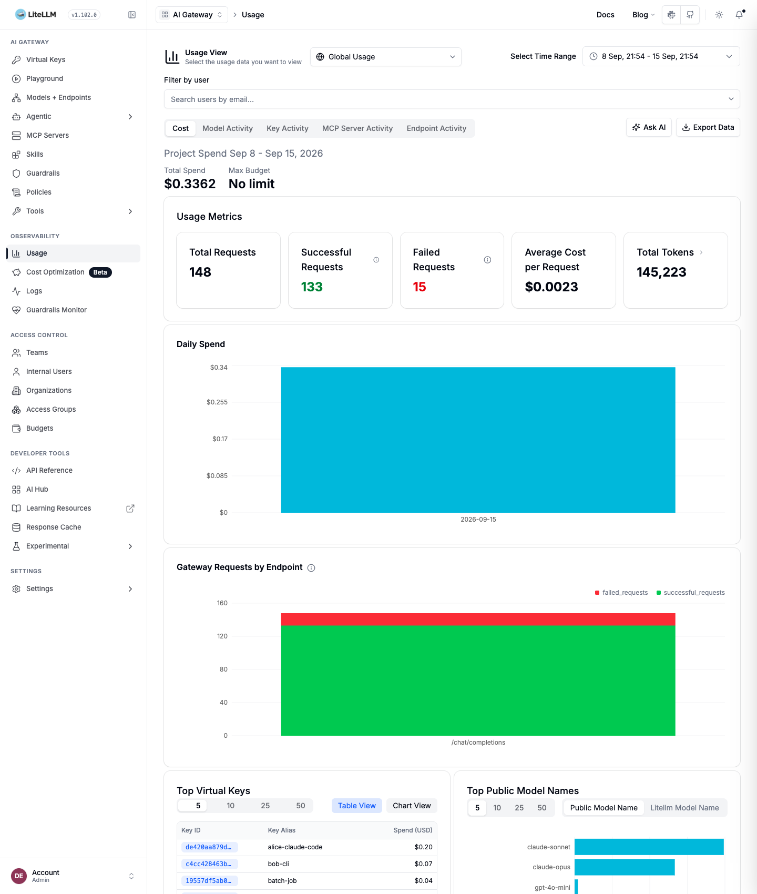

Switch the view to Team Usage and you get spend per team and per user within each team. This is the screen for pulling "who spent what" at the end of the month.

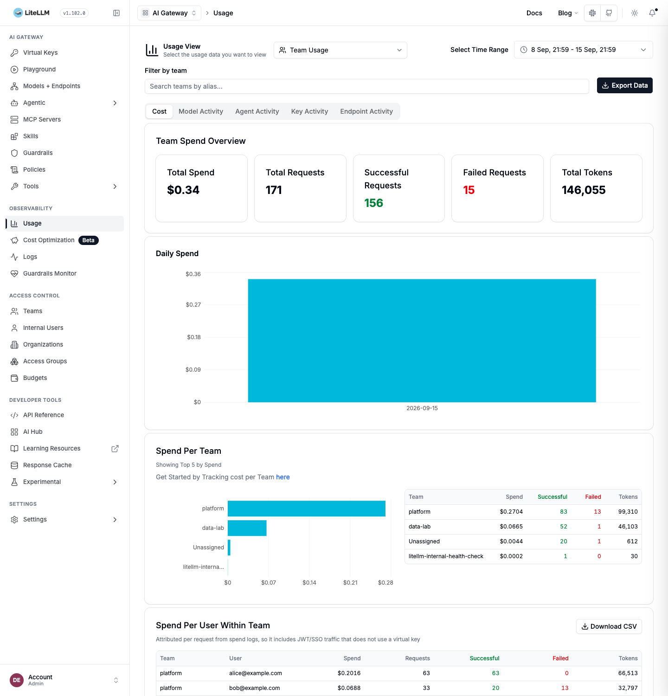

For the API, use `/user/daily/activity` and `/global/spend/{keys,models,teams}`. `/global/spend/report` only opens with an Enterprise license.

### What lands in the DB

Going by [schema.prisma](https://github.com/BerriAI/litellm/blob/main/schema.prisma), 78 tables are created, but only ten received rows in this experiment. The core is `LiteLLM_SpendLogs` with one row per request, three daily rollups by user, team and tag, and the key, user and team tables. The UI dashboard and `/user/daily/activity` read the daily rollups instead of scanning `SpendLogs` every time. The dashboard's request, token and spend numbers matched the rollup sums exactly. The `api_key` column is a SHA-256 hash, so a leaked DB does not leak the keys themselves.

With `store_prompts_in_spend_logs` off, the default, the Logs detail has tokens and cost but no bodies. The screen even tells you how to turn it on.

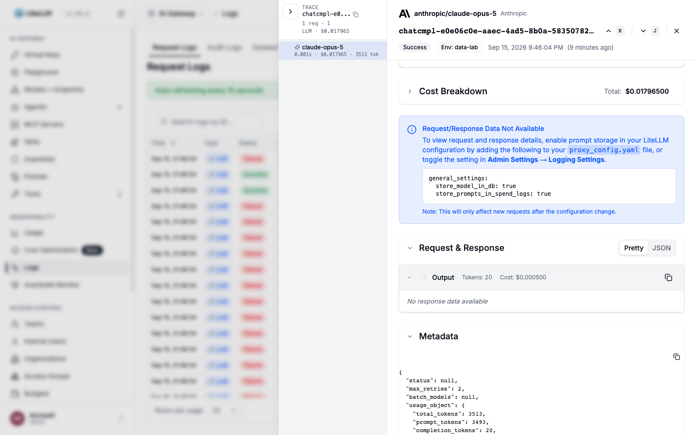

For requests sent after enabling it and restarting, the system and user prompts and the assistant response appear as they are. In the DB the request body went into the `proxy_server_request` column and the response into `response`. Of the request headers only `host` remained; `Authorization` was not stored.

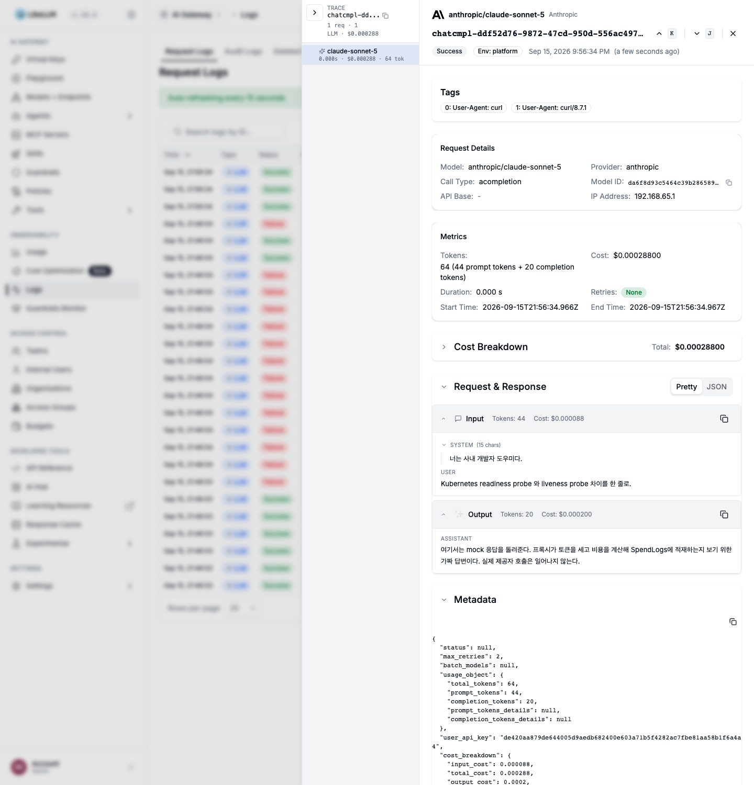

### Built-in alerts

Slack, Discord, MS Teams and webhook alerts are built in, and only region outage alerts are paid. Provider errors, slow responses, deployment isolation, DB exceptions, budget overruns, daily reports, per-user spend thresholds and anomaly detection are switched on by type.

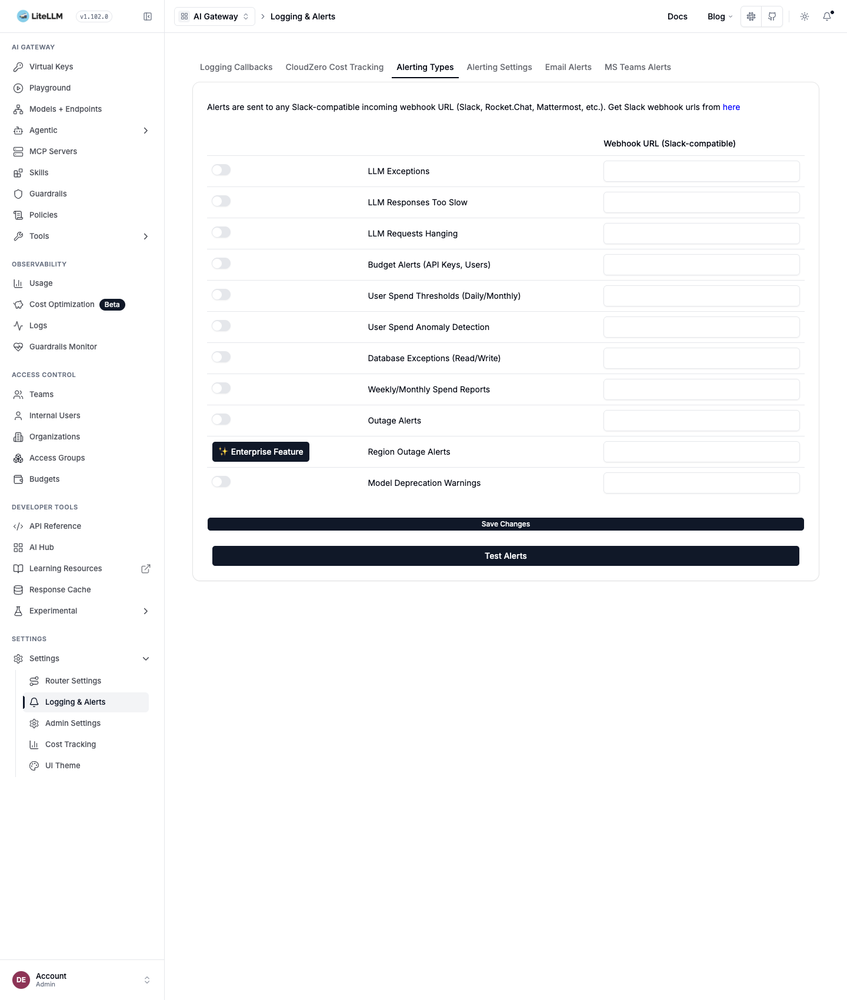

```yaml
general_settings:
  alerting: ["slack"]          # SLACK_WEBHOOK_URL env var
  alerting_threshold: 60       # seconds. The default 300 is on the loose side
  alert_types: [llm_exceptions, llm_requests_hanging, outage_alerts,
                db_exceptions, budget_alerts, daily_reports, fallback_reports]
```

`budget_alerts` only fires when a key or user has a `max_budget`. Turning on all of `llm_exceptions` floods the channel with user mistakes as well, so batching them with the digest option in `alert_type_config` is the better choice.

### What the Admin UI does not show

- The time axis is coarse. With daily rollups you cannot see that "the failure rate has been rising for ten minutes".
- Retries and cooldown are invisible. `SpendLogs` keeps only what the client received.
- Request bodies show only when enabled, and even then one request is one line. A conversation session or an agent run is not grouped into a tree.
- There is nowhere to record whether the answer was right.

## What Prometheus and Grafana show

Prometheus scrapes the proxy's `/metrics` into time series, and Grafana builds dashboards and alerts on top. This is the tool for the second question from the introduction: is the gateway healthy.

### Hooking it up

One line, `callbacks: ["prometheus"]`, opens `/metrics`. Calling it without auth returns 401. Instead of giving Prometheus the master key, issue a virtual key that allows only `allowed_routes: ["/metrics"]`. Calling `/chat/completions` with that key is blocked with 403.

```bash
curl -X POST $PROXY/key/generate -H "Authorization: Bearer $MASTER_KEY" \
  -H "Content-Type: application/json" \
  -d '{"key_alias":"prometheus-scraper","allowed_routes":["/metrics"]}'
```

```yaml
# prometheus.yml
scrape_configs:
  - job_name: litellm
    metrics_path: /metrics/   # /metrics redirects to /metrics/ with a 307
    authorization:
      credentials: sk-...   # the key issued above
    static_configs:
      - targets: ["litellm:4000"]
```

In Grafana I provisioned a Prometheus data source and the [official dashboard JSON](https://github.com/BerriAI/litellm/tree/main/cookbook/litellm_proxy_server/grafana_dashboard) from the LiteLLM repo. The metrics carry `api_key_alias`, `team_alias`, `user`, `model`, `requested_model`, `model_id` and `exception_class` labels, so most questions can be split on a single label.

### The official dashboard

It shows proxy requests per second, failures per second by exception class, mean and median latency, and requests per second by key and team. From 22:30, when the traffic generator started, requests climb to 2/s, and failures split into `BudgetExceededError` for budget overruns and `Anthropic.InternalServerError` for the dead deployment.

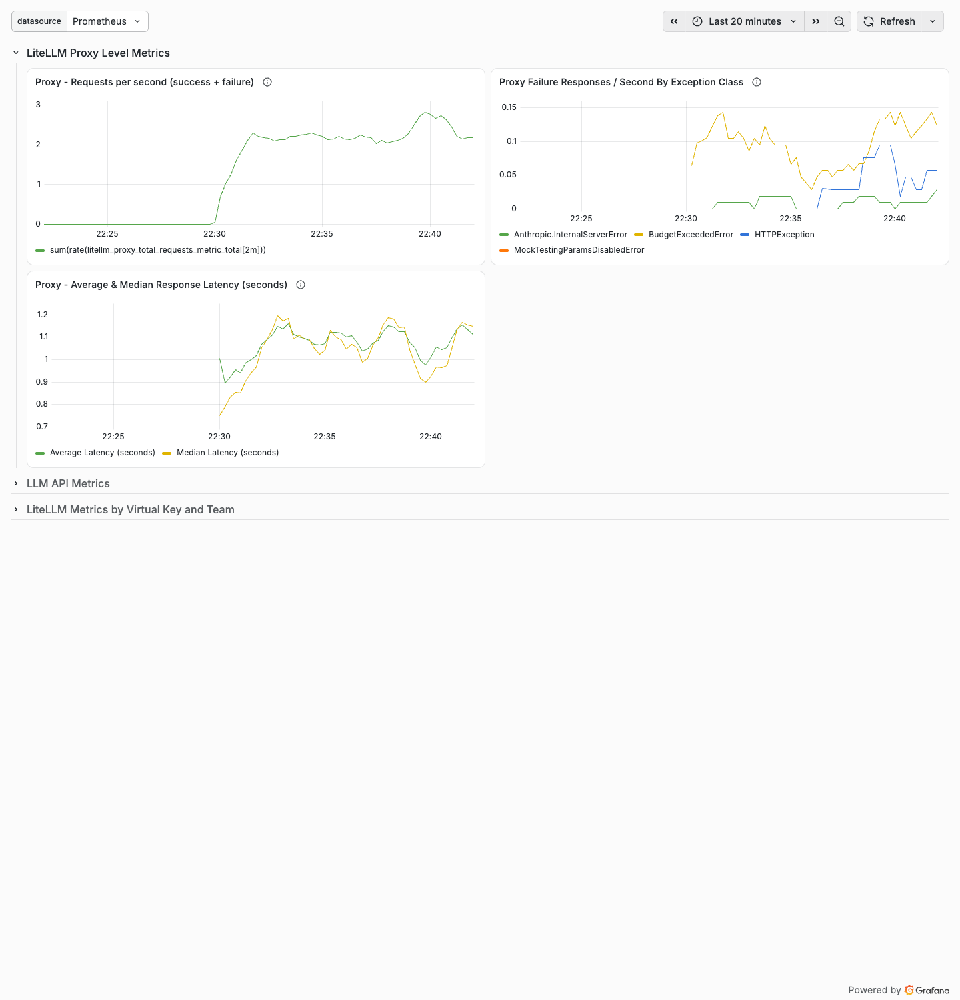

### Building an operations dashboard

The official dashboard has no cost or budget panels. To move the questions the Admin UI answered onto time series, I built twelve panels of my own.


| Panel | PromQL |
| --- | --- |
| Spend per team (5-minute) | `sum by (team_alias) (increase(litellm_spend_metric_total[5m]))` |
| Spend per model | `sum by (model) (increase(litellm_spend_metric_total[5m]))` |
| Cumulative spend per key | `sum by (api_key_alias) (litellm_spend_metric_total)` |
| Remaining budget ratio per key | `litellm_remaining_api_key_budget_metric / litellm_api_key_max_budget_metric` |
| Remaining budget per team | `litellm_remaining_team_budget_metric` |
| Tokens per minute per model | `sum by (model) (rate(litellm_total_tokens_metric_total[5m])) * 60` |
| Requests per second per key | `sum by (api_key_alias) (rate(litellm_proxy_total_requests_metric_total[5m]))` |
| Proxy failure rate | `sum(rate(litellm_proxy_failed_requests_metric_total[5m])) / sum(rate(litellm_proxy_total_requests_metric_total[5m]))` |
| Deployment failures | `sum by (model_id, exception_class) (rate(litellm_deployment_failure_responses_total[5m]))` |
| Deployment state | `max by (model_id) (litellm_deployment_state)` (0 healthy, 1 partial outage, 2 full outage) |
| Request latency p95 | `histogram_quantile(0.95, sum by (le) (rate(litellm_request_total_latency_metric_bucket[5m])))` |
| p95 latency per model | `histogram_quantile(0.95, sum by (le, model) (rate(litellm_request_total_latency_metric_bucket[5m])))` |

Five things read off this screen.

- Team spend: platform is ten times data-lab, because the agent runs use a platform team key. It shows in 5-minute buckets, before any invoice arrives.
- The remaining budget ratio is an LCD gauge per key that changes color at 20% and 50%. It uses the same expression as the alert rule.
- The failure rate jumps to 10% as soon as traffic starts and then hovers between 3% and 8%. That is the mix of the over-budget key and the dead deployment, and the exception_class panel below splits which is which.
- In the deployment state timeline only sonnet-dead is red. The retries and cooldown that never reached SpendLogs in the fallback test earlier are here as time series.
- p95 latency sits around 3.7 seconds and p50 around 1 second, exactly what a random `mock_delay` between 0.3 and 2.5 seconds produces.

### Alert rules

I added two Grafana alert rules through the provisioning API. The conditions are the same expressions as the dashboard panels.

| Rule | Condition | Severity |
| --- | --- | --- |
| Virtual key budget below 20% | remaining budget ratio panel expression < 0.2 for 5 minutes | warning |
| Proxy failure rate above 10% | failure rate panel expression > 0.1 for 5 minutes | critical |

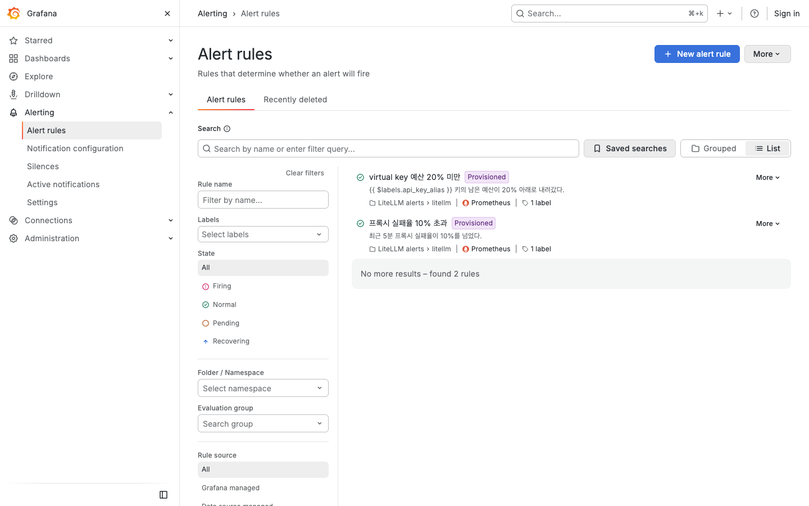

This overlaps a lot with LiteLLM's built-in Slack alerts. If the cluster already has Alertmanager or Grafana alerting, gathering the rules there is easier to manage; if not, taking only outage and budget alerts from the built-in alerting is faster.

### What Grafana does not show

Grafana sees aggregates only. When the failure rate spikes to 10%, "which requests failed" means going down to the Admin UI's Logs, and "which prompt was expensive" and "was the answer right" are in neither.

## What Langfuse shows

Langfuse has request bodies, sessions, traces that group several calls, and scores. It is the tool for the third question from the introduction: what was exchanged, and was the answer any good.

### Hooking it up

Self-hosted Langfuse has required Postgres, ClickHouse, Redis and S3-compatible storage since v3. The official compose file brings up six containers. The initial organization, project and API keys can be created ahead of time with `LANGFUSE_INIT_*` environment variables.

`success_callback: ["langfuse"]`, which has been in the LiteLLM docs for a long time, did not work against a v4 self-host. Langfuse v4 defaults to events_only mode and drops events that arrive at the old `/api/public/ingestion` endpoint. The langfuse-web log records it like this.

```text
Rejected 2 event(s) from the legacy /api/public/ingestion endpoint for project proj-lab
because this Langfuse v4 deployment runs in events_only mode. These events were not stored.
Upgrade the client or integration to a v4-compatible SDK or OTLP ingestion path.
As a temporary migration bridge, set LANGFUSE_MIGRATION_V4_WRITE_MODE=dual ...
```

Switching to the OTLP path, the [`langfuse_otel`](https://docs.litellm.ai/docs/observability/langfuse_otel_integration) callback, made the events land immediately. Langfuse Cloud also closes the old ingestion API on November 16, 2026, so this is the path for new integrations.

```yaml
litellm_settings:
  callbacks: ["prometheus", "langfuse_otel"]
# env: LANGFUSE_PUBLIC_KEY, LANGFUSE_SECRET_KEY, LANGFUSE_HOST=http://langfuse-web:3000
```

Put `metadata` on the request and the trace name, user, session, tags and generation name carry over as Langfuse attributes. The key alias, team alias and cost are attached by LiteLLM automatically.

```bash
curl $PROXY/chat/completions -H "Authorization: Bearer $KEY" -H "Content-Type: application/json" \
  -d '{"model":"claude-sonnet",
       "messages":[{"role":"user","content":"How should I pick the TTL for a Redis distributed lock?"}],
       "metadata":{"trace_name":"cli-chat","generation_name":"answer",
                   "trace_user_id":"bob","session_id":"<session id>","tags":["cli","chat"]}}'
```

The `trace_id` and `existing_trace_id` metadata that group the several calls of one agent run into one trace did not apply on the OTel path. The four steps arrived as four separate traces; the attributes had `langfuse.trace.id` stamped on them, but Langfuse used the OTel span's trace id. Sending the same W3C `traceparent` header on each call does group them. When the client generated a 32-character trace id and a 16-character span id and put the same header on the four calls, four observations landed under one trace.

```bash
-H "traceparent: 00-<32 hex char trace id>-<16 hex char span id>-01"
```

Langfuse recalculates cost from its own price table. claude-sonnet-5 and claude-opus-5 were in the default list; gpt-4o-mini was not, so I registered its prices through `/api/public/models`. Observations from before the registration carry no cost.

### Home

The project home shows what the Admin UI's Usage dashboard showed, along the trace, user and score axes instead. Counts by trace name, tokens and cost by model, cost by user, score averages and observation counts by level share one screen. The counts differ from the proxy's SpendLogs. Requests blocked on budget or RPM come in as ERROR observations just as they do there, but every attempt that went to the dead deployment, retries included, becomes its own ERROR observation. In the experiment the client received a 500 eleven times, while Langfuse holds 48 `Cannot connect to host` observations.

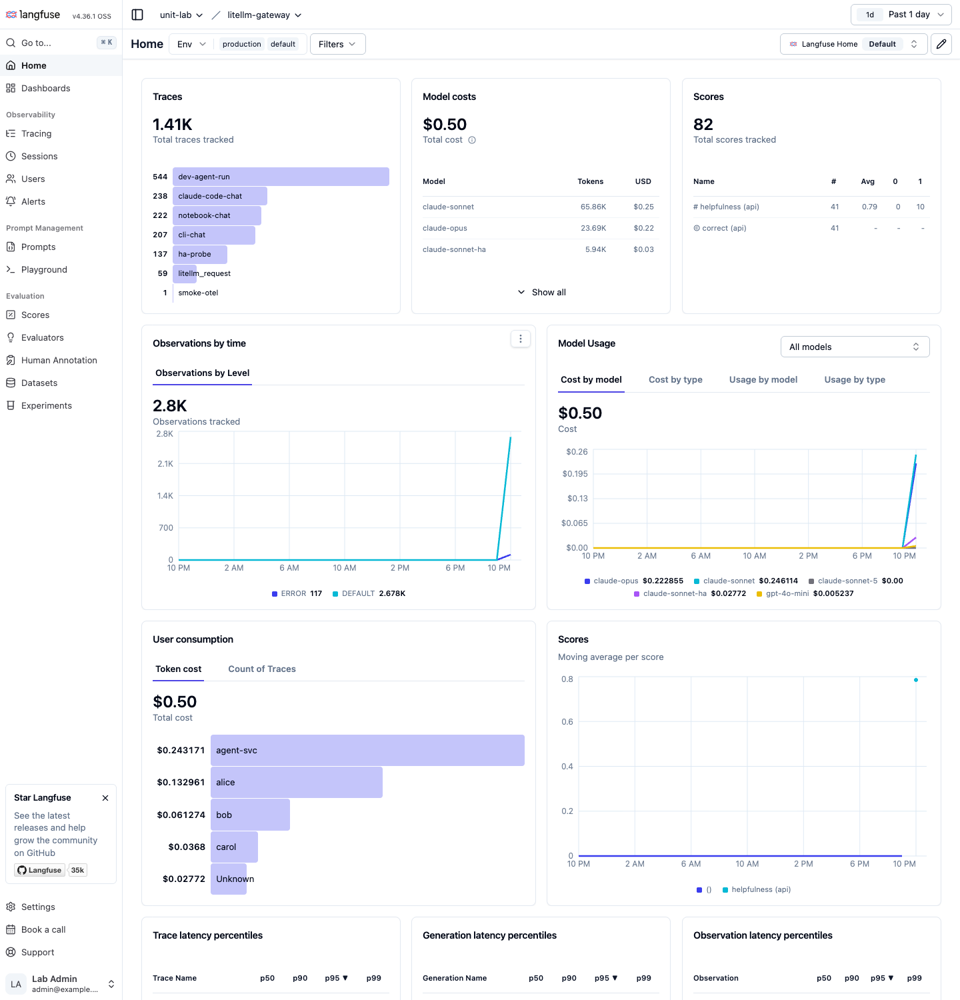

### Opening a single request

The Tracing list works at the observation level. The search box takes expressions such as `level:ERROR`, `latency:>2` and `scores.accuracy:>0.8`, and the Quality, Slow and Cost presets filter straight to "observations over $1" or "generations over 5 seconds".

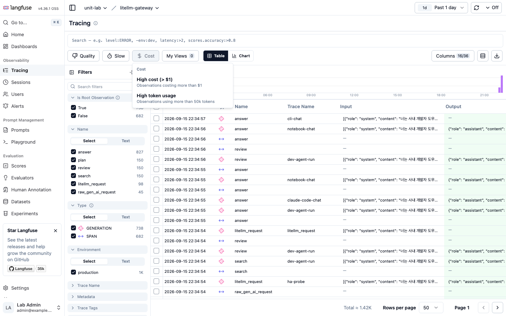

Open one observation and everything the Admin UI's Logs detail lacked is there: the system, user and assistant bodies, links to the session and the user, tags, tokens and cost, and in the metadata the key alias and team alias LiteLLM attached. From here you score it with Annotate or push it into regression test data with Add to datasets.

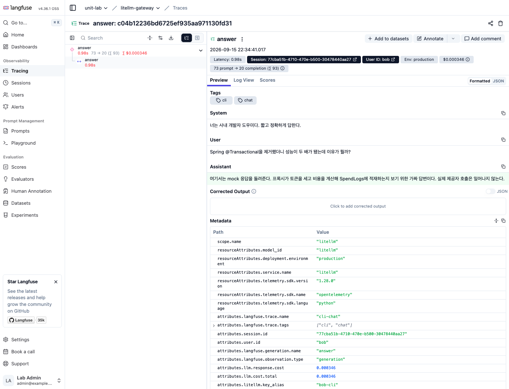

Agent runs appear as a tree. The four generations, plan, search, answer and review, sit under one trace, and each step carries latency, tokens and cost, so which step is expensive reads off at once. Whatever agent framework sits behind the proxy, passing `traceparent` through is enough to get this picture.

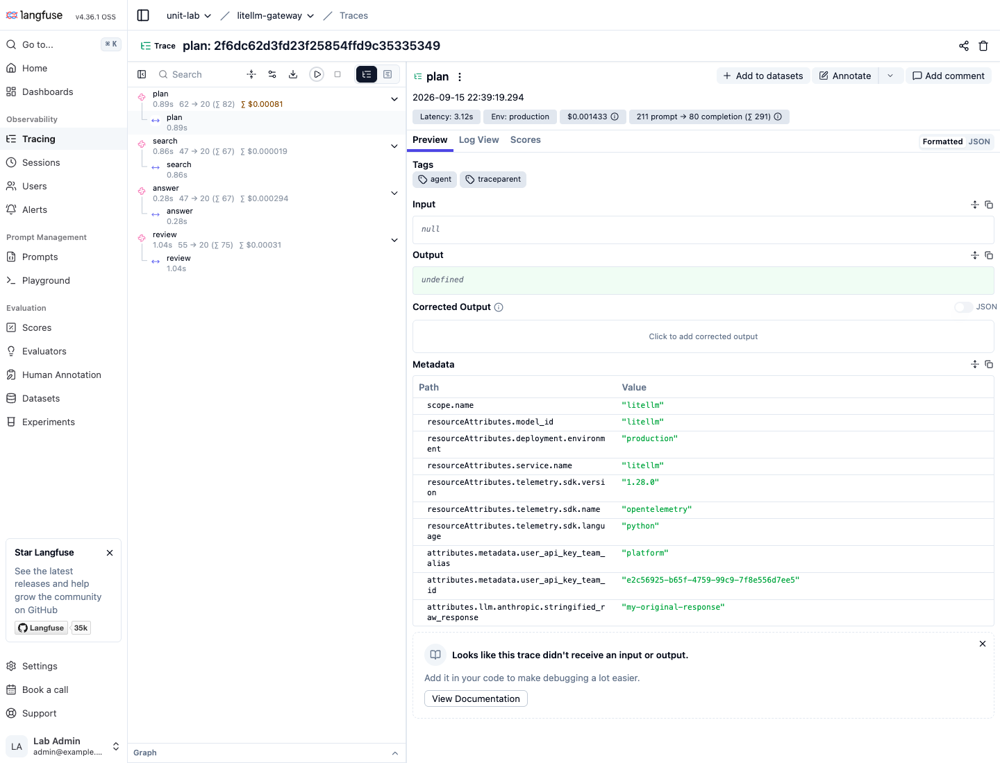

### Sessions and users

The session list works at the conversation level. Each session is one line with duration, trace count, tokens and cost, scores and user.

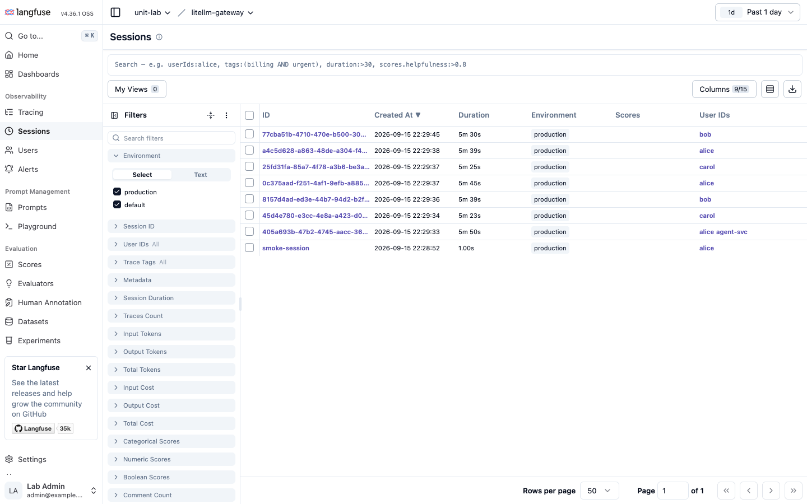

Open a session and the conversation runs in order, with annotations and scores added right next to each turn. "Why did this user ask the same question three times" is answered on this screen.

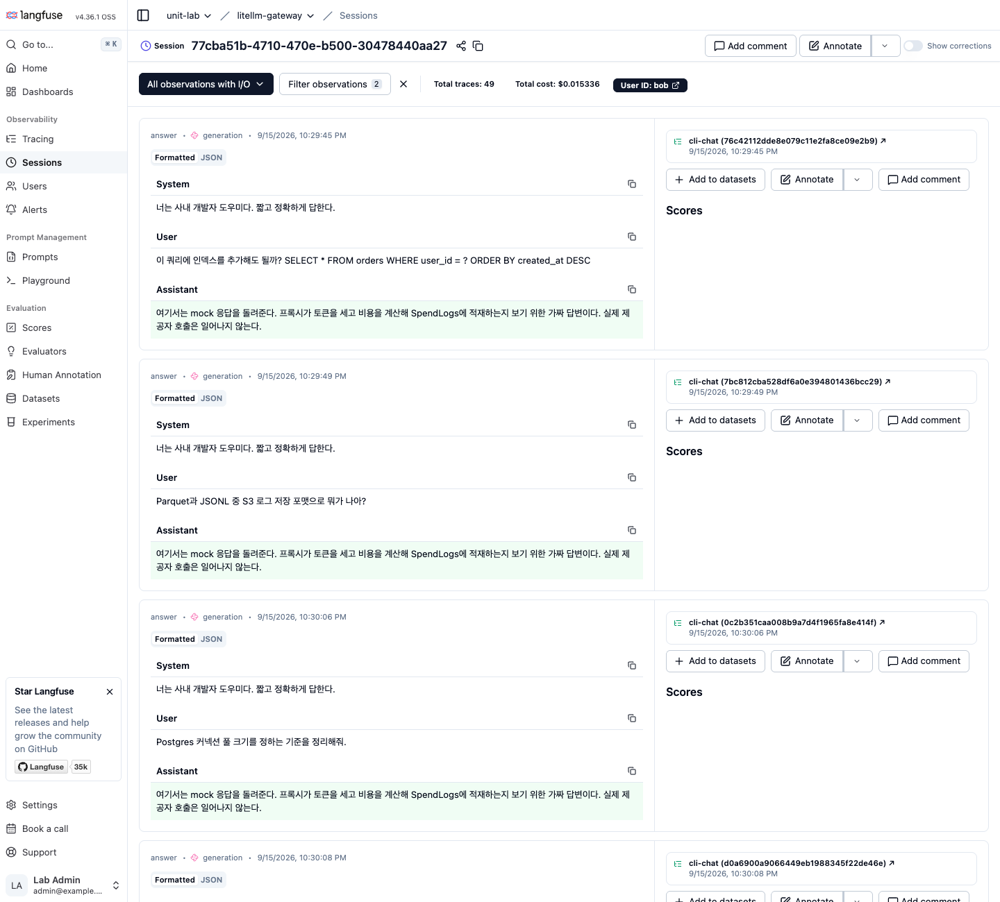

The user list gives first and last activity, event count, tokens and cost per user. The Admin UI's user screen has these too, but here you click a user and drop straight into that person's traces and sessions.

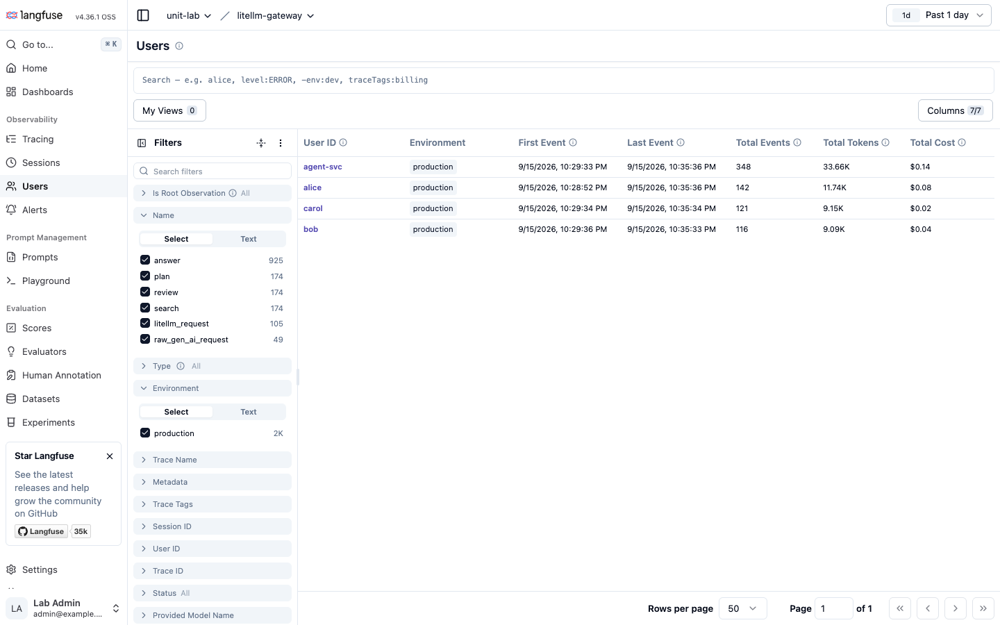

### Recording quality

A score is a named value attached to a trace or an observation. The value is a number, a category or a boolean, and it is set by a person in the UI, pushed through the API, or assigned automatically by an evaluator. In the experiment I pushed `helpfulness`, a value between 0 and 1, and `correct`, yes or no, through the API.

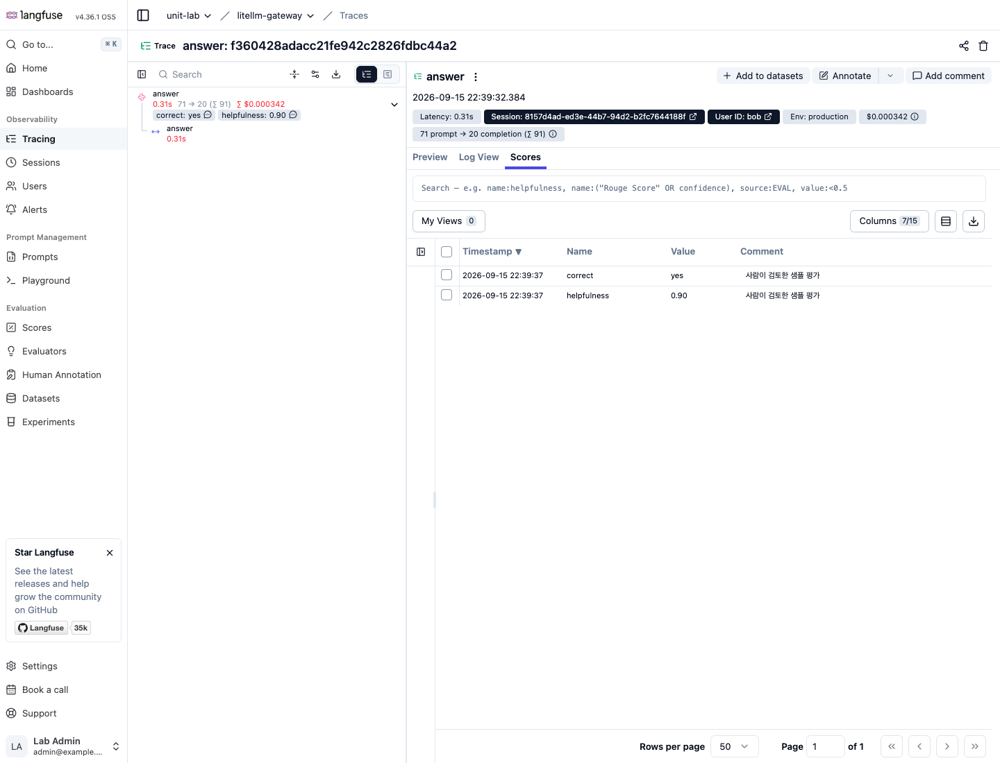

The Scores list filters by score name, value and comment, and the moving average chart on Home shows the trend. "Average helpfulness dropped after last week's deploy" becomes a statement with a number behind it.

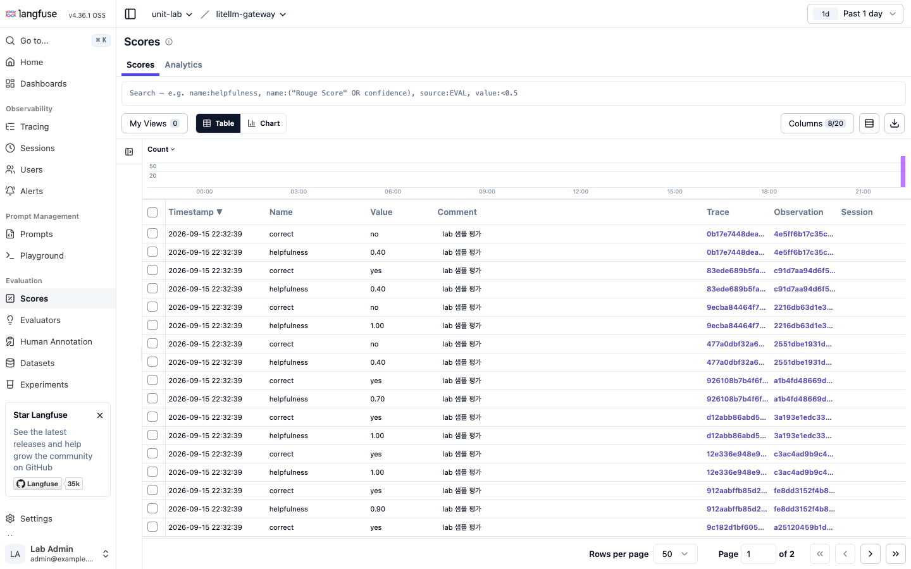

Evaluators are the automatic side of scoring. There are twenty LLM-as-a-judge templates and code evaluators, and they run as rules over production traces or against dataset runs. The judge model can point at the LiteLLM proxy as an OpenAI-compatible endpoint, so that cost is captured under a LiteLLM virtual key as well.

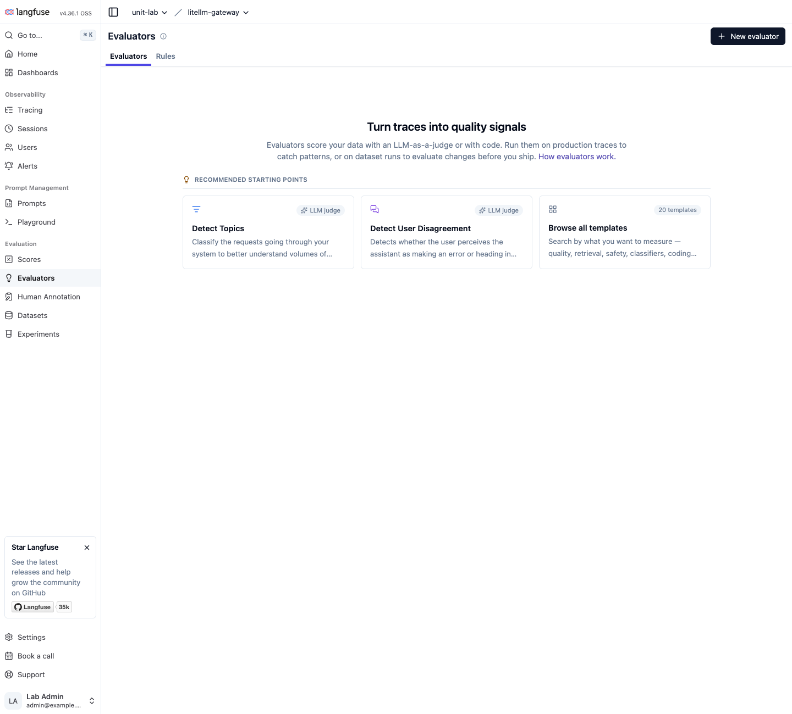

### Latency and alerts

Latency exists on the Langfuse side too. The default dashboard has p95 per use case, split by trace name, p95 per level, max latency per user and p95 per model. Where Grafana's p95 covers the whole proxy, here it splits by app, as in "cli-chat is slower than notebook-chat".

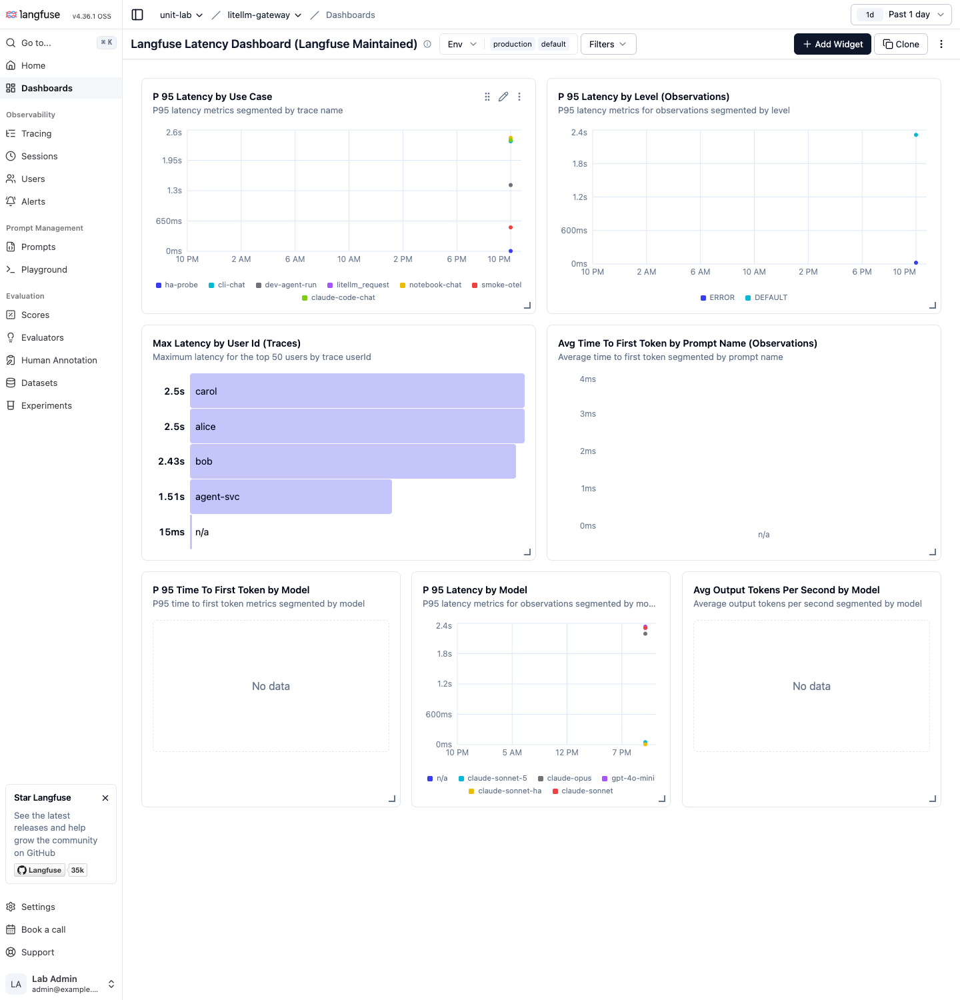

Alerts are metric thresholds. Pick observations, traces or scores, put filters on a measure such as count, cost, latency or score average, set a threshold and a window, and it delivers to Slack, a webhook or GitHub Actions. Rules like "cost over $1 in 5 minutes" or "average helpfulness below 0.6" exist without Grafana.

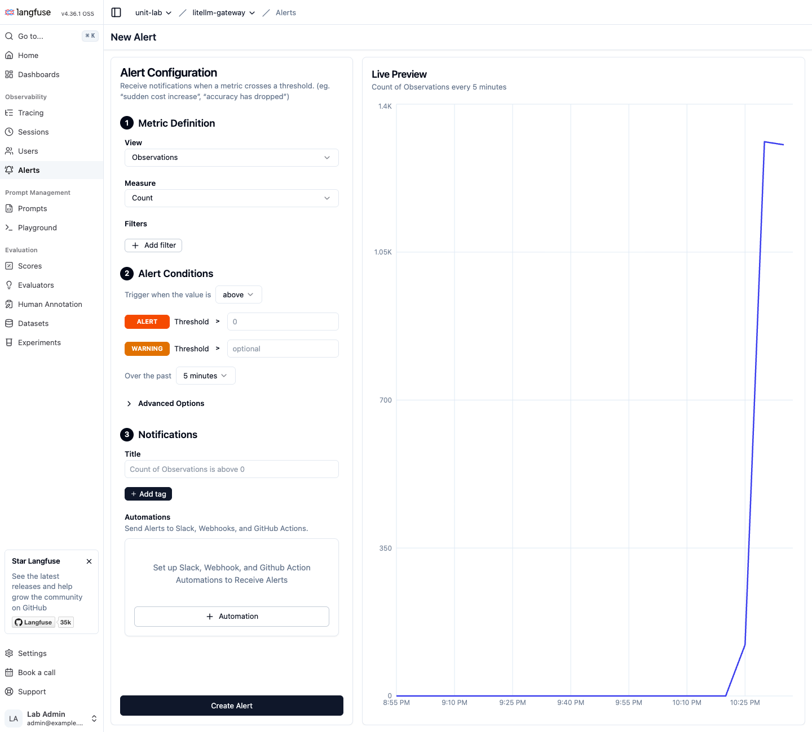

### Prompt versioning

Prompts live in Langfuse with versions and labels such as production. Once generations are linked to a prompt name and version, "how did the scores change after switching to v2" is answered in the prompt's Metrics tab. In this experiment the client did not fetch prompts from Langfuse, so I only registered one and did not go as far as linking.

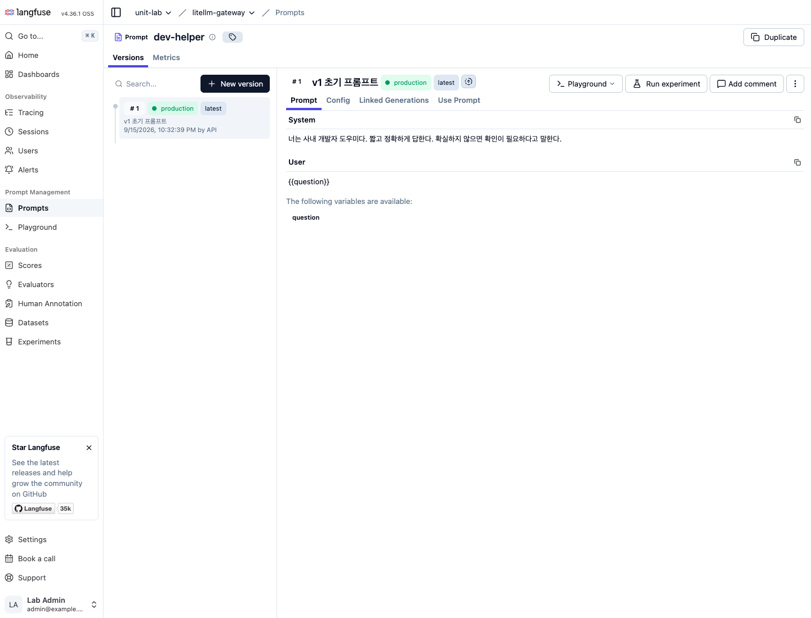

### Decide before attaching it

There are six more containers to run, and ClickHouse among them uses a lot of memory. And once bodies are stored, <strong>personal data inside prompts stays in the log DB</strong>. That holds for LiteLLM's `store_prompts_in_spend_logs` and for Langfuse alike. If sensitive data can end up in prompts, decide whether to store bodies and for how long before turning it on.

## Summary

Split the three questions from the introduction into nine and map them onto the three tools, and this is the result.

| Question | LiteLLM Admin UI | Grafana | Langfuse |
| --- | --- | --- | --- |
| Who spent how much | Spend per key, user and team, daily | Spend time series per team, key and model | Cost per user, session and trace |
| How much budget is left | Key and team detail | Remaining budget gauge and alert | None |
| Is one key running away | Spend in the key list, RPM blocking | Requests per second per key | Event count per user |
| Failure rate and latency trend | Period totals only | 5-minute time series, p95, alerts | p95 per use case and user |
| Fallback and cooldown | Not visible | Deployment state and failure time series | Failed attempts as ERROR observations, state not visible |
| Which request failed | Logs detail | Not visible | Observation detail, `level:ERROR` search |
| What was exchanged | Per request, if body storage is on | Not visible | Observation, session and trace tree |
| Was the answer good | None | None | Scores, evaluators, annotations |
| Did the prompt change help | None | None | Score comparison per version |

Calling these three logs, metrics and traces is only half right. Metrics maps cleanly onto Prometheus, and Langfuse receives spans over OTLP, so it is close to traces. But the core of the Admin UI is management, keys, budgets, rate limits and spend rollups, not a log system, and Langfuse's scores, evaluators and prompt versions are an evaluation layer beyond traces. To fill the three pillars literally you would send traces to Tempo or Jaeger through the OTel callback and the proxy's stdout logs to Loki, but then sessions, scores and prompt comparison disappear. Budget and key management and evaluation fit none of the three pillars, which is why this post split the tools by question rather than by data type.

## Recommended order

1. Start with Postgres and `/ui` only. "Who spent how much" and key and budget management end here.
2. If the cluster already has Prometheus and Grafana, add `callbacks: ["prometheus"]` and a `/metrics`-only key. Start from the official dashboard and add the cost, budget and deployment panels from the PromQL table above. If not, take only outage and budget alerts from the built-in Slack alerting.
3. When you have to ask "what was the conversation" and "was the answer good", attach Langfuse. The `langfuse_otel` callback, request `metadata`, and a `traceparent` header to group several calls are the whole integration. Decide on storage and retention before attaching it.
