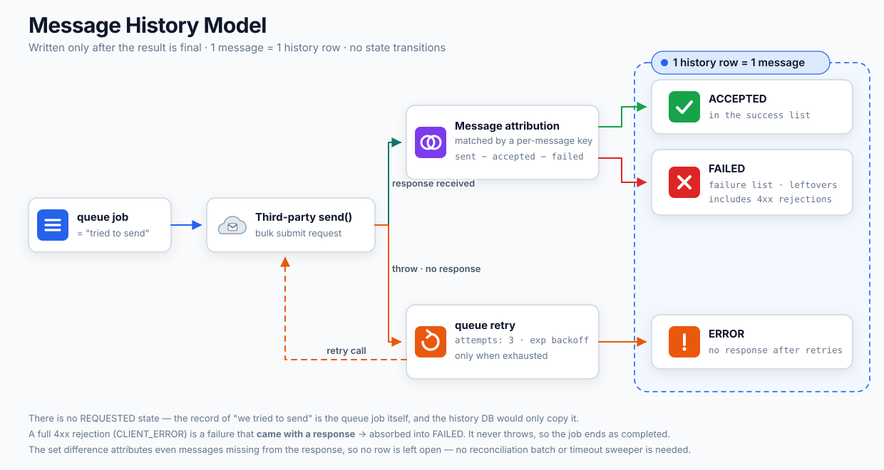
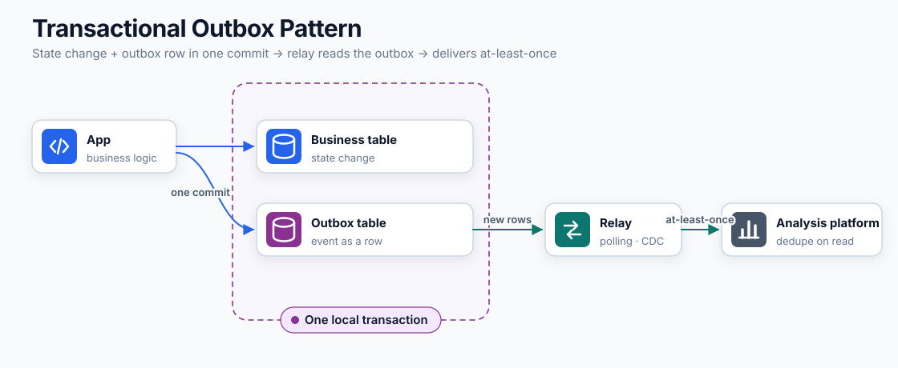
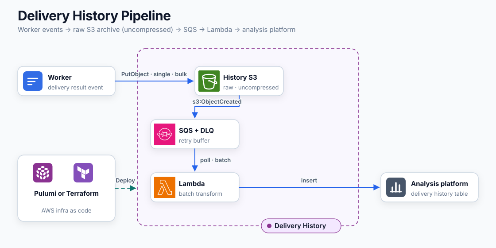
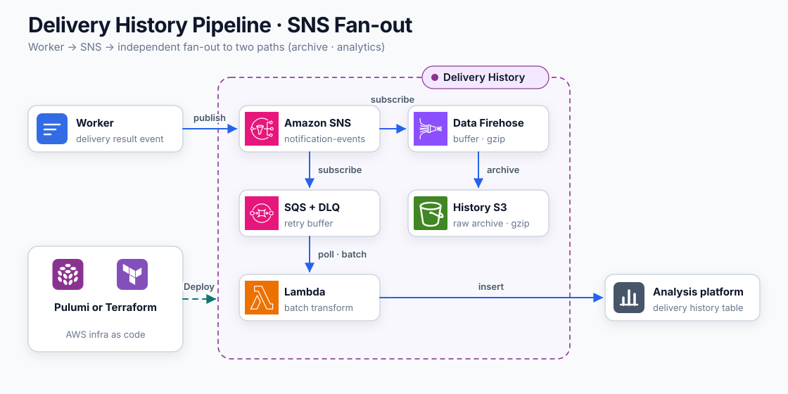
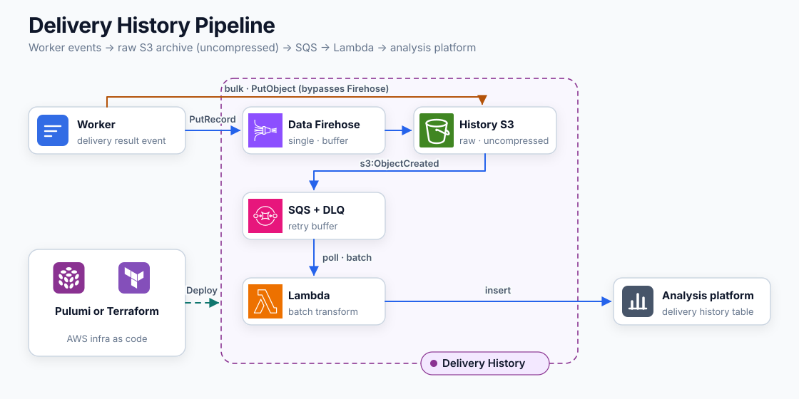
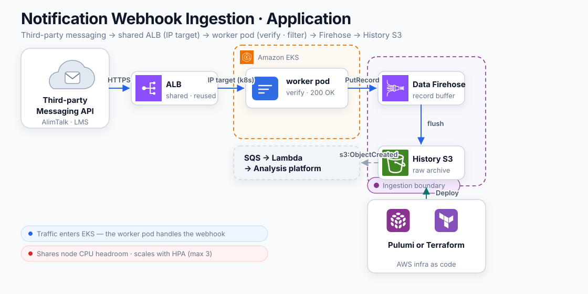
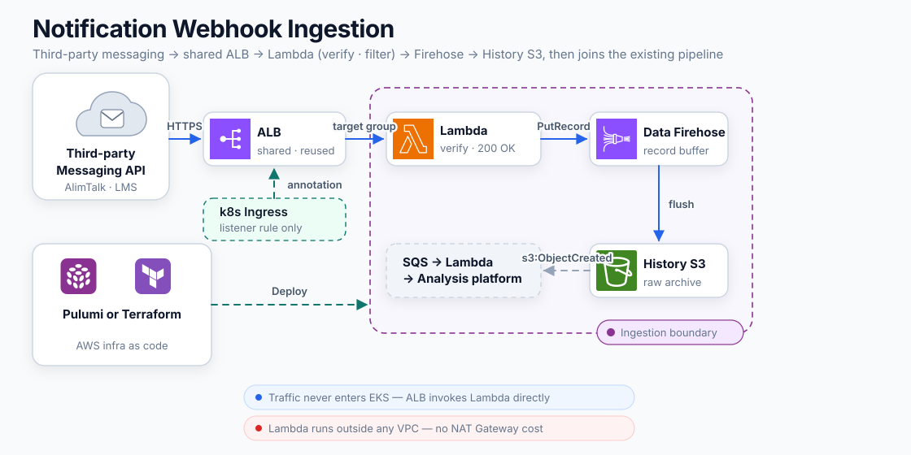
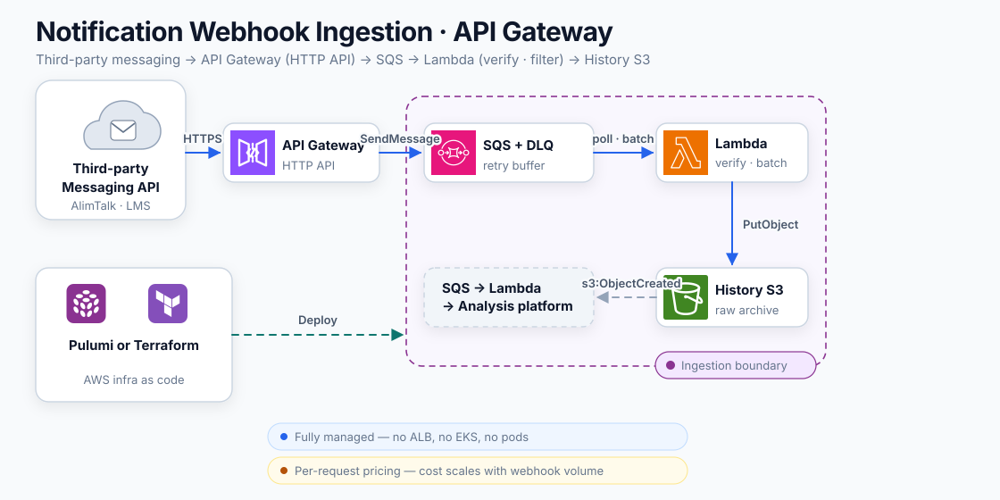

## 들어가며

[1편](/ko/blog/notification-server-part-1-delegating-delivery)과 [2편](/ko/blog/bullmq-notification-part-2-rate-limit)은 발송을 어떻게 내보낼 것인가에 대한 이야기였다. 3편은 보낸 다음의 이야기다.

무엇을 언제 누구에게 보냈고 결과가 어땠는지는 어딘가에 남아야 한다. 외부 API의 콘솔에도 이력은 있지만 그것만으로는 답하지 못하는 질문이 있다. 무엇을 남겨야 하는지부터 정리하고, 세 질문으로 나눠 따진다.

1. 이력을 언제, 어떤 모양으로 남길 것인가
2. 이력을 어디에 쌓을 것인가
3. 도달 결과를 어디서 받을 것인가

순서는 문제, 데이터, 설계, 저장소다. 저장소는 구현체라 마지막에 고르는 것이 맞다고 본다.

## 콘솔만으로는 답하지 못하는 것

발송은 외부 API가 대신해 주고 이력도 그쪽 콘솔에 남는다. 콘솔을 잘 쓰면 데이터를 따로 쌓을 이유가 없다고 생각할 수도 있다. 1편의 서비스가 가입 환영, 결제 재안내, 공지를 보내고 있다고 해 보자. 콘솔에만 기대면 아래 질문에 답하기 어려워진다.

- <strong>"이 사용자에게 무엇이 언제 갔나"를 우리 쪽에서 못 본다.</strong> 콘솔은 외부 API가 붙인 메시지 ID로는 찾아 주지만 우리 회원 ID로는 찾지 못한다. CS 문의가 들어올 때마다 콘솔과 운영 DB를 사람이 대조해야 한다.
- <strong>실패율을 기간으로 집계할 수 없다.</strong> 실패 목록은 응답 시점에만 손에 들어온다. 그때 남기지 않으면 어제의 실패율도 다시 만들지 못한다. 네트워크 문제나 4xx/5xx로 호출 자체가 throw한 건은 외부 API 쪽에 이력조차 없어서 분모에도 안 잡힌다.
- <strong>무슨 내용으로 나갔는지 확인할 수 없다.</strong> 콘솔의 내보내기에 템플릿 변수가 빠져 있다면 실제로 나간 문구를 다시 만들 수 없다.
- <strong>보관 기간과 조회 한도에 묶인다.</strong> 보관 기간이 6개월이라면 작년 같은 시기와 비교하려는 순간 데이터가 없다. 조회 API를 어드민 화면에 붙이면 2편에서 본 429를 조회에서도 만난다.

<strong>행위는 위임해도 데이터는 위임하지 말자.</strong>

## 무엇을 남겨야 하는가

위 문제를 풀려면 어떤 데이터를 어떻게 쌓아야 할까?

먼저 <strong>기록의 단위는 수신자 1명</strong>이다. 접수 요청 1회에 수신자 여러 명이 들어가는데 요청을 단위로 잡으면 첫 번째 문제에 답할 수 없다. CS 문의는 언제나 사람 하나에 대한 모든 이력을 확인해야 한다. 다만 요청 단위로만 아는 정보가 있어서 그룹과 엔트리 두 층으로 둔다.

남길 데이터는 앞의 문제에서 하나씩 나온다.

| 문제 | 남기는 데이터 |
| --- | --- |
| 사용자 축으로 못 찾는다 | 우리 쪽 수신자 식별자, 발송 시각 |
| 실패율을 기간으로 못 센다 | 메시지별 최종 결과와 실패 사유 |
| throw 건이 분모에서 빠진다 | 외부 API의 응답이 없어도 우리가 직접 남기는 실패 기록 |
| 무슨 내용으로 나갔는지 모른다 | 치환이 끝난 발송 내용 |
| 템플릿·채널별로 못 나눈다 | 템플릿과 채널 구분 |

데이터 항목으로는 잡히지 않는 조건도 붙는다. 작년 같은 시기와 비교하려면 <strong>보관 기간은 최소 2년</strong>이 필요하다고 하자. 그리고 운영 DB에 영향을 주지 않으면서 <strong>운영 DB에 있는 유저 테이블과 조인할 수 있어야 한다.</strong> 채널별 성과나 리텐션을 따지기 위해서다. 마지막은 <strong>가공 전 원본을 아카이빙할 공간</strong>이다. 이력을 우리 스키마로 바꿔 적재하고 나면 변환이 틀렸거나 새 질문이 생겼을 때 돌아갈 원천이 필요하다. 원본이 남아 있어야 백필도 재처리도 가능하다.

조회 패턴은 보통 아래와 같을 것이다.

- 기간별 실패율과 사유 분포
- 템플릿·채널별 성과
- 유저 테이블과 조인한 반응·리텐션 분석
- CS 문의 시 특정 수신자의 이력 조회

집계와 대량 조회가 주를 이룬다. 쓰기는 대량 append이고 읽기는 대부분 스캔이 될 것이다.

## 이력을 언제, 어떤 모양으로 남길 것인가

이 데이터를 쌓는 방식에서 정할 것이 셋 있다. 셋 다 특정 저장소를 전제하지 않고 답할 수 있는 질문이고, 답할 때마다 저장소에 요구할 성질이 하나씩 쌓인다. 물론 반대 방향도 있다. 저장소가 주는 성질이 충분히 매력적이면 여기서 내린 답을 되물릴 수도 있다. 그 검토는 저장소를 고르는 절에서 한다.

### 1. 발송과 이력을 한 흐름에 묶을 것인가

알림을 발송하는 일과 이력으로 성과를 지켜보는 일은 관심사가 다르다. 발송은 지금 이 메시지를 내보내는 일이고 실패하면 안 된다. 이력은 그 결과를 모아 뒀다가 나중에 묻는 일이다. CS 추적, 실패율 집계, 성과 분석이 소비처라 분 단위로 늦어도 되고, 드물게 한 건을 잃어도 잃는 것은 기록 한 건이다. 요구사항이 정반대인 둘이다.

<strong>묶으면 완결성을 얻는다.</strong> 같은 흐름 안에서 이력을 쓰고 성공을 확인한 뒤 발송을 마치면, 발송은 성공했는데 이력이 없는 상태가 원천적으로 생기지 않는다. 대신 부산물의 장애가 주 기능으로 번진다. 이력 저장소가 죽으면 발송도 멈추고, 분석 플랫폼이 느려졌다고 알림톡이 안 나가는 상황이 생긴다.

<strong>끊으면 그 반대다.</strong> 워커는 발송 결과를 이벤트로 발행할 뿐 저장의 성공을 기다리지 않는다. 발행이 실패해도 발송은 계속 나가고, 실패한 이벤트는 발송 흐름 밖에서 재시도한다. 재시도마저 실패하면 발송은 됐는데 이벤트만 없는 창이 남는다. 응답을 받은 건은 외부 API 콘솔에서 백필할 수 있지만, throw 건은 상대에게 이력조차 없어 그마저도 안 된다. 이벤트로 끊으면 따라오는 것도 있다. 저장소에 맞는 스키마로 바꾸는 책임까지 발송 코드 밖으로 나간다.

묶는 쪽이 맞는 때는 이력 쓰기가 발송의 성립 조건일 때다. 규제상 "보낸 기록이 없으면 보내지 않은 것으로 본다"에 해당하는 통신이라면 묶어서 완결성을 얻는다. 끊는 쪽이 맞는 때는 이력이 사후 분석과 CS를 위한 것이라 드문 기록 유실을 받아들일 수 있을 때다.

이 글의 서비스에서 이력은 발송의 성립 조건이 아니라고 하자. 끊는 쪽을 따라가면 저장소에 걸리는 조건이 나온다. 발송 경로 밖에서 이벤트를 받아 쓸 수 있고, 쓰기가 실패해도 발송이 계속되어야 한다.

### 2. 언제 기록할 것인가

접수 시점부터 행을 만들어 상태를 바꿔 가는 길과, 결과가 확정된 뒤 한 번만 쓰는 길이 있다.



상태 전이 방식은 진행 중인 발송을 관측할 수 있다. 지금 몇 건이 접수 대기인지, 어느 그룹이 멈춰 있는지가 이력에서 바로 보인다. 무엇보다 <strong>호출 자체가 throw해도 "보내려 했다"는 행이 이미 남는다.</strong> 분모에서 빠지던 throw 건이 여기서 그냥 잡힌다. 대신 미종결 행이 생긴다. 응답을 영영 못 받은 행이 `REQUESTED`로 남고, 이걸 정리하려면 sweep이 필요하다.

확정 후 기록 방식은 메시지 1건이 이력 1행으로 끝나고 상태 전이가 없다. 미종결 행이 없으니 sweep도 필요 없고 적재량도 상태 수만큼 늘지 않는다. 대신 진행 중 상태를 이력에서 볼 수 없고 throw 건은 재시도를 다 쓴 뒤에야 기록된다.

상태 전이가 맞는 때는 진행 중인 발송을 이력에서 바로 봐야 하거나, throw 건을 재시도가 끝나기 전에 분모에 넣어야 할 때다. 확정 후 기록이 맞는 때는 접수 사실을 이미 다른 곳이 갖고 있을 때다. 1편처럼 큐를 두었다면 접수 사실은 큐의 작업이 이미 갖고 있다. 이력 DB가 그걸 복사하면 적재량만 늘고 두 기록이 어긋날 여지가 생긴다. 진행 상황은 큐의 대시보드에서 보면 된다.

이 글은 확정 후 기록을 따라간다. 남기는 상태는 셋이다.

| 상태 | 의미 | 발행 시점 |
| --- | --- | --- |
| `ACCEPTED` | 접수 성공 | 응답의 성공 목록에 매칭 |
| `FAILED` | 접수 실패 | 응답의 실패 목록에 매칭 |
| `ERROR` | 외부 API 호출 자체가 throw | 재시도를 다 썼거나 재시도할 수 없을 때 |

짚어 둘 것이 있다. 이 셋은 전부 <strong>접수까지의 결과</strong>다. `ACCEPTED`도 외부 API가 요청을 받아 줬다는 뜻이지 단말에 도달했다는 뜻이 아니다. 실제 도달 여부는 외부 API가 한참 뒤에 웹훅으로 알려 주는 별개의 사건이고, <strong>그 결과도 웹훅을 받아 이력에 남긴다.</strong> 방식은 같다. 이미 쓴 행을 고치는 것이 아니라 확정된 결과를 별도 이벤트로 append한다. 상태 전이 없음이라는 원칙은 웹훅이 들어와도 유지된다. 그 웹훅을 어디서 받을지는 세 번째 질문에서 따진다.

확정 후 기록에서 지켜야 할 불변식이 하나 있다. <strong>응답 하나를 처리하고 나면 그 요청으로 보낸 메시지 전부가 종결 상태를 얻어야 한다.</strong> 응답의 어느 목록에도 담기지 않은 메시지가 미종결로 남는 순간, 없다고 했던 sweep이 도로 필요해진다. 그래서 매칭 규칙은 남는 것 없이 전부 귀속시키는 방향으로 잡는다. 구체적인 매칭 방식은 외부 API의 응답 형식에 달린 구현 문제라 설계에서는 이 불변식까지만 정한다.

전체가 4xx로 거부된 경우도 응답을 받은 실패이므로 `FAILED`로 흡수하고 throw하지 않는다. 큐의 작업은 성공으로 끝낸다. 2편에서 본 것처럼 재시도해 봐야 결과가 같은 실패에 재시도 횟수를 쓰지 않기 위해서다. 응답 자체를 받지 못한 경우에만 throw하고, 큐가 재시도를 다 쓰면 `ERROR`를 남긴다.

저장소는 append만 할 수 있으면 된다. UPDATE도, 미종결 행을 훑는 배치도 필요 없다.

### 3. 이력의 중복을 어디서 거를 것인가

재시도는 어디에나 있다. 큐가 작업을 다시 돌릴 수도 있고 파이프라인 중간에서 같은 이벤트가 두 번 흐를 수도 있다. 그때마다 같은 발송이 이력에 두 번 적힐 수 있다. 여기서 정하는 것은 <strong>이력의 멱등</strong>이다. 발송 한 건은 이력에서도 한 건이어야 한다. 같은 메시지를 두 번 보내지 않는다는 발송의 멱등은 별개 문제이고 저장소를 고르는 절에서 다시 나온다. 걸러 낼 자리는 크게 둘이다. 흐르는 중간과 최종 이력이다.

파이프라인 중간에서 exactly-once를 만들려면 처리한 키를 기억하는 상태 저장소가 하나 더 필요하다. 그 저장소가 새 장애점이 되고, 결국 중복 제거기를 누가 중복 제거하느냐는 문제로 돌아온다. 중간에서 거르는 쪽이 맞는 때는 이력을 읽는 곳이 여럿이고 그 각각이 중복을 거를 수 없을 때다.

최종 이력에서 거르면 전달은 at-least-once로 두고, 이력을 읽는 시점에 메시지 1건이 1행으로 보이게 하면 된다. 중간에 같은 이벤트가 몇 번 흘러도 상관없다. 수단은 저장소가 정한다. 유일성 제약을 걸 수 있는 저장소라면 PK나 UNIQUE로 적재 시점에 끝내고, 제약을 강제할 수 없는 저장소라면 조회에서 걸러 낸다. 이 쪽이 맞는 때는 이력을 읽는 창구를 하나로 통제할 수 있을 때다. 이 글은 최종 이력에서 거르는 쪽을 따라간다.

어느 쪽이든 전제는 하나다. 같은 발송이 몇 번 재시도돼도 <strong>식별자가 변하지 않아야 한다.</strong> 식별자가 키 역할을 하지 못하면 어느 층에서도 중복을 알아볼 수 없다.

저장소에 거는 조건은 유일성을 보장할 수단이다. 메시지 단위든 발송 그룹 단위든 상관없다.

### 결정을 데이터에 투영하면

셋을 정하고 나면 데이터 형태는 따라 나온다. 요구사항 절의 추상 항목들이 여기서 처음 구체적인 필드가 된다. 수신자 식별자는 `user_id`, 최종 결과는 `status`, 실패 사유는 `status_code`, 발송 내용은 `variables`다.

```typescript
export type NotificationHistoryGroup = {
  group_id: string;   // 큐의 작업 id 기반. 재시도해도 바뀌지 않는다
  sent_at: Date;
  template_type: string;
  notification_type: string;
  entries: NotificationHistory[];
};

// 그룹 내 엔트리 = 수신자 1명의 결과
type NotificationHistory = {
  message_id: string;
  user_id: number;
  status: 'ACCEPTED' | 'FAILED' | 'ERROR';
  status_code?: string;
  variables?: Record<string, string>;
};
```

모양 곳곳에 방금의 결정이 박혀 있다. `status`에 `REQUESTED`가 없는 것은 확정 후에만 쓰기로 한 결정 2의 결과다. `message_id`가 멱등의 키인 것은 결정 3의 결과다. `group_id`를 작업 id로 고정한 것도 같은 맥락이다. 같은 작업이 여러 번 돌아도 그룹 식별자가 변하지 않아야 어느 층에서든 중복을 알아볼 수 있다. 결정을 반대로 내렸다면 이 타입에는 `REQUESTED`와 상태 전이 시각이 있었을 것이다.

이 모양 자체가 저장소에 거는 조건도 하나 만든다. <strong>그룹과 엔트리로 중첩된 구조를 두 단위로 펼칠 수 있어야 한다.</strong> 이 조건 하나가 뒤에서 선택지 하나를 그대로 걸러 낸다.

### 설계가 저장소에 거는 조건

셋을 정하고 나면 저장소에 요구할 것이 이렇게 남는다.

- 발송 경로 밖에서 쓸 수 있을 것
- 그룹·엔트리 두 층 구조를 두 단위로 펼칠 수 있을 것
- append만으로 충분할 것 (UPDATE·sweep 불필요)
- 메시지 단위 유일성을 보장할 수단이 있을 것 (제약 또는 조회 창구 통제)
- 가공 전 원본을 아카이빙할 자리가 있을 것
- 여기에 처음 조건에서 온 집계 스캔, 2년 보존, 유저 테이블 조인

## 이력을 어디에 쌓을 것인가

네 안을 같은 잣대로 본다. 위 조건에 더해 저장소마다 값이 갈리는 것 셋을 얹는다. 저장소가 둘로 나뉠 때 어긋난 것이 스스로 맞춰지는가(정합성), 쓰고 나서 조회에 잡히기까지 얼마나 걸리는가(최신성), 관리할 것이 몇 개이고 비용은 어떻게 늘어나는가(운영 부담)다.

### 1. 관계형 DB

<pre class="mermaid">

flowchart LR
    accTitle: 이력 전용 관계형 DB
    accDescr: 워커가 외부 API 호출 직전에 메시지 행과 REQUESTED 상태를 쓰고, 응답을 받은 뒤 마감 상태와 외부 API의 식별자를 각각 추가한다. 분석이 필요하면 별도 파이프라인으로 분석 플랫폼에 다시 옮겨야 한다.
    W["Worker"] --&gt;|"호출 직전"| M[("message<br/>status: REQUESTED")]
    W --&gt;|"응답 후"| S[("status: ACCEPTED · FAILED · ERROR<br/>외부 API의 groupId · messageId")]
    M --&gt; SQL["SQL 조회<br/>CS·운영"]
    S --&gt; SQL
    SQL -. "분석하려면 재적재" .-&gt; AP["분석 플랫폼"]

</pre>

앞 절의 결정대로라면 이 안은 출발부터 불리하다. 그런데도 첫 후보로 자세히 보는 이유가 있다. <strong>설계 결정 1번과 2번을 반대로 답할 수 있게 해 주는 유일한 후보</strong>이기 때문이다. 나머지 셋은 그 선택지를 주지 않는다. 그러니 여기서 볼 것은 결정을 되물릴 만큼의 값을 주는가다.

외부 API 호출 직전에 메시지 행과 `REQUESTED`를 쓰고 응답을 받은 뒤 마감하면, 호출이 통째로 throw해도 흔적이 남는다. 재시도를 다 쓸 때까지 기다릴 필요가 없다. 멱등도 제약으로 잡힌다.

```sql
UNIQUE KEY uk_message_id_status (message_id, status)
```

`INSERT IGNORE`로 `REQUESTED`를 넣었는데 0행이 들어가면 이미 시도한 발송이라는 뜻이다. 그 자리에서 큐의 재시도를 끊으면(BullMQ라면 `UnrecoverableError`) 중복 발송이 원천 차단된다. 이력의 중복을 거르는 것은 어느 안이든 할 수 있다. 하지만 <strong>발송 자체의 중복을 막는 것은</strong> 발송 전에 제약 있는 저장소에 기록할 때만 가능하다.

거기에 저장소가 하나라 정합성 문제 자체가 생기지 않고, 쓰자마자 읽히므로 최신성도 가장 좋다. 익숙하고, 마이그레이션 도구도 있고, 조회도 SQL이다.

대신 치를 것이 셋 있다.

#### 마감 UPDATE가 병목이 된다

메시지마다 외부 API가 돌려주는 식별자가 다르므로 응답을 받고 행마다 UPDATE를 날리게 된다. 2만 건 청크를 가정하고 로컬 MySQL 8.4에서 재 봤다.

| 마감 방식 | `flush_log=1` | `flush_log=2` |
| --- | --- | --- |
| 행별 UPDATE 19,000건 | 8.8초 | 6.6초 |
| multi-row INSERT 19청크 | 0.56초 | 0.56초 |

`innodb_flush_log_at_trx_commit`을 완화해도 25%밖에 줄지 않았다. <strong>병목이 fsync가 아니라 커밋 횟수</strong>였기 때문이다. 19,000번 커밋과 19번 커밋의 차이다.

해법은 있다. 외부 API의 식별자를 `UNIQUE(message_id)`를 건 별도 테이블에 insert-only로 쌓으면 마감이 multi-row INSERT 한 번으로 끝나고, 같은 응답이 두 번 와도 키 중복으로 걸러진다. 다만 그렇게 설계했을 때의 이야기다. message 행을 UPDATE하는 처음 모양 그대로라면 대량 발송에서 그대로 병목이 된다.

#### 미종결 행을 직접 치워야 한다

발송 전에 기록하는 대가다. 호출은 나갔는데 응답을 쓰기 전에 워커가 죽으면 `REQUESTED`인 채로 남는다. 접수가 됐는지 아닌지를 우리 쪽에서는 알 수 없으니 자동 재발송도 위험하다.

그래서 sweep이 필요하다. 예를 들어 10분마다 최근 24시간에서 `REQUESTED` 이후 30분이 지났는데 마감 상태도 외부 API의 식별자 행도 없는 건을 찾아 메트릭으로 올린다. 사람이 외부 API 콘솔에서 실제 발송 여부를 확인하고 안 나간 것만 다시 넣는다. <strong>운영 부담이 코드가 아니라 이 사이클에서 생긴다.</strong>

#### 인스턴스를 하나 더 소유하게 된다

운영 DB에 같이 두는 선택지가 먼저 떠오른다. 조인도 되고 외래 키도 걸 수 있다. 걸리는 것은 물량이다. 공지가 몰리는 날에는 하루 수백만 건이 나간다고 해 보자. 1년이면 메시지 행이 수억, 상태 행은 그 두 배를 넘긴다. 이 쓰기가 가입과 결제의 트랜잭션과 buffer pool과 IOPS를 두고 경합한다.

분리해야 하는 이유가 하나 더 있다. 위 표의 `flush_log=2`는 <strong>인스턴스 전역 설정</strong>이라 테이블별로 나눌 수 없다. 이력은 1초쯤 유실돼도 외부 API 콘솔에서 백필하면 되지만 결제는 아니다. 두 워크로드가 한 인스턴스에 있으면 이력만 완화하는 선택 자체가 성립하지 않는다.

그래서 인스턴스를 따로 세우게 되고, 스키마 마이그레이션, purge 배치, 개인정보 삭제 파이프라인이 전부 그 인스턴스 몫으로 붙는다. 보존을 12개월만 온라인에 둔다고 하자. MySQL에서는 파티션 키가 모든 UNIQUE 키에 들어 있어야 해서, 월별 파티셔닝이 멱등 가드로 쓰는 UNIQUE 키와 부딪힌다. 그러면 PK 범위로 잘라 지우는 배치로 가야 한다. 하나 정하면 하나가 따라오는 식으로 계속 늘어난다.

사소하지만 성격을 잘 보여 주는 것도 있다. `error_message VARCHAR(500)`에 외부 API 호출이 throw한 에러 메시지를 그대로 넣으면 URL과 응답 body 조각이 붙어 500자를 쉽게 넘긴다. strict 모드에서는 잘리는 것이 아니라 INSERT가 실패한다. <strong>에러를 기록하는 INSERT가 에러 메시지 길이 때문에 실패한다.</strong> 스키마가 고정된 저장소를 쓰면 이런 자리를 하나씩 막아야 한다.

#### 그래도 이 안이 맞는 때

조회 패턴 문제는 끝까지 남는다. 넷 중 셋이 집계라 인덱스로 얼마간 버티다가 결국 분석 플랫폼에 한 번 더 옮기게 되고, 그러면 관계형 DB는 중간 기착지가 된다. 그럼에도 아래에 해당하면 이 안이 가장 단순하다.

- 발송 직후 즉시 일관된 조회가 필요하다. 보냈는데 목록에 아직 안 보이면 곤란한 화면이 있다면 분 단위 지연을 감수할 수 없다.
- 이력이 발송의 성립 조건이다. `INSERT IGNORE` 가드처럼 이력 쓰기가 곧 중복 발송 방지라면 설계 결정 1번의 답이 달라진다.
- 물량이 작다. 집계도 그냥 SQL로 충분한 규모라면 저장소를 둘로 나눌 이유가 없다.
- 분석 창구가 조직에 없다. 별도 분석 플랫폼이 없다면 이중 적재라는 단점 자체가 성립하지 않는다.

> #### 참고 — 트랜잭셔널 아웃박스는 왜 후보가 아닌가
>
> 1편에서 발송 요청을 넘기는 후보로 본 트랜잭셔널 아웃박스는 상태 변경과 이벤트 발행을 한 로컬 트랜잭션으로 묶는다. 커밋됐으면 이벤트도 반드시 나가므로 상태는 바뀌었는데 이벤트만 유실되는 이중 쓰기 문제가 사라진다.
>
> 
>
> 이력에 쓰려면 묶을 상태 변경이 로컬 트랜잭션이어야 한다. 그런데 이력이 기록할 사건은 외부 API 호출이라 트랜잭션에 넣을 수 없다. 아웃박스를 쓰려면 발송 경로에 트랜잭션 저장소부터 들여와야 하고, 그러면 결정 1에서 끊어 낸 의존이 도로 생긴다.
>
> 다만 관계형 DB 안을 고른다면 이 패턴이 자연스럽게 따라온다. message 행이 곧 outbox 행이고, 분석 플랫폼으로 옮기는 재적재가 relay가 된다. 위에서 중간 기착지라고 부른 것이 이 구조다.

### 2. S3 직렬 파이프라인



워커는 이벤트를 S3에 쓰는 것으로 끝이고, 객체 생성 알림이 SQS를 거쳐 Lambda로, 다시 분석 플랫폼으로 흐른다. 적재가 발송 경로 밖에 있고, Lambda가 중첩 구조를 두 테이블로 펼쳐 넣고, 집계는 분석 플랫폼이 맡는다. 설계가 건 조건에 그대로 맞는다.

<strong>S3가 단일 원천</strong>이라는 것이 이 구조의 핵심이다. 두 저장소가 어긋날 일이 없고, 분석 플랫폼 쪽이 유실되면 객체를 다시 흘려 백필한다. 사람이 대조할 일이 없다.

중간에 SQS를 끼운 데는 이유가 있다. S3는 SNS, SQS, Lambda, EventBridge로만 이벤트를 보낼 수 있는데, <strong>SNS와 Lambda는 기본 설정에서는 재시도가 소진되면 이벤트를 보관하지 않고 버린다.</strong> Lambda 동시 실행 한도에 걸리곤 하는 환경에서는 이것이 조용한 유실이 된다. 실패분을 남기려면 어차피 DLQ로 SQS를 붙이게 되니 처음부터 SQS를 경로에 두는 편이 낫다. 최대 14일 보존에 DLQ까지 붙여 재시도 버퍼가 된다.

S3를 원천으로 두면 따라오는 결정도 있다. 객체는 사실상 고치지 않으므로 개인정보 삭제 요청은 분석 플랫폼에서 행 단위로 지우고, 원본은 수명주기 만료로 받아 낸다. 관계형 DB 안이 삭제 파이프라인으로 치르는 비용을 이 구조는 원본이 만료될 때까지의 잔존 기간으로 치른다.

내주는 것은 직렬이라 앞이 막히면 뒤도 함께 뒤처진다는 점이다. 다만 멈추는 것이 아니라 늦어지는 것이고, 복구되면 쌓인 것을 스스로 따라잡는다.

이 안이 맞는 때는 소비처가 사후 분석 위주여서 수 초에서 수 분의 지연을 받아들일 수 있고, 아카이브 원본과 분석 테이블이 항상 같아야 할 때다. 실시간성이 요구사항이라면 다음 안을 봐야 한다.

### 3. SNS fan-out



워커가 SNS에 발행하고 SNS가 아카이브 경로와 분석 경로로 나눠 보낸다. 발송과 끊겨 있다는 점은 앞의 안과 같고, 여기에 <strong>두 경로가 독립</strong>이라는 성질이 붙는다. S3 장애가 분석 플랫폼 적재를 막지 않고 최신성이 초 단위가 된다.

내주는 것은 정합성이다. 한쪽만 실패하면 S3와 분석 플랫폼이 어긋난 채로 남고 누군가 백필 스크립트를 돌려야 한다. 직렬에서 "늦어졌다가 따라잡는다"였던 것이 여기서는 "어긋난 채로 남는다"가 된다. 관리할 리소스도 하나 늘고 비용도 SNS 발행과 전달만큼 붙는다. SNS 메시지는 기본 256KB까지라 대량 발송 이벤트를 쪼개는 로직도 필요하다. 2026년 9월부터는 토픽의 `MaximumMessageSize`를 올려 1MiB까지 보낼 수 있지만, 그 토픽은 SQS, Firehose, Lambda 구독만 받는다.

이 안이 맞는 때는 실패율이 실시간 대시보드에 떠야 하거나 이상 징후를 초 단위로 잡아야 할 때다. <strong>결국 최신성을 살 것이냐 완결성을 살 것이냐의 문제다.</strong> 소비처가 전부 사후 분석이라면 초 단위 최신성을 얻자고 정합성과 수동 백필을 치를 이유가 약하다.

### 4. Firehose 경유



앞의 두 안과 나란히 놓기는 했지만 성격이 조금 다르다. S3에 넣는 방식만 바꾸는 것이라 <strong>직렬이든 fan-out이든 그 앞단에 끼워 넣을 수 있다.</strong>

끼우는 이유는 비용이다. S3에는 여러 객체를 한 번에 올리는 API가 없어서 단건 발송이 많으면 작업 하나가 객체 하나가 된다. 단건 발송이 한 달에 1,000만 건이라고 해 보자. S3에 바로 쓰면 PUT이 1,000만 번이고, S3 Standard의 PUT 요금(us-east-1 기준 1,000건당 $0.005)으로 PUT만 $50이다. 객체마다 SQS 메시지와 Lambda 처리도 따라붙는다.

버퍼링해서 묶으면 이 차이가 사라지는데, Firehose를 쓰면 그 버퍼링을 직접 구현하지 않아도 된다. 다만 <strong>레코드마다 5KB 단위로 올림해 과금한다.</strong> 기록 하나가 0.5KB라면 5KB로 청구되니 10배다. 1,000만 건이면 실제로는 5GB가 안 되는 데이터가 청구 기준으로는 약 48GB가 되고, GB당 $0.029로 약 $1.4다.

| 한 달 단건 1,000만 건 | S3에 바로 PUT | Firehose 경유 |
| --- | --- | --- |
| 쓰기 요금 | $50 (PUT 1,000만 번) | 약 $1.4 (청구 기준 약 48GB) |
| S3 객체 수 | 1,000만 개 | 버퍼를 비울 때마다 하나 |
| 객체마다 붙는 SQS·Lambda | 1,000만 번 | 객체 수만큼으로 줄어든다 |

5KB 올림을 감안해도 절대 금액은 Firehose가 훨씬 싸다. 싼 쪽을 안 고르게 만드는 요인은 셋이다.

- 관리 포인트가 하나 늘어난다. 스트림 설정, 버퍼 크기, 플러시 주기가 운영 대상이 된다.
- 버퍼가 찰 때까지 기다리므로 최신성이 버퍼 주기만큼 밀린다. 60초로 잡으면 1분, 900초로 잡으면 15분이다.
- <strong>발송 그룹별로 파일을 나눌 수 없다.</strong> 중첩 NDJSON을 쓰면 동적 파티셔닝이 걸리지 않는다. 다건 발송은 이미 배치라 Firehose를 우회하는 편이 낫고, 그러면 경로가 둘로 갈라진다. 위 그림이 그 모양이다.

이 안이 맞는 때는 단건 발송이 많아 PUT 비용이 커졌고, S3를 순수 아카이빙 용도로만 써서 객체 하나가 발송 그룹 하나에 대응할 필요가 없을 때다. 반대로 객체 하나가 발송 그룹 하나에 대응해야 한다면 단순함을 사는 대신 PUT 비용을 낸다.

### 네 안을 나란히 놓고 보면

| 기준 | 관계형 DB | S3 직렬 | SNS fan-out | Firehose 경유 |
| --- | --- | --- | --- | --- |
| 집계 조회 | 인덱스로 버티다 한계 | 분석 플랫폼이 맡음 | 분석 플랫폼이 맡음 | 분석 플랫폼이 맡음 |
| 발송과의 결합 | 동기면 전파 | 끊김 | 끊김 | 끊김 |
| 이력 멱등 | 적재 시점, 제약으로 | 조회 시점 dedup | 조회 시점 dedup | 조회 시점 dedup |
| 발송 중복 가드 | 발송 전 기록으로 가능 | 없음 | 없음 | 없음 |
| 미종결 행 | sweep 필요 | 없음 | 없음 | 없음 |
| 정합성 | 저장소가 하나 | 자동 복구 | 수동 백필 | 자동 복구 |
| 최신성 | 즉시 | 수 초\~수 분 | 초 단위 | 버퍼 주기(1\~15분) |
| 관리 대상 | 인스턴스·sweep·purge·삭제 파이프라인 | S3·SQS·Lambda | 위 + SNS | 위 + 스트림 |
| 비용이 늘어나는 단위 | 인스턴스 크기와 켜 둔 시간 | 객체 수 | 객체 수와 발행 수 | 데이터 양(5KB 올림) |

비용은 물량이 어디서 느느냐에 따라 순서가 바뀐다. 객체가 적을 때는 S3 직렬이 켜 둔 시간만큼 요금이 붙는 관계형 DB보다 싸다. 단건 발송이 몰려 객체 수가 늘면 PUT 요금이 비용의 대부분을 차지하고, 그 구간에서 Firehose를 끼우면 객체 수가 버퍼 주기만큼으로 줄어든다. 관계형 DB는 물량이 늘수록 인스턴스를 키워야 한다.

### 쌓을 곳을 고르는 기준

네 안 가운데 늘 맞는 하나는 없다. 이력이 발송과 얼마나 붙어 있어야 하는지, 소비처가 얼마나 빨리 봐야 하는지, 물량이 어디서 느는지에 따라 고른다.

- <strong>이력이 발송의 성립 조건이거나 보낸 직후 바로 조회해야 한다면 관계형 DB가 맞다.</strong> 얻는 것은 발송 전에 기록해 중복 발송까지 막는다는 점이다. 내주는 것은 sweep, 인스턴스 하나, 분석을 위한 재적재다.
- <strong>소비처가 사후 분석이고 원본과 분석 테이블이 늘 같아야 한다면 S3 직렬이 맞다.</strong> 얻는 것은 S3 하나가 원천이라 늦어져도 스스로 따라잡는다는 점이다. 내주는 것은 수 초에서 수 분의 지연, 그리고 발송 전 가드가 없다는 점이다. 워커가 호출한 뒤 결과를 남기기 전에 죽는 드문 경우의 중복 발송은 받아들여야 한다.
- <strong>실패율을 초 단위로 봐야 한다면 SNS fan-out이 맞다.</strong> 얻는 것은 최신성이다. 내주는 것은 두 경로가 어긋났을 때 사람이 백필해야 한다는 점이다.
- <strong>단건 발송이 많아 PUT 비용이 커진다면 Firehose를 앞에 끼운다.</strong> 얻는 것은 비용이다. 내주는 것은 버퍼 주기만큼의 지연과 그룹별로 파일을 나눌 수 없다는 점이다. 직렬이든 fan-out이든 앞단만 갈아 끼우면 되므로 물량이 늘었을 때 더해도 늦지 않다.

### 표에 올리지 않은 두 안

<strong>분석 플랫폼의 관리형 적재 서비스</strong>는 S3까지만 두고 주기 로드를 맡기는 방식이다. 코드가 0줄이고 비용도 거의 없다. 다만 파일을 그대로 로드하기 때문에 앞에서 정한 중첩 구조를 두 테이블로 펼칠 수 없어, 설계가 건 조건 하나에 걸린다. 적재 지연이 최소 15분이라는 점, 분석 플랫폼 쪽 설정이 AWS를 알아야 한다는 점도 감안해야 한다. 이벤트가 중첩 없는 구조라면 이것이 가장 싸고 단순한 답이다.

<strong>외부 API의 조회 API에 캐시를 씌우는 방식</strong>은 앞에서 적은 문제를 그대로 물려받는다. 보관 기간과 조회 한도에 묶이고 throw 건은 애초에 상대에게 이력이 없다. 다만 특정 유저의 최근 발송을 보여 주는 정도의 단순 점 조회는 오히려 이쪽이 낫다. 분석 플랫폼은 조회량에 비례해 비용이 붙으므로 자주 열리는 화면을 스캔으로 채우는 것은 낭비다. 둘은 역할이 달라 서로 대체하지 않는다.

## 도달 결과를 어디서 받을 것인가

결정 2에서 도달 결과는 웹훅으로 받아 별도 이벤트로 남기기로 했다. 남은 것은 받는 쪽이다. 지금까지는 우리가 밖으로 내보내는 흐름이었다면, 웹훅은 외부 API가 우리를 호출하는 인바운드다. HTTP 엔드포인트를 하나 열어야 한다.

워크로드 성격부터 보자. 평소에는 거의 없다가 대량 발송 직후에 몰려오는 <strong>저용량 스파이크형</strong>이다. 그리고 외부 API는 응답을 못 받으면 같은 결과를 다시 보낸다. 중복이 올 수 있다는 뜻인데, 결정 3의 원칙대로 이력 층에서 걸러지므로 수신부가 신경 쓸 필요가 없다. 수신부가 할 일은 셋으로 좁혀진다. 요청을 검증하고, 종결 상태만 남기고 중간 상태는 버리고, 즉시 200을 돌려준 뒤 적재는 비동기로 넘긴다.

종착점은 이미 있다. 검증과 필터를 거친 이벤트를 이력 S3에 넣으면 그 뒤는 앞에서 만든 파이프라인이 그대로 받아 준다. S3를 단일 원천으로 둔 설계에서 얻는 것이다. <strong>유입 경로가 하나 늘어도 뒤는 바뀌지 않는다.</strong> 그러니 저울질할 것은 HTTPS부터 S3까지의 앞부분뿐이고, 버퍼링이 필요하면 Firehose를 끼울 수 있다는 것도 앞에서 본 그대로다.

### 1. 이미 쓰는 ALB에서 애플리케이션으로



웹훅도 그냥 서비스 코드로 받는다. ALB가 클러스터 안 pod로 바로 라우팅하고 pod가 검증, 필터, 적재까지 한다. 배포, 로깅, 관측이 기존 서비스와 같고, 검증이나 필터에 도메인 로직이 필요해지면 코드를 그대로 재사용한다.

대신 스파이크가 서비스와 자원을 다툰다. 웹훅이 몰려오는 시점은 정확히 대량 발송 직후라 워커도 바쁠 때이고, HPA가 늘려 주기까지의 시차 동안 노드 CPU를 나눠 쓴다. 이 안이 맞는 때는 웹훅 처리에 서비스의 코드와 데이터가 필요하거나 관리형 조각을 늘리고 싶지 않을 때다.

### 2. 이미 쓰는 ALB에서 Lambda로



ALB는 그대로 두고 타깃만 pod에서 Lambda로 바꾼다. <strong>트래픽이 클러스터에 들어가지 않는다.</strong> Lambda가 검증하고 즉시 200을 돌려준 뒤 S3로 넘긴다. VPC 밖에서 돌리면 NAT Gateway 비용도 없다.

내주는 것은 관리 주체가 걸쳐진다는 점이다. 라우팅 규칙은 Kubernetes Ingress 애너테이션으로, Lambda는 IaC로 관리돼 경계가 두 곳에 나뉜다. 이 안이 맞는 때는 쓰던 ALB가 이미 있고 수신 부하를 서비스 자원과 격리하고 싶을 때다.

### 3. API Gateway로 받는다



아예 서비스 인프라 밖으로 나가는 안이다. API Gateway의 SQS 네이티브 통합으로 요청을 큐에 바로 넣는다. <strong>접수 시점에 컴퓨트가 없다.</strong> Lambda가 배치로 꺼내 검증하고 종결 상태만 걸러 S3에 넣는다. 로드밸런서도 클러스터도 없이 전부 관리형이고 요청당 과금이라, 스파이크는 SQS가 흡수하고 평시 비용은 0에 수렴한다.

대신 검증이 큐 뒤로 밀린다. 서명이 틀린 요청도 일단 큐에 들어가고 걸러지는 것은 소비 시점이다. 이 안이 맞는 때는 재사용할 인프라가 없거나 수신부를 발송 인프라와 완전히 분리하고 싶을 때다.

### 받는 곳을 고르는 기준

세 안 모두 웹훅 한 건에 드는 비용이 작아 비용은 결정적이지 않다. 갈리는 축은 <strong>스파이크를 누가 흡수하느냐</strong>(pod냐, Lambda 동시 실행이냐, 큐냐)와 관리 포인트가 어디에 생기느냐다.

- <strong>검증에 서비스의 코드와 데이터가 필요하다면 애플리케이션으로 받는다.</strong> 얻는 것은 배포와 관측을 그대로 쓴다는 점이다. 내주는 것은 대량 발송 직후의 스파이크를 워커와 함께 받는다는 점이다.
- <strong>쓰던 ALB가 있고 수신 부하를 격리하고 싶다면 Lambda로 받는다.</strong> 얻는 것은 클러스터 밖에서 처리한다는 점이다. 내주는 것은 관리 경계가 두 곳으로 나뉜다는 점이다.
- <strong>재사용할 인프라가 없다면 API Gateway로 받는다.</strong> 얻는 것은 접수 시점에 컴퓨트가 없고 스파이크를 큐가 흡수한다는 점이다. 내주는 것은 검증이 큐 뒤로 밀린다는 점이다.

어느 경로를 고르든 그 전에 정리할 일이 있다. <strong>웹훅은 계정 단위로 온다.</strong> 시스템 밖에서 나간 발송, 그러니까 콘솔에서 손으로 보낸 것이나 외부 도구 연동의 결과도 같은 엔드포인트로 들어온다. 매칭할 이력이 없는 결과는 내용 없는 고아 행으로만 쌓인다. 2편에서 계정을 여럿이 쓸 때 한도를 나누는 방식을 따졌는데, 이력도 같은 문제를 안는다. 발송 경로를 시스템으로 모으는 것이 먼저다.

## 마치며

3편은 "발송 이력을 어디에 쌓을 것인가"를 세 질문으로 나눠 따졌다.

- <strong>이력을 언제, 어떤 모양으로 남길 것인가</strong> — 이력이 발송의 성립 조건인지가 첫 단추다. 아니라면 발송과 끊고, 결과가 확정된 뒤 한 번만 쓰고, 중복은 최종 이력에서 거른다.
- <strong>이력을 어디에 쌓을 것인가</strong> — 발송 전 가드와 즉시 조회가 필요하면 관계형 DB, 사후 분석이 중심이면 S3를 원천으로 둔다. 최신성이 필요하면 SNS를, 단건이 많아 비용이 커지면 Firehose를 더한다.
- <strong>도달 결과를 어디서 받을 것인가</strong> — 스파이크를 누가 흡수하는지와 관리 포인트가 어디에 생기는지로 고른다. 어느 쪽이든 발송 경로를 먼저 모은다.

문제와 설계를 먼저 그려 두면 저장소 고르기는 오히려 기계적이다. 조건을 하나씩 대 보면 후보가 저절로 줄어든다. 반대로 저장소부터 정하면 그 저장소가 잘하는 쪽으로 이력 모델이 끌려간다.

물론 설계 결정 자체도 조건에 매여 있다. <strong>발송과 이력이 같은 관심사인가</strong>가 그중 첫 단추다. 같은 관심사라고, 곧 이력이 발송의 성립 조건이라고 답하면 선택지는 좁아지는 대신 보장이 강해진다. 관계형 DB가 `INSERT IGNORE` 하나로 중복 발송을 막아 주는 것이 그 보장이다. 다른 관심사라고 답하는 순간 지연과 중복을 허용할 수 있게 되고, 선택지가 넓어지는 대신 그 보장을 직접 만들어야 한다. 이 질문에 먼저 답하고 나머지를 따지는 것이 순서다.

[4편](/ko/blog/bullmq-notification-part-4-reading-history)에서는 쌓아 둔 이력을 어떻게 읽을지 다룬다. S3를 원천으로 두면 이력은 작업마다 JSON 파일 하나로 쌓인다. 그대로는 질의하기 어려운 이 파일들을 어떤 모양으로 바꿔 읽을지가 남는다.

## 참고

- [Transactional outbox pattern](https://microservices.io/patterns/data/transactional-outbox.html)
- [Amazon S3 이벤트 알림](https://docs.aws.amazon.com/AmazonS3/latest/userguide/EventNotifications.html)
- [Amazon S3 요금](https://aws.amazon.com/s3/pricing/)
- [Amazon Data Firehose 요금](https://aws.amazon.com/firehose/pricing/)
- [Amazon SNS now supports message payloads up to 1 MiB](https://aws.amazon.com/about-aws/whats-new/2026/09/amazon-sns-1mib-support/)
- [MySQL `innodb_flush_log_at_trx_commit`](https://dev.mysql.com/doc/refman/8.4/en/innodb-parameters.html#sysvar_innodb_flush_log_at_trx_commit)
- [MySQL Partitioning Keys, Primary Keys, and Unique Keys](https://dev.mysql.com/doc/refman/8.4/en/partitioning-limitations-partitioning-keys-unique-keys.html)
