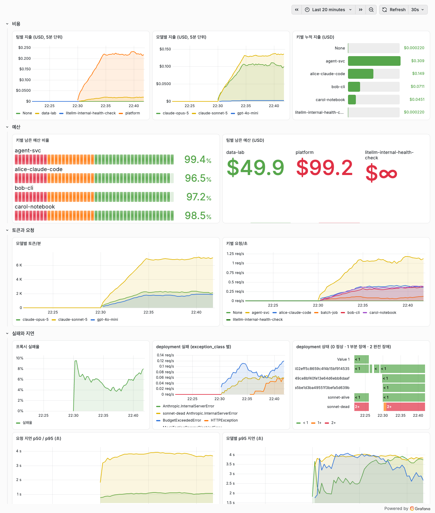

## 들어가며

Postgres를 붙인 LiteLLM 프록시는 누가 얼마나 썼는지를 보여준다. 게이트웨이가 건강한지, 무슨 대화가 오갔는지는 다른 도구가 있어야 보인다. 여러 서비스의 LLM 호출을 프록시 하나로 모으면 확인해야 할 것들이 생긴다.

1. 누가 얼마나 썼고 얼마까지 쓸 수 있는가.
2. 게이트웨이가 건강한가. 실패율과 지연은 어떤가, fallback은 실제로 일어나는가.
3. 무슨 내용을 주고받았고 그 답이 괜찮았는가.

LiteLLM이 내장한 Admin UI는 1번에 답하고 2번의 일부를 보여준다. 2번을 시계열과 알림으로 보려면 Prometheus와 Grafana가 필요하고, 3번은 Langfuse 같은 트레이싱 도구가 있어야 보인다. 이 글은 세 도구를 로컬에 전부 띄우고 같은 트래픽을 흘린 뒤 각각 무엇을 보여주는지 화면으로 확인한 기록이다.

> 기준 버전은 LiteLLM v1.102.0, Grafana 13.2, Langfuse v4.36이다.

## 실험 조건

Docker compose 스택 셋을 올렸다.

| 스택 | 컨테이너 | 역할 |
| --- | --- | --- |
| LiteLLM | litellm, postgres | 게이트웨이와 virtual key·사용량 DB |
| Grafana | prometheus, grafana | `/metrics` 수집과 대시보드·알림 |
| Langfuse | langfuse-web, langfuse-worker, postgres, clickhouse, redis, minio | 트레이스·세션·평가 |

제공자 API 키 없이 돌렸다. `litellm_params`에 `mock_response`를 넣으면 프록시가 제공자를 호출하지 않고 그 문자열을 답으로 돌려주는데, 토큰과 비용 계산은 실제 호출과 같은 경로를 탄다. 요청마다 다른 답과 지연을 주려고 `mock_response`와 `mock_delay`를 요청 body로 넘겼다. 요청 단위 mock 파라미터는 기본으로 막혀 있어서 `general_settings.dangerously_allow_mock_testing_request_params: true`를 켜야 한다.

```yaml
model_list:
  - model_name: claude-sonnet
    litellm_params:
      model: anthropic/claude-sonnet-5
      api_key: sk-fake
      mock_response: "mock 응답이다."
  - model_name: claude-opus
    litellm_params:
      model: anthropic/claude-opus-5
      api_key: sk-fake
      mock_response: "Opus mock 응답이다."
  - model_name: gpt-4o-mini
    litellm_params:
      model: openai/gpt-4o-mini
      api_key: sk-fake
      mock_response: "gpt-4o-mini mock response."
  - model_name: claude-sonnet-ha          # fallback 실험용 라우팅 그룹
    litellm_params:
      model: anthropic/claude-sonnet-5
      api_key: sk-fake
      api_base: http://127.0.0.1:9        # 아무것도 듣지 않는 주소
    model_info:
      id: sonnet-dead
  - model_name: claude-sonnet-ha
    litellm_params:
      model: anthropic/claude-sonnet-5
      api_key: sk-fake
      mock_response: "살아 있는 deployment 의 응답이다."
    model_info:
      id: sonnet-alive

litellm_settings:
  callbacks: ["prometheus", "langfuse_otel"]

general_settings:
  master_key: os.environ/LITELLM_MASTER_KEY
  database_url: os.environ/DATABASE_URL
  store_model_in_db: true
  store_prompts_in_spend_logs: true
  dangerously_allow_mock_testing_request_params: true

router_settings:
  num_retries: 2
  allowed_fails: 3
  cooldown_time: 30
```

데이터는 팀 platform과 data-lab, 유저 넷, 키 여섯 개를 만들고 트래픽 생성기를 14분 돌려 채웠다. 스레드 넷이 0.2~2초 간격으로 아래 비율로 요청을 보낸다.

| 비율 | 트래픽 | 넣은 이유 |
| --- | --- | --- |
| 70% | 유저 셋의 채팅. claude-code, cli, notebook 앱 | 유저·세션별 비용과 지연 |
| 15% | plan → search → answer → review 네 단계를 도는 에이전트 실행 | 여러 호출을 한 트레이스로 묶기 |
| 10% | 죽은 deployment가 섞인 `claude-sonnet-ha` 호출 | fallback과 cooldown |
| 5% | 예산이 0.02달러뿐인 batch-job 키의 호출 | 예산 초과 차단 |

생성기 집계로 요청 1,481건 가운데 실패가 130건이었고, 예산 초과 79건, RPM 초과 40건, 죽은 deployment 11건이다.

## LiteLLM Admin UI가 보여주는 것

DB 없이 띄운 프록시는 master key 하나로 라우팅만 한다. Postgres를 붙이면 아래가 생긴다.

| 기능 | Postgres를 붙이면 |
| --- | --- |
| 인증 | 사람·앱별 virtual key. 만료일과 허용 모델 지정 |
| 유저·팀 | 유저·팀·조직 계층과 역할 |
| 사용량 | 요청마다 키·유저·모델·토큰·비용을 `LiteLLM_SpendLogs`에 기록, 일별 롤업 |
| 예산 | 키·유저·팀별 `max_budget`, 기간 리셋, 초과 시 차단 |
| 속도 제한 | 키·유저·팀별 TPM/RPM |
| Admin UI | `/ui` 로그인, 대시보드·Logs·키·유저·팀 관리 |
| 본문 저장 | `store_prompts_in_spend_logs`, 기본 꺼짐 |

이 챕터의 화면과 수치는 트래픽 생성기를 돌리기 전, 키를 만들고 제한을 시험하던 단계의 것이다.

### 키·예산·제한

virtual key가 중심이다. 제공자의 실제 API 키는 프록시만 들고 있고, 사용자에게는 프록시가 발급한 키를 준다. 키마다 허용 모델, 예산과 리셋 주기, TPM/RPM을 건다.


키 목록에서는 키별 지출과 예산, 마지막 사용 시각이 한 줄로 보인다. 예산을 넘긴 batch-job은 빨간 막대로 표시되고, 발급만 받고 쓰지 않은 dave-unused는 Last Active가 Unknown이다. 도입률은 이 열 하나로 읽힌다.


제한을 넘기면 어떻게 되는지 세 가지를 일부러 넘겨 봤다.

| 제한 | 설정 | 결과 |
| --- | --- | --- |
| RPM | bob-cli 키에 `rpm_limit: 20` | 32건 중 20건 200, 12건 429 |
| 예산 | batch-job 키에 `max_budget: 0.02` | 3번째 요청부터 429 `budget_exceeded` |
| 허용 모델 | bob-cli 키는 `claude-sonnet`만 | `claude-opus` 요청에 403 `key_model_access_denied` |

```json
{"error":{"message":"Budget has been exceeded! Key=batch-job (sk-...2K4w) Current cost: 0.03581, Max budget: 0.02",
          "type":"budget_exceeded","param":null,"code":"429"}}
```

예산 확인은 요청 전에 일어난다. batch-job은 두 번째 요청까지 통과해 0.0358달러를 썼고 세 번째부터 막혔다. 차단된 요청도 `SpendLogs`에 실패로 남고 Logs 화면에서 사유가 보인다.


### 라우팅과 fallback

같은 `model_name`에 deployment를 여러 개 두면 라우팅 그룹이 된다. `claude-sonnet-ha`에 죽은 deployment와 산 deployment를 묶고 `num_retries: 2`, `allowed_fails: 3`으로 20건을 보냈다.

| 항목 | 결과 |
| --- | --- |
| 클라이언트가 받은 응답 | 200 × 19건, 500 × 1건 |
| 죽은 deployment로 간 시도 | 5회 |
| 죽은 deployment 상태 | cooldown |

죽은 쪽으로 간 시도 다섯 번 가운데 클라이언트까지 500으로 돌아간 것은 한 건이고, 나머지는 재시도로 산 쪽에 붙어 성공했다. 실패가 쌓이자 죽은 deployment는 cooldown에 들어갔고 이후 요청은 전부 산 쪽으로 갔다. `SpendLogs`에는 클라이언트가 받은 결과만 남고, 재시도 다섯 번은 Prometheus의 deployment 메트릭에 보인다. 이 차이가 Grafana가 필요한 이유 중 하나다.


### Usage 대시보드

기간을 고르면 요청 수, 성공·실패, 요청당 평균 비용, 토큰 합, 일별 지출, 엔드포인트별 요청, 상위 키와 모델을 한 화면에 보여준다.


보는 단위를 Team Usage로 바꾸면 팀별 지출과 팀 안의 유저별 지출이 나온다. 월말에 "누가 얼마"를 뽑는 화면이 이것이다.


API로 뽑을 때는 `/user/daily/activity`와 `/global/spend/{keys,models,teams}`를 쓴다. `/global/spend/report`는 Enterprise 라이선스가 있어야 열린다.

### DB에 담기는 것

[schema.prisma](https://github.com/BerriAI/litellm/blob/main/schema.prisma) 기준으로 테이블이 78개 생기지만, 이번 실험에서 행이 들어간 테이블은 열 개였다. 핵심은 요청 1건이 한 행인 `LiteLLM_SpendLogs`, 유저·팀·태그별 일별 롤업 셋, 그리고 키·유저·팀 테이블이다. UI 대시보드와 `/user/daily/activity`는 `SpendLogs`를 매번 훑지 않고 일별 롤업을 읽는다. 대시보드의 요청 수·토큰·지출은 롤업 테이블의 합과 정확히 같았다. `api_key` 컬럼은 SHA-256 해시라 DB가 새어도 키 원문은 안 나간다.

`store_prompts_in_spend_logs`가 꺼진 기본 상태에서는 Logs 상세에 토큰과 비용만 있고 본문은 없다. 화면이 켜는 방법까지 알려준다.


켜고 재시작한 뒤 보낸 요청부터는 system·user 프롬프트와 assistant 응답이 그대로 보인다. DB에서는 `proxy_server_request` 컬럼에 요청 body가, `response` 컬럼에 응답이 들어갔다. 요청 헤더는 `host` 하나만 남고 `Authorization`은 저장되지 않았다.


### 내장 알림

Slack·Discord·MS Teams·webhook 알림이 내장돼 있고 리전 장애 알림만 유료다. 제공자 에러, 느린 응답, deployment 격리, DB 예외, 예산 초과, 일간 리포트, 유저별 지출 임계값과 이상 탐지를 종류별로 켠다.


```yaml
general_settings:
  alerting: ["slack"]          # SLACK_WEBHOOK_URL 환경변수
  alerting_threshold: 60       # 초. 기본 300은 느슨한 편
  alert_types: [llm_exceptions, llm_requests_hanging, outage_alerts,
                db_exceptions, budget_alerts, daily_reports, fallback_reports]
```

`budget_alerts`는 키나 유저에 `max_budget`이 있어야 울린다. `llm_exceptions`를 다 켜면 사용자 실수까지 채널에 쏟아지니 `alert_type_config`의 digest로 묶어 보내는 편이 낫다.

### Admin UI에서 안 보이는 것

- 시간 축이 거칠다. 일별 롤업이라 "10분 전부터 실패율이 오르고 있다"는 못 본다.
- 재시도와 cooldown이 안 보인다. `SpendLogs`는 클라이언트가 받은 결과만 남긴다.
- 요청 본문은 켜야 보이고, 켜도 한 요청이 한 줄이다. 대화 한 세션이나 에이전트 한 실행이 트리로 묶이지 않는다.
- 답이 맞았는지 기록할 자리가 없다.

## Prometheus와 Grafana가 보여주는 것

Prometheus는 프록시의 `/metrics`를 긁어 시계열로 쌓고, Grafana는 그 위에 대시보드와 알림을 만든다. 서문의 두 번째 질문, 게이트웨이가 건강한가에 답하는 도구다.

### 연결

`callbacks: ["prometheus"]` 한 줄이면 `/metrics`가 열린다. 인증 없이 부르면 401이 난다. Prometheus에 master key를 주는 대신 `allowed_routes: ["/metrics"]`만 허용한 virtual key를 발급해 넣는다. 이 키로 `/chat/completions`를 부르면 403으로 막힌다.

```bash
curl -X POST $PROXY/key/generate -H "Authorization: Bearer $MASTER_KEY" \
  -H "Content-Type: application/json" \
  -d '{"key_alias":"prometheus-scraper","allowed_routes":["/metrics"]}'
```

```yaml
# prometheus.yml
scrape_configs:
  - job_name: litellm
    metrics_path: /metrics/   # /metrics는 /metrics/로 307 리다이렉트
    authorization:
      credentials: sk-...   # 위에서 발급한 키
    static_configs:
      - targets: ["litellm:4000"]
```

Grafana에는 Prometheus 데이터소스와 LiteLLM 레포의 [공식 대시보드 JSON](https://github.com/BerriAI/litellm/tree/main/cookbook/litellm_proxy_server/grafana_dashboard)을 provisioning으로 넣었다. 메트릭 라벨에 `api_key_alias`, `team_alias`, `user`, `model`, `requested_model`, `model_id`, `exception_class`가 붙어 있어서 대부분의 질문은 라벨 하나로 갈라 볼 수 있다.

### 공식 대시보드

프록시 요청/초, 예외 클래스별 실패/초, 평균·중앙 지연, 키·팀별 요청/초를 보여준다. 트래픽 생성기를 켠 22:30부터 요청이 2건/초로 올라가고, 예산 초과는 `BudgetExceededError`, 죽은 deployment는 `Anthropic.InternalServerError`로 실패가 갈라져 보인다.


### 운영 대시보드 만들기

공식 대시보드에는 비용과 예산 패널이 없다. Admin UI가 답하던 질문을 시계열로 옮기려고 패널 열두 개를 따로 만들었다.



| 패널 | PromQL |
| --- | --- |
| 팀별 지출 (5분 단위) | `sum by (team_alias) (increase(litellm_spend_metric_total[5m]))` |
| 모델별 지출 | `sum by (model) (increase(litellm_spend_metric_total[5m]))` |
| 키별 누적 지출 | `sum by (api_key_alias) (litellm_spend_metric_total)` |
| 키별 남은 예산 비율 | `litellm_remaining_api_key_budget_metric / litellm_api_key_max_budget_metric` |
| 팀별 남은 예산 | `litellm_remaining_team_budget_metric` |
| 모델별 토큰/분 | `sum by (model) (rate(litellm_total_tokens_metric_total[5m])) * 60` |
| 키별 요청/초 | `sum by (api_key_alias) (rate(litellm_proxy_total_requests_metric_total[5m]))` |
| 프록시 실패율 | `sum(rate(litellm_proxy_failed_requests_metric_total[5m])) / sum(rate(litellm_proxy_total_requests_metric_total[5m]))` |
| deployment 실패 | `sum by (model_id, exception_class) (rate(litellm_deployment_failure_responses_total[5m]))` |
| deployment 상태 | `max by (model_id) (litellm_deployment_state)` (0 정상, 1 부분 장애, 2 완전 장애) |
| 요청 지연 p95 | `histogram_quantile(0.95, sum by (le) (rate(litellm_request_total_latency_metric_bucket[5m])))` |
| 모델별 p95 지연 | `histogram_quantile(0.95, sum by (le, model) (rate(litellm_request_total_latency_metric_bucket[5m])))` |

이 화면에서 읽히는 것은 다섯 가지다.

- 팀별 지출은 platform이 data-lab의 열 배다. 에이전트 실행이 platform 팀 키로 돌기 때문이다. 청구서가 오기 전에 5분 단위로 보인다.
- 남은 예산 비율은 키마다 LCD 게이지로 나오고 20%와 50%에 색이 바뀐다. 알림 규칙과 같은 식을 쓴다.
- 실패율은 트래픽을 켜자마자 10%로 튀었다가 3~8% 사이를 오간다. 예산 초과 키와 죽은 deployment를 섞어 둔 결과이며, 아래 exception_class 패널에서 어느 쪽 실패인지 갈라진다.
- deployment 상태 타임라인에서 sonnet-dead만 빨간색이다. 앞의 fallback 실험에서 SpendLogs에 안 남던 재시도와 cooldown이 여기서는 시계열로 남는다.
- p95 지연이 3.7초 부근, p50이 1초 부근이다. `mock_delay`를 0.3~2.5초 사이에서 무작위로 준 결과 그대로다.

### 알림 규칙

Grafana 알림 규칙 두 개를 provisioning API로 넣었다. 조건식은 대시보드 패널과 같다.

| 규칙 | 조건 | 심각도 |
| --- | --- | --- |
| virtual key 예산 20% 미만 | 남은 예산 비율 패널 식 < 0.2, 5분 지속 | warning |
| 프록시 실패율 10% 초과 | 실패율 패널 식 > 0.1, 5분 지속 | critical |


LiteLLM의 Slack 내장 알림과 겹치는 부분이 많다. 클러스터에 이미 Alertmanager나 Grafana 알림이 있으면 규칙을 이쪽으로 모으는 편이 관리하기 쉽고, 없으면 내장 알림으로 장애·예산만 받는 편이 빠르다.

### Grafana에서 안 보이는 것

Grafana는 집계만 본다. 실패율이 10%로 튀었을 때 "어떤 요청이 실패했는지"는 Admin UI의 Logs로 내려가야 하고, "무슨 프롬프트가 비쌌는지"와 "답이 맞았는지"는 어느 쪽에도 없다.

## Langfuse가 보여주는 것

Langfuse에는 요청 본문과 세션, 여러 호출을 묶은 트레이스, 그리고 점수가 있다. 서문의 세 번째 질문, 무슨 내용을 주고받았고 그 답이 괜찮았는가에 답하는 도구다.

### 연결

Langfuse self-host는 v3부터 Postgres, ClickHouse, Redis, S3 호환 스토리지를 요구한다. 공식 compose로 올리면 컨테이너 여섯 개가 뜬다. 초기 조직·프로젝트·API 키는 `LANGFUSE_INIT_*` 환경변수로 미리 만들 수 있다.

LiteLLM 문서에 오래 있던 `success_callback: ["langfuse"]`는 v4 self-host에서 동작하지 않았다. Langfuse v4는 기본이 events_only 모드라 예전 `/api/public/ingestion` 엔드포인트로 오는 이벤트를 버린다. langfuse-web 로그에 이렇게 남는다.

```text
Rejected 2 event(s) from the legacy /api/public/ingestion endpoint for project proj-lab
because this Langfuse v4 deployment runs in events_only mode. These events were not stored.
Upgrade the client or integration to a v4-compatible SDK or OTLP ingestion path.
As a temporary migration bridge, set LANGFUSE_MIGRATION_V4_WRITE_MODE=dual ...
```

OTLP 경로인 [`langfuse_otel`](https://docs.litellm.ai/docs/observability/langfuse_otel_integration) 콜백으로 바꾸니 바로 들어갔다. Langfuse Cloud도 2026년 11월 16일에 예전 ingestion API를 닫으므로 새로 붙일 때는 이쪽이 맞다.

```yaml
litellm_settings:
  callbacks: ["prometheus", "langfuse_otel"]
# env: LANGFUSE_PUBLIC_KEY, LANGFUSE_SECRET_KEY, LANGFUSE_HOST=http://langfuse-web:3000
```

요청에 `metadata`를 실으면 트레이스 이름·유저·세션·태그·generation 이름이 Langfuse 속성으로 넘어간다. 키 별칭과 팀 별칭, 비용은 LiteLLM이 자동으로 붙인다.

```bash
curl $PROXY/chat/completions -H "Authorization: Bearer $KEY" -H "Content-Type: application/json" \
  -d '{"model":"claude-sonnet",
       "messages":[{"role":"user","content":"Redis 분산 락에서 TTL을 어떻게 잡아야 해?"}],
       "metadata":{"trace_name":"cli-chat","generation_name":"answer",
                   "trace_user_id":"bob","session_id":"<세션 id>","tags":["cli","chat"]}}'
```

에이전트 한 실행의 호출 여러 개를 한 트레이스로 묶는 `trace_id`와 `existing_trace_id` 메타데이터가 OTel 경로에서는 적용되지 않았다. 네 단계가 각각 별개 트레이스로 들어갔고, 속성에 `langfuse.trace.id`는 찍혀 있었지만 Langfuse는 OTel span의 trace id를 썼다. 대신 W3C `traceparent` 헤더를 같은 값으로 보내면 묶인다. 클라이언트가 trace id 32자리와 span id 16자리를 만들어 네 호출에 같은 헤더를 붙였더니 한 트레이스 아래 관측 넷이 들어갔다.

```bash
-H "traceparent: 00-<trace id 32자리 hex>-<span id 16자리 hex>-01"
```

Langfuse는 자체 단가표로 비용을 다시 계산한다. claude-sonnet-5와 claude-opus-5는 기본 목록에 있었고, 없던 gpt-4o-mini는 `/api/public/models`로 단가를 등록했다. 등록 전 관측에는 비용이 안 붙는다.

### Home

프로젝트 홈은 Admin UI의 Usage 대시보드가 보여주던 것을 트레이스·유저·점수 축으로 보여준다. 트레이스 이름별 건수, 모델별 토큰과 비용, 유저별 비용, 점수 평균, 레벨별 관측 수가 한 화면이다. 건수는 프록시의 SpendLogs와 다르게 잡힌다. 예산과 RPM에서 막힌 요청이 ERROR 관측으로 들어오는 것은 같지만, 죽은 deployment로 간 시도는 재시도까지 건별 ERROR 관측으로 남는다. 실험에서 클라이언트가 500을 받은 것은 11건인데 Langfuse에는 `Cannot connect to host` 관측이 48건이다.


### 요청 하나를 열어 보기

Tracing 목록은 관측 단위다. 검색창에 `level:ERROR`, `latency:>2`, `scores.accuracy:>0.8` 같은 식을 쓰고, Quality·Slow·Cost 프리셋으로 "1달러 넘는 관측", "5초 넘는 generation"을 바로 거른다.


관측 하나를 열면 Admin UI의 Logs 상세에 없던 것이 다 있다. system·user·assistant 본문, 세션과 유저 링크, 태그, 토큰과 비용, 그리고 메타데이터에 LiteLLM이 붙인 키 별칭과 팀 별칭이 있다. 여기서 Annotate로 점수를 매기거나 Add to datasets로 회귀 테스트 데이터에 넣는다.


에이전트 실행은 트리로 보인다. plan, search, answer, review 네 generation이 한 트레이스 아래 있고, 단계마다 지연·토큰·비용이 붙어서 어느 단계가 비싼지 바로 읽힌다. 프록시 뒤에 있는 에이전트 프레임워크가 무엇이든 `traceparent`만 전달하면 이 그림이 나온다.


### 세션과 유저

세션 목록은 대화 단위다. 세션마다 지속 시간, 트레이스 수, 토큰과 비용, 점수, 유저가 한 줄이다.


세션 하나를 열면 대화가 시간순으로 이어지고 각 턴 옆에서 바로 주석과 점수를 단다. "이 사용자가 왜 같은 질문을 세 번 했을까"는 이 화면에서 본다.


유저 목록은 유저별 첫·마지막 활동, 이벤트 수, 토큰, 비용이다. Admin UI의 유저 화면에도 있는 항목이지만 여기서는 유저를 눌러 그 사람의 트레이스와 세션으로 바로 내려간다.


### 품질을 기록하기

점수는 트레이스나 관측에 붙는 이름 있는 값이다. 값은 숫자·범주·불리언 중 하나이고, 사람이 UI에서 매기거나 API로 넣거나 evaluator가 자동으로 매긴다. 실험에서는 0에서 1 사이 값인 `helpfulness`와 yes/no인 `correct`를 API로 넣었다.


Scores 목록에서 점수 이름·값·코멘트로 거르고, Home의 이동평균 차트에서 추이를 본다. "지난주 배포 뒤 helpfulness 평균이 떨어졌다"를 숫자로 말할 수 있게 된다.


Evaluators는 점수를 자동으로 매기는 쪽이다. LLM-as-a-judge 템플릿 스무 개와 코드 evaluator가 있고, 운영 트레이스에 규칙으로 걸어 두거나 데이터셋 실행에 돌린다. judge 모델 연결은 LiteLLM 프록시를 OpenAI 호환 엔드포인트로 가리키면 되므로 이 비용도 LiteLLM의 virtual key로 잡힌다.


### 지연과 알림

지연은 Langfuse 쪽에도 있다. 트레이스 이름으로 나눈 유스케이스별 p95, 레벨별 p95, 유저별 최대 지연, 모델별 p95가 기본 대시보드에 들어 있다. Grafana의 p95가 프록시 전체를 보는 것이라면 여기는 "cli-chat이 notebook-chat보다 느리다"처럼 앱 단위로 갈라 본다.


알림은 메트릭 임계값 방식이다. 관측·트레이스·점수 중 하나를 고르고 count·cost·latency·점수 평균 같은 measure에 필터를 걸어 임계값과 기간을 정하면, Slack·webhook·GitHub Actions로 보낸다. "5분간 비용이 1달러를 넘으면", "helpfulness 평균이 0.6 아래로 내려가면" 같은 규칙이 Grafana 없이도 생긴다.


### 프롬프트 버전 관리

프롬프트를 Langfuse에 두고 버전과 production 같은 라벨로 관리한다. 생성 결과에 프롬프트 이름과 버전이 링크되면 "v2로 바꾼 뒤 점수가 어떻게 됐나"를 프롬프트 화면의 Metrics 탭에서 본다. 이번 실험은 클라이언트가 Langfuse에서 프롬프트를 받아 쓰는 구조가 아니라서 링크까지는 안 했고 등록만 해 봤다.


### 붙이기 전에 정할 것

운영할 것이 여섯 컨테이너 늘고, 그중 ClickHouse는 메모리를 많이 쓴다. 그리고 본문을 저장하면 <strong>프롬프트에 들어간 개인정보가 로그 DB에 남는다</strong>. LiteLLM의 `store_prompts_in_spend_logs`든 Langfuse든 같다. 민감 데이터가 프롬프트에 섞이는 서비스라면 저장 여부와 보관 기간을 먼저 정해야 한다.

## 정리

서문의 질문 셋을 아홉 개로 쪼개 세 도구에 대응시키면 이렇다.

| 질문 | LiteLLM Admin UI | Grafana | Langfuse |
| --- | --- | --- | --- |
| 누가 얼마나 썼나 | 키·유저·팀별 지출, 일별 | 팀·키·모델별 지출 시계열 | 유저·세션·트레이스별 비용 |
| 예산이 얼마나 남았나 | 키·팀 상세 | 남은 예산 비율 게이지와 알림 | 없음 |
| 특정 키가 폭주하나 | 키 목록의 지출, RPM 차단 | 키별 요청/초 시계열 | 유저별 이벤트 수 |
| 실패율·지연 추이 | 기간 합계만 | 5분 단위 시계열, p95, 알림 | 유스케이스·유저별 p95 |
| fallback과 cooldown | 안 보임 | deployment 상태와 실패 시계열 | 실패한 시도는 ERROR 관측, 상태는 안 보임 |
| 어떤 요청이 실패했나 | Logs 상세 | 안 보임 | 관측 상세, `level:ERROR` 검색 |
| 무슨 내용을 주고받았나 | 본문 저장 켜면 요청 단위 | 안 보임 | 관측·세션·트레이스 트리 |
| 답이 괜찮았나 | 없음 | 없음 | 점수, evaluator, 주석 |
| 프롬프트를 바꾸면 나아졌나 | 없음 | 없음 | 버전별 점수 비교 |

이 셋을 logs·metrics·traces로 부르면 절반만 맞다. metrics는 Prometheus와 그대로 겹치고, Langfuse는 OTLP로 span을 받으니 traces에 가깝다. 하지만 Admin UI의 본체는 키·예산·속도 제한과 지출 집계라는 관리 기능이지 로그 시스템이 아니고, Langfuse의 점수·evaluator·프롬프트 버전은 traces 너머의 평가 영역이다. 세 기둥을 그대로 채우려면 traces는 OTel 콜백으로 Tempo나 Jaeger에, logs는 프록시 stdout을 Loki에 보내면 되지만, 그러면 세션·점수·프롬프트 비교가 없어진다. 예산·키 관리와 평가가 세 기둥 어디에도 들어가지 않아서 이 글은 데이터 형태가 아니라 질문으로 도구를 갈랐다.

## 권장 순서

1. Postgres + `/ui`만 켜고 써본다. "누가 얼마나"와 키·예산 관리는 이것으로 끝난다.
2. 클러스터에 Prometheus/Grafana가 있으면 `callbacks: ["prometheus"]`와 `/metrics` 전용 키를 넣는다. 공식 대시보드로 시작하고 비용·예산·deployment 패널은 앞의 PromQL 표로 더한다. 없으면 내장 Slack 알림으로 장애·예산만 받는다.
3. "무슨 대화였는지"와 "답이 괜찮았는지"를 물어야 할 때 Langfuse를 붙인다. `langfuse_otel` 콜백, 요청 `metadata`, 여러 호출을 묶을 `traceparent` 헤더까지가 연결의 전부다. 저장 여부와 보관 기간은 붙이기 전에 정한다.
