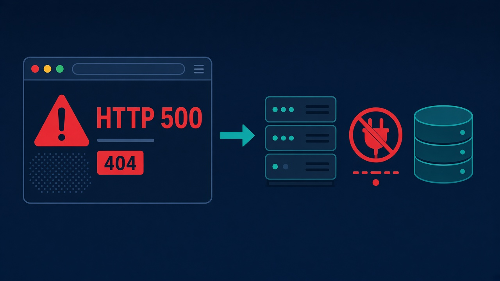
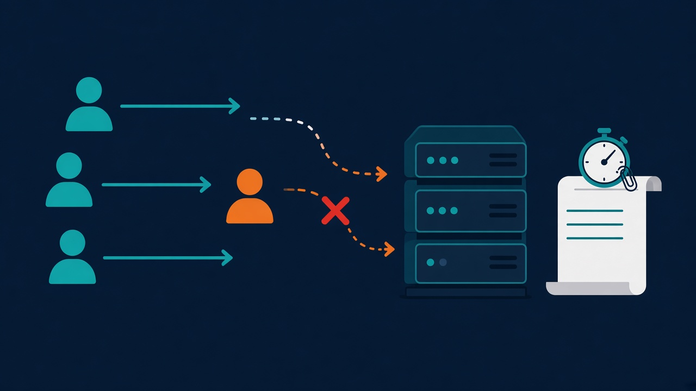
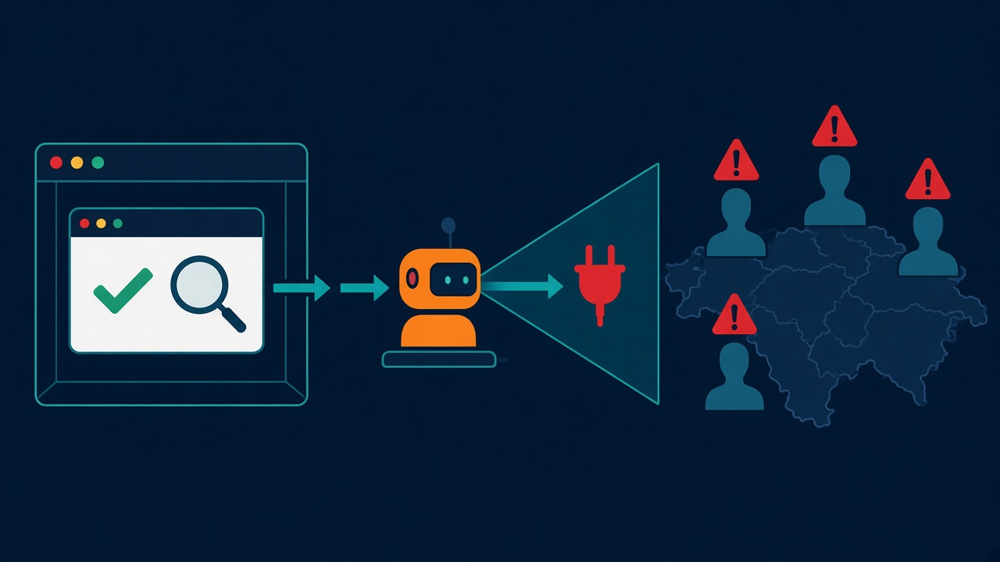

import DashboardFigure from "@/materials/monitoring-design/DashboardFigure";
import MeasureFailureFigure from "@/materials/monitoring-design/MeasureFailureFigure";
import MeanVsTailFigure from "@/materials/monitoring-design/MeanVsTailFigure";
import QuantileEstimateFigure from "@/materials/monitoring-design/QuantileEstimateFigure";

## 들어가며

모니터링 도구를 붙이면 지표는 금방 쌓인다. 어려운 것은 그다음이다. 어떤 지표를 대시보드에 올릴지, 어디에 경보를 걸지, 누가 언제 볼지가 정해지지 않으면 패널과 알림만 늘어난다. 알림이 하루에 수십 번 울리면 사람들은 알림을 읽지 않게 되고, 정작 큰 장애가 났을 때 놓친다.

그래서 모니터링 설계를 다룬 자료들을 찾아 읽었다. 이 글은 자료들이 말하는 것을 모으고, 처음 모니터링을 세운다면 어떤 순서로 할지 정리한 학습 노트다.

| 자료 | 다루는 것 |
| --- | --- |
| Google SRE 책 6장 「Monitoring Distributed Systems」 | 증상과 원인, 네 가지 황금 신호, 경보 원칙 |
| Google SRE 책 4장 「Service Level Objectives」 | SLI, SLO, SLA와 목표를 고르는 법 |
| Google SRE 워크북 2장 「Implementing SLOs」 | SLI를 어디서 잴지 |
| Google SRE 워크북 5장 「Alerting on SLOs」 | 에러 버짓 소진율로 경보를 거는 법 |
| Rob Ewaschuk 「My Philosophy on Alerting」 | 원인이 아니라 증상에 경보를 거는 이유 |
| Brendan Gregg 「The USE Method」, Grafana 블로그 「The RED Method」 | 자원과 서비스를 점검하는 틀 |
| Grafana 「Dashboard best practices」, 「Introduction to exemplars」 | 대시보드를 만들고 관리하는 법, 지표에서 트레이스로 넘어가는 법 |
| Prometheus 「Histograms and summaries」 | 히스토그램으로 백분위를 구할 때 조심할 점 |
| Prometheus 「Metric and label naming」, OpenTelemetry 지표 규약 | 지표 이름을 짓는 규칙 |
| Netflix 기술 블로그 「SPS: the Pulse of Netflix Streaming」, Prometheus 「Overview」 | 사업 지표로 장애를 알아채는 법 |
| Prometheus 「Alerting」 | 배치 작업에 경보를 거는 때 |

SRE 책 1판과 워크북은 sre.google에 전문이 무료로 공개되어 있다.

> SRE(Site Reliability Engineering)는 Google에서 서비스 운영을 맡는 직무이자 일하는 방식이다. SRE 책 서론을 쓴 Benjamin Treynor Sloss는 2003년 Google에 들어와 운영팀을 맡았고, SRE를 "소프트웨어 엔지니어에게 운영팀을 설계하라고 하면 생기는 것"이라고 설명한다. SRE 팀은 서비스의 가용성, 지연, 성능, 효율, 변경 관리, 모니터링, 긴급 대응, 용량 계획을 맡는다. 티켓 처리, 당직, 수작업 같은 운영 일은 전체 시간의 50%를 넘지 않게 하고, 나머지 절반은 개발에 쓴다.

## 모니터링이 답할 두 질문

### 증상과 원인

SRE 책 6장은 모니터링이 답할 질문을 두 가지로 줄인다. 하나는 무엇이 고장 났는가이고 다른 하나는 왜 고장 났는가다. 앞의 질문은 증상을 묻고 뒤의 질문은 원인을 묻는다. 책에 실린 예를 옮기면 다음과 같다.

#### 1. HTTP 500이나 404를 돌려준다

사용자는 HTTP 500이나 404를 받는다. 원인은 그 뒤에서 DB 서버가 연결을 거부한 것이다. 아래 그림의 왼쪽이 증상, 오른쪽이 원인이다.



#### 2. 응답이 느리다

사용자 화면은 응답을 기다리며 멈춰 있다. 원인은 서버의 CPU 과부하이거나, 랙 밑에 눌린 네트워크 케이블 때문에 패킷 일부가 유실되는 것이다. 아래 그림의 오른쪽이 증상, 왼쪽과 아래가 원인이다.


#### 3. 비공개 콘텐츠를 누구나 읽을 수 있다

누구나 비공개 문서를 읽을 수 있다. 원인은 새로 배포한 소프트웨어가 접근 제어 목록을 빠뜨려 모든 요청을 허용한 것이다. 아래 그림에서 오른쪽 아래의 로켓이 새 배포이고, 찢어진 목록과 열린 문이 빠진 접근 제어다.


증상과 원인을 나누는 까닭은 쓰임새가 달라서다. 증상은 사용자가 지금 겪는 문제라서 당직 엔지니어에게 경보를 보내 바로 대응하게 할 근거가 된다. 이 글에서는 이것을 "사람을 부른다" 또는 "호출한다"고 쓴다. 원인은 고칠 곳을 찾을 때 필요하다. 증상 하나에 원인이 여러 가지일 수 있다. 원인이 있어도 사용자에게는 아무 일이 없을 수도 있다.

### 블랙박스와 화이트박스

책은 같은 구분을 블랙박스 모니터링과 화이트박스 모니터링으로도 설명한다. 블랙박스 모니터링은 사용자처럼 바깥에서 시스템의 동작을 시험한다. 지금 벌어지는 문제를 보여 주므로 사람을 부르는 데 알맞다. 하지만 곧 닥칠 문제는 잡지 못한다. 화이트박스 모니터링은 시스템 내부가 내보내는 지표를 본다. 아직 증상이 되지 않은 문제와 그 원인은 화이트박스로 찾는다. 디스크가 차오르는 것이 그런 문제의 예다.

책은 한 팀의 증상이 다른 팀에게는 원인일 수 있다고도 짚는다. 예를 들어 DB가 느린 것은 DB를 맡은 팀에게는 증상이지만 그 DB를 쓰는 서비스 팀에게는 원인이다.

여기서 이 글 전체를 이끌 원칙이 나온다. <strong>경보는 증상에 걸고, 원인은 대시보드에서 찾는다.</strong>

이 원칙대로 대시보드를 만들려면 두 가지를 더 정해야 한다. 하나는 증상을 어디서 잴지다. 다른 하나는 대시보드를 본 다음 원인을 어디서 확인할지다.

### 증상을 재는 곳

증상은 사용자에게 가까운 곳에서 잰다. 같은 지표라도 재는 곳에 따라 잡히는 것이 다르다. SRE 워크북 2장은 홈페이지 요청 가운데 100ms 안에 뜬 비율을 재는 예를 든다. 재는 방법은 세 가지이고, 워크북은 이 셋을 세 기준으로 따진다.

- <strong>품질</strong> — 사용자 경험을 얼마나 정확히 담는지 본다.
- <strong>범위</strong> — 모든 사용자의 경험을 얼마나 담는지 본다.
- <strong>비용</strong> — 그 방법을 갖추고 운영하는 데 품이 얼마나 드는지 본다.

세 방법마다 좋은 점과 아쉬운 점을 이 기준에 맞춰 보면 다음과 같다.

#### 1. 서버 로그에 남은 지연 시간

- <strong>비용이 적다</strong> — 이미 있는 로그로 바로 잴 수 있다.
- <strong>범위가 좁다</strong> — 백엔드에 닿지 못한 요청은 빠진다.

아래 그림에서 주황색 사용자의 요청은 서버에 닿기 전에 끊긴다. 그래서 오른쪽 로그에는 이 요청이 남지 않는다.



#### 2. 가상 머신에서 브라우저로 페이지를 열어 보는 점검

- <strong>품질이 낫다</strong> — 요청이 네트워크에 닿지 못하는 오류도 잡는다.
- <strong>범위에 빈틈이 있다</strong> — 일부 사용자에게만 생기는 문제는 놓칠 수 있다.

아래 그림의 로봇이 가상 머신에서 도는 점검이다. 로봇은 빠진 플러그처럼 요청이 네트워크에 닿지 못하는 고장을 잡는다. 그러나 로봇이 연 페이지에 확인 표시가 떠 있는 동안에도 오른쪽 지도 위의 일부 사용자는 문제를 겪을 수 있다.



#### 3. 홈페이지의 JavaScript가 직접 재서 보내는 값

- <strong>품질이 가장 높다</strong> — 사용자 경험을 가장 정확하게 담는다.
- <strong>비용이 크다</strong> — 코드를 고치고 값을 받을 시스템을 세워야 한다. 그 시스템도 따로 안정적으로 돌아야 한다.

아래 그림의 왼쪽 창들이 사용자마다의 브라우저다. 중괄호는 페이지의 JavaScript, 초시계는 그 코드가 잰 시간이다. 오른쪽의 서버와 저장소, 그래프, 톱니바퀴는 이 값을 받으려고 따로 세우고 돌봐야 하는 시스템이다.


### 재는 곳마다 잡는 고장

워크북은 잴 수 있는 곳으로 네 가지를 든다. 앱 서버 로그, 로드밸런서, 블랙박스 점검, 클라이언트 계측이다. 예시에서는 그중 로드밸런서 지표를 고른다. 이 지표는 이미 있고 앱 서버 로그보다 사용자 경험에 가깝기 때문이다. 앱이 잰 지연 시간에는 요청이 앱에 닿기 전에 앞단에서 걸린 시간이 들어가지 않는다.

고장 난 곳에 따라 네 곳이 무엇을 잡고 무엇을 놓치는지 그려 보면 다음과 같다. 그림에서 빨간 테두리와 X는 고장 난 곳이다.

#### 1. 앱이 500을 돌려준다

요청은 앱까지 닿았다가 실패한다. 그래서 네 곳 모두 실패를 본다.

<MeasureFailureFigure scene={1} />

#### 2. 앱이 죽었다

로드밸런서가 앱 대신 5xx를 돌려준다. 앱은 요청을 받지 못했으니 서버 로그에는 아무것도 남지 않는다.

<MeasureFailureFigure scene={2} />

#### 3. 로드밸런서 앞에서 막혔다

DNS나 인증서에서 막히면 요청이 로드밸런서에 닿지 못한다. 바깥 점검은 잡지만 로드밸런서와 서버 로그는 놓친다. 브라우저 계측은 이미 떠 있는 페이지가 실패를 보고할 수 있을 때 잡는다.

<MeasureFailureFigure scene={3} />

#### 4. 일부 사용자에게만 느리다

느린 구간이 일부 사용자 쪽에 있으면 바깥 점검의 요청은 평소처럼 빠르게 지나간다. 그래서 바깥 점검도 놓치고 브라우저 계측만 잡는다.

<MeasureFailureFigure scene={4} />

그렇다고 처음부터 가장 정확한 곳을 고집할 필요는 없다. 웹 서버 로그가 이미 있고 점검을 새로 세우는 데 몇 주가 걸린다면, 워크북은 로그부터 쓰라고 권한다.

### 원인을 찾는 곳

원인 찾기는 대시보드에서 끝나지 않는다. 대시보드의 지표는 어느 서비스의 어느 구간이 아픈지까지 좁혀 준다. 요청 하나가 왜 느렸는지는 로그와 트레이스를 봐야 안다. Grafana의 exemplar는 대시보드의 지표와 트레이스를 잇는다. exemplar는 어떤 시간대의 측정을 대표하는 트레이스 하나다. 지연 그래프 위에는 점으로 찍힌다. 점에 마우스를 올리면 트레이스 ID가 보인다. 그 트레이스로 넘어가면 구간마다 걸린 시간을 볼 수 있다.

## 무엇을 잴까

### 네 가지 황금 신호

SRE 책은 사용자를 상대하는 시스템에서 지표를 넷만 잴 수 있다면 다음 넷을 재라고 한다.

| 신호 | 뜻 | 책이 덧붙인 주의점 |
| --- | --- | --- |
| 지연(latency) | 요청 하나를 처리하는 데 걸린 시간 | 성공한 요청과 실패한 요청의 지연을 나눠 본다 |
| 트래픽(traffic) | 시스템에 걸리는 수요 | 웹 서비스는 초당 HTTP 요청 수, 오디오 스트리밍은 네트워크 I/O나 동시 세션 수처럼 시스템에 맞는 단위로 잰다 |
| 오류(errors) | 실패한 요청의 비율 | 드러난 실패만이 아니라 숨은 실패와 정책상 실패도 센다 |
| 포화(saturation) | 서비스가 얼마나 꽉 찼는가 | 가장 먼저 바닥나는 자원을 보고, 앞으로 찰 시점도 예측한다 |

주의점 셋은 따로 짚어 둘 만하다.

<strong>지연은 성공과 실패를 나눠 본다.</strong> DB 연결이 끊겨 돌려준 500 응답은 아주 빠를 수 있다. 이것을 전체 지연에 섞으면 계산이 틀어진다. 장애 중인데 오히려 응답이 빨라진 것처럼 보일 수 있다. 그렇다고 실패를 무시해도 되는 것은 아니다. 책의 표현으로는 "a slow error is even worse than a fast error"다. 느린 실패는 빠른 실패보다 더 나쁘다.

<strong>오류는 응답 코드만으로 다 잡히지 않는다.</strong> 책은 실패를 세 가지로 나눈다. HTTP 500처럼 드러난 실패, 200을 돌려줬지만 내용이 틀린 숨은 실패, 1초 안에 응답하기로 약속했다면 1초를 넘긴 요청 같은 정책상 실패다. 내용이 틀린 응답은 끝에서 끝까지 확인하는 시험으로만 잡을 수 있다.

<strong>포화는 100%가 되기 전에 문제가 된다.</strong> 많은 시스템은 사용률 100%에 닿기 전에 느려지므로 사용률 목표를 정해 두라고 한다. 짧은 창에서 잰 99번째 백분위 응답 시간이 포화를 일찍 알려 주는 신호가 될 수 있다. 책은 "데이터베이스 디스크가 4시간 뒤 가득 찰 것 같다"처럼 앞으로의 포화를 예측하는 것도 포화 신호에 넣는다.

### 평균 대신 분포

지연을 평균으로만 보면 느린 요청이 숨는다. 책의 예를 그대로 가져오면, 초당 1,000건을 평균 100ms로 처리하는 서비스에서도 요청의 1%는 5초씩 걸릴 수 있다. 평균은 멀쩡해 보이지만 그 1%의 사용자는 매번 5초를 기다린다.

느린 요청 1%가 평균과 백분위를 어떻게 움직이는지 그려 보면 다음과 같다. 나머지 99%는 50ms 근처에서 끝난다고 하자.

1. 요청 대부분은 50ms 근처에서 끝난다. 이때는 평균과 50번째 백분위인 p50이 모두 50ms다.

<MeanVsTailFigure step={1} />

2. 요청의 1%가 5초씩 걸리면 평균은 100ms가 된다. p50은 그대로 50ms다.

<MeanVsTailFigure step={2} />

3. 평균 100ms는 멀쩡해 보이지만 1%의 사용자는 매번 5초를 기다린다. 이 1%는 99.9번째 백분위인 p99.9에서 5초로 드러난다.

<MeanVsTailFigure step={3} />

SRE 책 4장은 그래서 지표를 평균이 아니라 분포로 보라고 한다. 99번째나 99.9번째 백분위는 그럴듯한 최악의 경우를, 50번째 백분위인 중앙값은 보통의 경우를 보여 준다. 사람들은 응답 시간이 들쭉날쭉한 시스템보다 조금 느려도 고른 시스템을 더 좋아한다고 책은 적는다.

분포를 보려면 수집 방식부터 달라야 한다. 6장은 지연 값을 하나하나 모으지 말고 지연 구간마다 요청 수를 세라고 권한다. 0\~10ms, 10\~30ms, 30\~100ms, 100\~300ms처럼 대략 3배씩 넓어지는 구간이다. 이렇게 세어 두면 히스토그램을 그릴 수 있고 백분위도 계산할 수 있다. Prometheus의 histogram과 OpenTelemetry의 Histogram이 이 방식으로 지연을 모은다.

히스토그램으로 백분위를 그릴 때는 두 가지를 조심해야 한다. 둘 다 Prometheus 문서 「Histograms and summaries」에 나오는 내용이다.

<strong>백분위는 평균 내지 않는다.</strong> 파드마다 99번째 백분위를 구한 뒤 그 값들을 평균 내도 전체의 99번째 백분위는 나오지 않는다. 문서도 미리 계산한 백분위를 합치는 것은 "rarely makes sense"라고 적는다. 히스토그램은 같은 구간의 요청 수끼리 더할 수 있다. 그래서 여러 파드의 구간별 요청 수를 먼저 더하고, 그렇게 합친 히스토그램에서 백분위를 구한다.

```promql
# 파드 전체의 99번째 백분위: 구간(le)별 요청 수를 먼저 더한다
histogram_quantile(0.99, sum by (le) (rate(http_request_duration_seconds_bucket[5m])))
```

<strong>히스토그램의 백분위는 추정값이다.</strong> 구간 안에서 요청이 어떻게 퍼져 있는지는 알 수 없다. 그래서 `histogram_quantile`은 구간 안을 보간해 값을 짐작한다. 문서의 예를 보자. 목표는 요청의 95%를 300ms 안에 처리하는 것이고, 구간 경계는 100ms, 200ms, 300ms, 450ms에 있다. 요청은 거의 다 220ms 근처에 몰려 있다고 하자. 실제 95번째 백분위는 220ms 근처지만, 요청이 모두 200\~300ms 구간에 들어가므로 추정값은 295ms가 된다. 대시보드만 보면 목표를 곧 넘을 것 같지만 실제로는 넉넉하다. 구간을 촘촘히 나누면 추정은 실제에 가까워진다. 같은 예에서 250ms에 경계를 하나 더 두면 추정값은 247.5ms가 된다.

목표를 미리 안다면 구간 경계를 목표 값인 0.3초에 두고, 300ms 안에 끝난 요청의 비율을 바로 그리는 편이 정확하다. SRE 워크북 2장도 느린 요청은 히스토그램으로 어림하기보다 직접 세는 편이 낫다고 적는다.

이 과정을 차례로 그리면 다음과 같다.

1. 실제 요청은 거의 다 220ms 근처에서 끝난다. 목표는 300ms다.

<QuantileEstimateFigure step={1} />

2. 히스토그램은 구간마다 요청 수만 남긴다. 경계가 100ms, 200ms, 300ms, 450ms에 있으면 요청은 모두 200\~300ms 구간에 들어간다.

<QuantileEstimateFigure step={2} />

3. `histogram_quantile`은 구간 안에 요청이 고르게 퍼져 있다고 보고 보간한다. 그래서 p95는 295ms로 추정된다.

<QuantileEstimateFigure step={3} />

4. 250ms에 경계를 하나 더 두면 추정값은 247.5ms로 실제에 가까워진다.

<QuantileEstimateFigure step={4} />

5. 경계가 목표 값 300ms에 있으면 300ms 안에 끝난 비율은 추정 없이 센다. 여기서는 100%다.

<QuantileEstimateFigure step={5} />

측정 간격도 목적에 맞춘다. CPU 사용률을 1분 단위로만 모으면 꼬리 지연을 만드는 꽤 긴 급등도 보이지 않는다. 반대로 연 99.9% 가용성이 목표라면 성공 응답을 1분에 한두 번보다 자주 확인할 필요는 없다고 책은 말한다.

### RED와 USE

황금 신호를 서비스와 자원에 맞게 나눈 틀이 RED와 USE다.

| 틀 | 대상 | 재는 것 |
| --- | --- | --- |
| RED | 서비스 | Rate(초당 요청 수), Errors(실패한 요청 수), Duration(요청에 걸린 시간의 분포) |
| USE | 자원 | Utilization(자원이 일하느라 바빴던 시간의 비율), Saturation(처리하지 못하고 쌓인 일, 흔히 대기열 길이), Errors(오류 이벤트 수) |

RED는 Tom Wilkie가 소개한 틀이다. 모든 서비스를 같은 세 지표로 보면 구조 전체를 한 모양으로 볼 수 있고, 자기가 짜지 않은 코드도 당직이 맡을 수 있다는 것이 Grafana 블로그 글의 설명이다. 황금 신호에서 포화를 뺀 것과 거의 같다.

USE는 Brendan Gregg가 만든 틀이다. CPU, 메모리, 네트워크 인터페이스, 디스크 같은 물리 자원마다 세 가지를 확인한다. 뮤텍스 락, 스레드 풀, 파일 디스크립터 같은 소프트웨어 자원에도 쓸 수 있다. 스레드 풀이라면 스레드가 바빴던 시간이 사용률이고, 스레드를 기다리는 요청이 포화다. 읽는 기준도 함께 준다. 사용률 100%는 대개 병목의 신호다. 포화는 0이 아니면 문제일 수 있다. 오류 카운터가 0이 아니고 성능이 나쁜 동안에도 계속 늘어난다면 살펴볼 만하다.

Grafana 문서는 둘의 관계를 이렇게 정리한다.

> The USE method tells you how happy your machines are, the RED method tells you how happy your users are.

USE는 원인을, RED는 사용자가 겪는 증상을 보여 준다. 그래서 Grafana 문서도 경보는 RED 대시보드에 걸라고 권한다. 앞에서 나온 원칙과 같다.

### 사업 지표와 배치

RED가 모두 정상인데 장애일 수도 있다. 오류율은 들어온 요청 가운데 실패한 비율이라서 요청이 아예 들어오지 않으면 오류도 없다. 주문 버튼이 화면에서 사라져 주문이 0건이 되어도 오류율과 지연은 깨끗하다. 이런 장애는 사업 지표에서만 보인다.

요청이 없을 때는 오류율 패널도 믿기 어렵다. 오류율은 실패한 요청 수를 전체 요청 수로 나눈 값이다. 요청이 0건이면 0을 0으로 나누게 되어 숫자가 아닌 값인 NaN이 나온다. 5xx 응답이 한 번도 없었던 서비스라면 실패한 요청을 세는 시계열 자체가 없어서 나눗셈 결과가 비고, Grafana에는 "No data"가 뜬다. 어느 쪽이든 오류율 패널만 봐서는 장애 중인지 평온한지 알 수 없다. 분자에 `or vector(0)`을 붙이면 실패가 없을 때 오류율이 0으로 나온다. 요청이 0건일 때는 그래도 값이 나오지 않으므로, 요청 수 패널을 오류율 옆에 둔다.

```promql
# 5xx가 한 번도 없어도 오류율이 비지 않게 한다
(sum(rate(http_requests_total{code=~"5.."}[5m])) or vector(0)) / sum(rate(http_requests_total[5m]))
```

배치 작업에도 RED는 잘 맞지 않는다. 요청을 받는 서비스가 아니기 때문이다. SRE 책 4장은 데이터 처리 파이프라인이 신경 쓰는 것으로 처리량과 들어와서 끝날 때까지 걸린 시간을 든다. Ewaschuk도 데이터의 완결성, 신선도, 내구성을 정확성 문제로 묶어 사용자가 겪는 증상에 넣는다. 매일 밤 도는 배치라면 마지막으로 성공한 시각과 처리한 건수를 재는 편이 오류율보다 낫다. 경보도 이 숫자에 건다. Prometheus 문서는 배치 작업이 최근에 충분히 성공하지 못했을 때 사람을 부르는 것이 맞고, 한 번 실패했다고 사람이 나서야 해서는 안 된다고 적는다.

사업 지표를 고르고 키우는 일은 그것만으로도 큰 주제라서 다음 글에서 따로 다룬다. 이 글에서는 장애를 알아채는 쓰임만 다룬다. 이 쓰임은 Netflix 기술 블로그의 「SPS: the Pulse of Netflix Streaming」에 잘 정리되어 있다. Netflix의 글과 Prometheus 문서에서 확인한 방법은 다음 넷이다.

<strong>가장 중요한 활동을 대표하는 지표 하나를 고른다.</strong> Netflix는 2008년 무렵 지표 수백 개를 사람이 지켜보며 문제를 찾았다. 서버와 기기가 늘자 이 방식은 버티지 못했다. 여러 부서 사람이 함께 알아들을 수 있는 단순한 지표가 필요했고, 그래서 가장 중요한 활동인 시청에 가까운 지표 하나를 찾았다. 재생 버튼을 누른 횟수를 세는 서버 쪽 지표는 패턴이 일정하면서도 화면, 기기, 서버에 문제가 생기면 크게 흔들렸다. 이 지표를 초당 재생 시작 수라는 뜻으로 SPS라고 부른다. 주문 서비스라면 초당 주문 완료 수가 이런 지표가 될 수 있다. 완료 비율이 아니라 완료 수를 보는 까닭은 앞의 예 때문이다. 주문 버튼이 사라져 주문이 아예 시작되지 않으면 완료 비율은 오류율처럼 0을 0으로 나누게 되어 비어 버린다.

<strong>장애의 심각도를 그 지표로 가른다.</strong> Netflix에서 SPS는 회사 안의 공용어가 되었다. 운영 문제는 SPS에 영향이 있는지 없는지로 나뉘고, 그것이 곧 심각도다. 서비스 가용성도 예상 SPS와 실제 SPS를 견줘 잰다.

<strong>고정 기준 대신 예상값과 비교한다.</strong> SPS는 지역마다 하루에 한 번 오르내린다. 저녁에 가장 높고 새벽에 가장 낮으며, 지역 휴일에는 낮 시청이 늘어난다. 글은 CPU 사용률이 오르는 것을 잡을 때는 고정 기준이 쓸 만하지만, 이렇게 오르내리는 신호가 떨어지는 것은 고정 기준으로 정확히 잡을 수 없다고 적는다. 새벽의 정상 값이 저녁의 장애 값보다 낮을 수 있기 때문이다. Netflix는 이번 주 선과 지난주 선을 겹쳐 보고, 쌓인 데이터로 한 주의 어느 시점에 재생이 몇 번 시작돼야 하는지 예측한다. 실제 값이 예측에서 벗어나면 경보를 보내고, 다시 예측대로 돌아오면 회복된 것으로 본다. 대시보드에서는 지난주 같은 시각의 값을 함께 그리는 것부터 시작할 수 있다. 주문 완료 카운터가 `orders_completed_total`이라고 하자.

```promql
# 이번 주와 지난주 같은 시각의 초당 주문 완료 수
sum(rate(orders_completed_total[5m]))
sum(rate(orders_completed_total[5m] offset 1w))
```

Netflix의 글은 예측 방법도 적어 두었다. Netflix는 이중 지수 평활(double exponential smoothing)로 정상 범위를 그린다. 이 방법은 SPS가 떨어지는 것은 잘 잡지만, 갑자기 회복될 때는 따라가지 못해 잠깐 잘못된 경보를 낸다. 그래도 쓸 만한 경보를 내는 방법이었다고 한다. 더 정교한 베이즈 방식도 시험했지만 계산이 무겁고 사람이 해석하기 어려워 많은 지표에 실시간으로 쓰지는 못했다.

<strong>정확해야 하는 숫자는 다른 곳에서 가져온다.</strong> Prometheus 문서는 요청마다 과금하는 것처럼 100% 정확해야 하는 수치에는 Prometheus가 맞지 않는다고 적는다. 모은 데이터가 그만큼 자세하고 빠짐없지 않기 때문이다. 그런 수치는 다른 시스템으로 모으고 Prometheus는 나머지 모니터링에 쓰라고 권한다. 대시보드의 사업 지표는 평소와 다른지를 알아보는 데 쓴다.

### 대시보드에 옮기면

이 장에서 본 지표를 주문 서비스의 대시보드 한 장에 모아 그리면 다음과 같다. 위에서 아래로 증상, 원인, 일의 순서로 놓았다. 실제로는 뒤의 「대시보드 나누기」에서 보듯 이 세 묶음을 서로 다른 대시보드로 나누는 편이 낫다.

<DashboardFigure />

1. 트래픽은 초당 요청 수다. 요청이 끊긴 것은 오류율이 아니라 이 패널에서 보인다.
2. 오류율은 5xx 응답의 비율이다. 분자에 `or vector(0)`을 붙여 실패가 없을 때도 비지 않게 한다.
3. 지연은 성공한 요청과 실패한 요청을 두 선으로 나누고, 평균 대신 p50과 p99로 그린다.
4. 포화는 가장 먼저 바닥나는 자원의 사용률이다. 100%가 아니라 미리 정한 사용률 목표선을 넘는지 본다.
5. 지연 히트맵은 구간별 요청 수를 그대로 그린다. 구간은 약 3배씩 넓힌다.
6. 300ms 안에 끝난 비율은 목표 값에 구간 경계를 두고 바로 센 값이다. 백분위 추정값보다 정확하다.
7. CPU는 USE의 세 가지인 사용률, 포화, 오류로 본다.
8. 메모리도 같은 세 가지로 본다.
9. 디스크는 지금 사용률과 함께 앞으로 언제 가득 찰지 예측한 선을 그린다.
10. 주문 완료 수는 RED가 모두 정상이어도 주문이 끊기면 여기서만 보인다. 지난주 같은 시각의 값을 점선으로 겹쳐 그려 평소와 견준다.
11. 배치는 마지막으로 성공한 뒤 지난 시간을 숫자 하나로 크게 보여 준다. 처리한 건수도 함께 둔다.

## 지표 이름 짓기

지표가 늘면 같은 것을 서비스마다 다른 이름으로 재는 일이 생긴다. 서비스가 셋이라고 하자. 한 서비스는 요청 시간을 `api_latency_ms`로, 다른 서비스는 `request_time_seconds`로, 또 다른 서비스는 `http_duration`으로 내보낸다. 세 서비스의 지연을 한 패널에 모으려면 쿼리를 따로 세 번 쓰고 단위도 맞춰야 한다.

SRE 책 4장도 SLI를 정의할 때마다 처음부터 따지지 말고 공통 정의를 정해 두라고 권한다. 집계 간격은 1분 평균, 집계 범위는 클러스터의 모든 태스크, 측정은 10초마다처럼 기본값을 정해 두고 다를 때만 따로 적는 식이다.

이름 규칙은 Prometheus와 OpenTelemetry가 각자 정해 두었다.

| 규칙 | Prometheus | OpenTelemetry |
| --- | --- | --- |
| 모양 | 앞에 도메인 접두어를 붙이고 밑줄로 잇는다 | 점으로 네임스페이스를 나누고, 한 칸 안의 단어는 밑줄로 잇는다 |
| 단위 | 기본 단위를 이름 끝에 복수형으로 붙인다(`_seconds`, `_bytes`) | 기본 단위(`s`, `By`)를 이름이 아니라 단위 칸에 적는다 |
| 누적 카운터 | 이름 끝에 `_total`을 붙인다 | `_total`을 붙이지 않는다 |
| HTTP 서버 지연의 예 | `http_request_duration_seconds` | `http.server.request.duration`, 단위 `s`, Histogram |

두 규칙은 `_total`과 단위를 적는 자리에서 갈리므로 하나를 골라 따르면 된다. 둘에 공통인 원칙도 있다.

- <strong>단위는 기본 단위 하나</strong> — 초와 밀리초, 바이트와 메가바이트를 섞지 않는다. Prometheus는 비율도 0\~100이 아니라 0\~1로 쓰라고 한다.
- <strong>이름 하나는 한 가지를 잰다</strong> — Prometheus 문서는 지표 하나를 모든 라벨에 걸쳐 `sum()`하거나 `avg()`했을 때 의미가 있어야 한다는 경험칙을 준다. 의미가 없다면 지표를 나눈다.
- <strong>라벨에 끝없는 값을 넣지 않는다</strong> — 라벨 값의 조합마다 시계열이 하나씩 생긴다. 사용자 ID나 이메일 주소처럼 값이 끝없이 늘어나는 것을 라벨로 넣으면 시계열이 끝없이 늘어난다.

OpenTelemetry의 HTTP 지표 규약은 `http.server.request.duration`에 붙일 속성도 정해 둔다. 요청 메서드(`http.request.method`)와 스킴(`url.scheme`)은 반드시 붙이고, 응답 코드와 라우트(`http.route`)는 값이 있을 때 붙인다. 공용 라이브러리나 미들웨어 하나가 이 규약대로 지표를 내보내게 하면 서비스마다 이름이 같아지고, 대시보드 한 장으로 모든 서비스를 볼 수 있다.

## 대시보드 나누기

지표를 정했으면 볼 곳을 나눈다. 지금까지 읽은 자료를 합치면 대시보드는 세 층으로 나눌 수 있다.

| 층 | 답하는 질문 | 주로 보는 지표 | 시간 단위 | 보는 사람 |
| --- | --- | --- | --- | --- |
| 서비스 상태 | 지금 사용자가 불편한가 | RED, 처리량 | 분, 시간 | 당직, 개발자 |
| 리소스 | 왜 느린가, 곧 바닥나는가 | USE, 재시작 횟수 | 시간, 일 | 당직, 개발자 |
| 사업 | 일이 잘 되고 있는가 | 완료 건수, 전환율 | 일, 주, 월 | 기획자, 리더 |

나누는 이유는 세 층이 묻는 질문과 시간 단위와 보는 사람이 다르기 때문이다. 장애 중인 당직은 지난 한 시간의 오류율을 보고 싶지, 지난달 주문 추이를 보고 싶은 것이 아니다.

### 한 장으로 합칠까, 서비스마다 나눌까

Grafana 문서는 대시보드를 복사하지 말라고 한다. 원본 대시보드의 설명을 고치거나 버그를 고치거나 지표를 더해도 사본에는 반영되지 않기 때문이다. 대신 템플릿 변수를 둔 대시보드 한 장을 두고, 보는 사람이 변수로 서비스를 골라 보게 한다.

이 권고를 따르면 합칠지 나눌지의 기준이 생긴다. <strong>서비스마다 같은 패널을 복사하고 있다면 합치고, 서비스마다 내용이 다르다면 나눈다.</strong>

서비스가 여럿이고 대시보드도 서비스마다 하나씩 있다고 하자. 모든 대시보드 아래쪽에 같은 파드 CPU, 메모리 패널이 복사되어 있고, 위쪽의 사업 패널은 서비스마다 전혀 다르다. 이때 파드 패널은 서비스 변수를 둔 리소스 대시보드 한 장으로 옮긴다. 서비스별 대시보드에는 사업 패널만 남기고 리소스 대시보드로 가는 링크를 단다. 그러면 공통인 것은 한 장으로, 서로 다른 것은 서비스별로 저절로 나뉜다.

Grafana 문서는 크기가 크게 다른 서비스는 대시보드를 나누라고도 한다("Compare like to like"). 초당 요청이 수천 건인 서비스와 몇 건인 서비스를 한 그래프에 그리면 작은 쪽은 바닥에 붙은 선이 된다.

### 대시보드 안의 순서

Grafana 문서는 대시보드가 이야기를 하거나 질문에 답해야 한다고 한다. 데이터는 큰 것에서 작은 것으로, 일반적인 것에서 구체적인 것으로 흐르게 둔다. 이 글의 원칙에 맞추면 위에는 요청 수, 오류율, 지연 같은 증상을 두고, 아래에는 원인을 찾을 패널을 둔다.

그 밖에 문서가 권하는 것은 다음과 같다.

| 권고 | 이유 |
| --- | --- |
| 대시보드 설명은 Text 패널에, 패널 설명은 설명 칸에 적는다 | 처음 보는 사람도 무엇을 보는지 안다 |
| 관련 대시보드끼리 링크를 건다 | 찾아 헤매지 않고 다음 단계로 내려간다 |
| 대부분의 대시보드는 경보에서 링크로 들어오게 한다 | 경보를 받은 사람이 맞는 대시보드를 바로 연다 |
| 대시보드 JSON을 버전 관리한다 | 누가 무엇을 바꿨는지 남고 되돌릴 수 있다 |
| 시험용 대시보드는 이름에 `TEST`를 붙이고 다 쓰면 지운다 | 쓰지 않는 대시보드가 쌓이면 맞는 것을 찾기 어렵다 |
| 쌓아 올린 그래프(stacked)를 조심한다 | 중요한 데이터를 가리고 오해를 부를 수 있다 |

문서는 대시보드 관리 수준을 세 단계로 나눈다. 낮은 단계에서는 누구나 대시보드를 고치고, 복사한 대시보드가 많고, 한 번 쓰고 버려둔 대시보드가 계속 남는다. 중간 단계에서는 템플릿 변수로 난립을 막고, 상위에서 하위로 내려가는 계층을 두고, JSON을 버전 관리한다. 높은 단계에서는 스크립트로 대시보드를 만들고 브라우저에서는 고치지 않는다. 처음 세우는 단계라면 중간 단계가 현실적인 목표다.

지우는 기준은 SRE 책 6장에 있다. 수집하고 있지만 어떤 대시보드에도 없고 어떤 경보에도 쓰지 않는 신호는 지울 후보다. 분기에 한 번도 쓰이지 않는 수집과 경보 설정도 마찬가지다.

## SLO로 목표 정하기

경보를 걸려면 무엇이 정상인지부터 정해야 한다. SRE 책 4장의 세 용어가 이것이다.

| 용어 | 뜻 | 예 |
| --- | --- | --- |
| SLI | 서비스 수준을 재는 지표 | 100ms 안에 끝난 요청의 비율 |
| SLO | SLI의 목표값 | 30일 동안 99.9% |
| SLA | 사용자와 맺은 약속. 어기면 정해진 결과가 따른다 | 99.9%를 못 지키면 요금 일부를 돌려준다 |

SLO와 SLA를 가르는 질문은 간단하다. 목표를 못 지키면 무슨 일이 생기는가? 정해진 결과가 없다면 SLO다.

### 무엇을 SLI로 삼을까

책은 모니터링하는 지표를 전부 SLI로 삼지 말고 대표 지표 몇 개만 고르라고 한다. 서비스 종류마다 사용자가 신경 쓰는 것이 다르다.

| 종류 | 신경 쓰는 것 | 묻는 질문 |
| --- | --- | --- |
| 사용자를 상대하는 서비스 | 가용성, 지연, 처리량 | 응답했는가, 얼마나 걸렸는가, 얼마나 처리할 수 있는가 |
| 저장 시스템 | 지연, 가용성, 내구성 | 읽고 쓰는 데 얼마나 걸리는가, 필요할 때 접근되는가, 데이터가 남아 있는가 |
| 데이터 처리 파이프라인 | 처리량, 끝까지 걸린 시간 | 얼마나 처리했는가, 들어와서 끝날 때까지 얼마나 걸렸는가 |
| 모든 시스템 | 정확성 | 맞는 답을 돌려줬는가 |

### 목표 고르기

책이 드는 원칙은 다섯 가지다.

1. <strong>지금 성능을 보고 정하지 않는다.</strong> 그대로 정하면 영웅적인 노력이 있어야만 지킬 수 있는 시스템에 묶일 수 있다.
2. <strong>단순하게 둔다.</strong> SLI를 복잡하게 집계하면 성능 변화가 가려진다.
3. <strong>절대값을 피한다.</strong> "항상 가용"이나 "무한히 확장" 같은 요구는 현실적이지 않다.
4. <strong>SLO는 가능한 한 적게 둔다.</strong> 시스템의 성질을 덮을 만큼만 고른다.
5. <strong>완벽은 기다릴 수 있다.</strong> 느슨하게 시작해 조이는 편이, 빡빡하게 시작했다가 지킬 수 없다는 것을 알고 푸는 것보다 낫다.

목표를 정한 뒤에도 두 가지를 챙긴다. 하나는 안전 여유다. 사용자에게 알린 SLO보다 내부 목표를 빡빡하게 두면, 문제가 밖으로 드러나기 전에 대응할 시간이 생긴다. 다른 하나는 목표를 지나치게 넘기지 않는 것이다. 사용자는 지금의 성능에 기대기 시작한다. Google의 잠금 서비스 Chubby는 너무 안정적이어서 다른 서비스들이 Chubby가 멈추지 않는다고 가정하고 의존했다. 그래서 SRE는 실제 장애로 가용성이 목표 아래로 떨어지지 않은 분기에는 일부러 Chubby를 멈춰, 무리한 의존을 일찍 드러낸다.

### 에러 버짓

SLO가 99.9%라면 나머지 0.1%는 실패해도 되는 몫이다. 이것이 에러 버짓이다. 4장은 에러 버짓을 SLO를 놓쳐도 되는 비율로 정의하고, 날마다 또는 주마다 추적하라고 한다.

기간을 30일이라고 하자. 30일은 43,200분이니, 서비스 전체가 멈춘다면 버짓은 43.2분이다. 다음 절의 경보는 이 버짓을 얼마나 빨리 쓰고 있는지를 본다.

## 언제 사람을 부를까

### 경보를 거르는 질문

SRE 책 6장은 경보 규칙을 만들 때 던질 질문들을 준다.

- 이 규칙은 다른 방법으로는 잡히지 않는, 급하고 손쓸 수 있으며 사용자에게 지금 또는 곧 보일 상황을 잡는가?
- 무해하다는 것을 알고 이 경보를 무시하게 될 때가 있는가? 언제, 왜 그런가? 그런 상황을 어떻게 피할 수 있는가?
- 이 경보는 사용자가 피해를 보고 있다는 뜻이 분명한가? 트래픽을 빼 둔 상태나 시험 배포처럼 사용자에게 피해가 없는 경우를 걸러 낼 수 있는가?
- 이 경보에 대응해 할 수 있는 일이 있는가? 그 일은 급한가, 아니면 아침까지 기다려도 되는가? 안전하게 자동화할 수 있는가? 오래가는 해결인가, 잠깐의 우회인가?
- 같은 문제로 다른 사람도 호출되고 있는가? 그렇다면 적어도 하나는 필요 없는 호출이다.

호출(page)에 대한 책의 태도도 분명하다. 당직은 하루에 몇 번까지만 긴장해서 대응할 수 있고, 그 뒤로는 지친다. 그래서 모든 호출은 행동으로 이어져야 하고, 판단이 필요해야 한다. 정해진 대로 기계적으로 대응하면 되는 경보라면 호출할 일이 아니다. 호출은 새로운 문제에 관한 것이어야 한다.

Ewaschuk의 글은 이것을 한 줄로 줄인다.

> Pages should be urgent, important, actionable, and real.

호출은 급하고, 중요하고, 손쓸 수 있고, 실제여야 한다. 그도 원인이 아니라 증상에 경보를 걸라고 한다. DB가 죽었다는 원인에 경보를 걸어도, 데이터를 읽지 못한다는 증상은 어차피 따로 잡아야 하기 때문이다. 원인 경보를 허락하는 예외는 둘이다. 원인이 증상의 잡음 아래에 묻혀 보이지 않을 때, 그리고 할당량이나 용량처럼 너무 늦어서야 증상이 드러날 때다. 디스크는 다 차기 전까지 사용자에게 아무 증상이 없으니 여기에는 원인 경보를 건다.

### 호출하지 않는 경보

모든 경보가 사람을 깨울 필요는 없다. Ewaschuk는 지금 당장은 아니지만 곧 손봐야 하는 경보를 티켓이나 정기 보고서로 보내라고 한다. 다만 티켓을 분류하고 닫을 책임이 정해져 있지 않으면 이 방식은 실패한다고 덧붙인다. 이메일 목록이나 채팅 채널에 쏟아 놓기만 하는 것도 피하라고 한다. SRE 책도 이메일 경보는 쓸모가 매우 적고 금방 잡음에 묻힌다고 본다.

경보가 맞았는지도 기록한다. Ewaschuk는 정확도가 50%보다 낮은 경보는 고장 난 것이라고 한다. 시끄러운 경보는 지우는 쪽을 택하라고도 한다. 감시가 지나친 것이 모자란 것보다 풀기 어려운 문제이기 때문이다.

정리하면 경보는 두 갈래다.

| 종류 | 언제 | 예 |
| --- | --- | --- |
| 호출(page) | 사용자가 지금 피해를 보고 있고, 지금 손써야 할 때 | 오류가 치솟아 에러 버짓이 빠르게 줄어든다 |
| 티켓 | 며칠 안에 처리하면 될 때 | 버짓이 천천히 줄어든다, 디스크가 2주 뒤 찬다 |

### 에러 버짓 소진율로 경보 걸기

그렇다면 사용자가 지금 피해를 보고 있다는 것을 어떻게 숫자로 판단할까. SRE 워크북 5장은 에러 버짓을 기준으로 경보를 거는 방법을 여섯 단계에 걸쳐 다듬는다. 각 방법은 네 기준으로 평가한다.

| 기준 | 뜻 |
| --- | --- |
| 정밀도(precision) | 울린 경보 가운데 실제로 중요한 사건의 비율 |
| 재현율(recall) | 중요한 사건 가운데 경보가 잡아낸 비율 |
| 감지 시간(detection time) | 문제가 생긴 뒤 경보가 울리기까지 걸리는 시간 |
| 해소 시간(reset time) | 문제가 해결된 뒤에도 경보가 계속 울리는 시간 |

가장 단순한 방법은 최근 10분의 오류율이 SLO 기준을 넘으면 울리는 것이다. 99.9% SLO라면 기준은 0.1%다. 재현율과 감지 시간은 좋지만 정밀도가 나쁘다. 오류율 0.1%가 10분 이어져도 한 달 버짓의 0.02%밖에 쓰지 않는다. 워크북의 계산으로는 이 방식이면 하루 최대 144번 경보를 받고 하나도 대응하지 않아도 SLO를 지킬 수 있다.

워크북이 권하는 방법은 소진율(burn rate)을 쓰는 것이다. 소진율은 SLO를 기준으로 에러 버짓을 얼마나 빨리 쓰는지를 나타낸다. 소진율이 1이면 기간이 끝나는 날 버짓을 딱 다 쓴다.

| 소진율 | 99.9% SLO에서의 오류율 | 30일 버짓이 바닥나는 시간 |
| --- | --- | --- |
| 1 | 0.1% | 30일 |
| 2 | 0.2% | 15일 |
| 10 | 1% | 3일 |
| 1,000 | 100% | 43분 |

여기에 창을 두 개씩 쓴다. 긴 창은 버짓을 의미 있게 썼는지 보고, 짧은 창은 그 일이 지금도 벌어지고 있는지 본다. 두 창이 모두 기준을 넘을 때만 울리므로 오류가 멈추면 경보도 곧 멈춘다. 워크북은 짧은 창을 긴 창의 12분의 1로 두라고 권하고, 다음 값을 제시한다.

| 종류 | 긴 창 | 짧은 창 | 소진율 | 쓴 버짓 |
| --- | --- | --- | --- | --- |
| 호출 | 1시간 | 5분 | 14.4 | 2% |
| 호출 | 6시간 | 30분 | 6 | 5% |
| 티켓 | 3일 | 6시간 | 1 | 10% |

14.4라는 숫자는 계산으로 나온다. 30일은 720시간이니, 1시간 동안 버짓의 2%를 쓰는 속도는 0.02 × 720 = 14.4다. 6시간에 5%면 0.05 × 720 ÷ 6 = 6이고, 3일인 72시간에 10%면 0.1 × 720 ÷ 72 = 1이다.

Prometheus 규칙으로 옮기면 다음과 같다. 요청 수 카운터가 `http_requests_total`이고 응답 코드 라벨이 `code`라고 하자.

```yaml
groups:
  - name: slo
    rules:
      # 창마다 실패한 요청의 비율을 미리 계산해 둔다. 30m, 1h, 6h도 같은 모양으로 만든다.
      - record: slo:error_ratio:rate5m
        expr: sum(rate(http_requests_total{code=~"5.."}[5m])) / sum(rate(http_requests_total[5m]))

      - alert: ErrorBudgetFastBurn
        # 99.9% SLO라서 버짓은 0.001이다.
        expr: |
          (slo:error_ratio:rate1h > 14.4 * 0.001 and slo:error_ratio:rate5m > 14.4 * 0.001)
          or
          (slo:error_ratio:rate6h > 6 * 0.001 and slo:error_ratio:rate30m > 6 * 0.001)
        labels:
          severity: page
```

### 트래픽이 적은 서비스

요청이 적은 서비스에서는 이 방식이 흔들린다. 한 시간에 요청이 10건이라고 하자. 1건만 실패해도 오류율이 10%가 되어, 99.9% SLO 기준으로 소진율 100이 된다. 경보는 울리지만 실제로는 사용자 한 명이 한 번 실패한 일이다. 워크북은 네 가지 대안을 든다.

| 대안 | 내용 |
| --- | --- |
| 인공 트래픽 만들기 | 사용자 활동을 흉내 낸 요청을 보내 오류와 느린 요청을 찾는다 |
| 서비스 묶기 | 작은 서비스 여러 개의 요청을 상위 그룹 하나로 모아 본다 |
| 서비스와 인프라 바꾸기 | 예를 들어 클라이언트가 지수 백오프와 지터를 두고 재시도하게 한다 |
| SLO를 낮추거나 창을 늘리기 | SLO를 낮추는 것은 제품 결정이라는 단점이 있다 |

### 목표가 아주 높은 서비스

반대쪽 끝도 있다. 월 가용성 목표가 99.999%라면 서비스 전체가 멈췄을 때 26초 만에 버짓을 다 쓴다. 사람이 경보를 받고 움직이기도 전에 버짓이 끝나는 셈이다. 워크북은 이 수준을 지키는 유일한 방법이 전체 장애가 날 가능성이 극히 낮도록 시스템을 설계하는 것이라고 말한다.

## 처음 모니터링을 세운다면

자료들을 합쳐 처음 세울 때의 순서를 정리하면 다음과 같다.

1. <strong>증상부터 잰다.</strong> 요청을 받는 서비스는 RED로, 배치는 마지막 성공 시각과 처리 건수로 잰다. 지연은 평균이 아니라 히스토그램으로 모은다.
2. <strong>이름 규칙을 하나 정한다.</strong> Prometheus와 OpenTelemetry 중 하나를 고르고, 공용 라이브러리나 미들웨어가 그 이름으로 지표를 내보내게 한다.
3. <strong>대시보드를 세 층으로 나눈다.</strong> 서비스 상태와 리소스는 변수를 둔 공용 대시보드 한 장씩, 사업 지표는 서비스별로 둔다. 대시보드마다 설명을 적고 서로 링크한다.
4. <strong>SLO를 느슨하게 정한다.</strong> 사용자가 신경 쓰는 SLI 한두 개로 시작한다.
5. <strong>경보는 소진율로 건다.</strong> 1시간과 6시간 창의 호출 둘, 3일 창의 티켓 하나로 시작한다. 원인 경보는 디스크처럼 늦게서야 증상이 보이는 것에만 건다.
6. <strong>주기적으로 덜어 낸다.</strong> 맞지 않은 경보, 아무도 보지 않는 대시보드, 어디에도 쓰지 않는 지표를 분기마다 지운다.

## 마치며

자료들을 모아 보면 순서가 보인다. 먼저 사용자가 겪는 증상을 서비스마다 같은 이름의 지표로 잰다. 그 지표로 무엇이 정상인지 SLO를 정하고, 버짓을 빠르게 태울 때만 사람을 부른다. 대시보드는 경보를 받은 사람이 증상에서 원인으로 내려가는 길이다.

이 글은 지표만 다뤘다. 로그와 트레이스도 원인을 찾는 데 지표만큼 중요하지만 다루지 않았다.

## 참고 자료

-   Google SRE, [Chapter 6 - Monitoring Distributed Systems](https://sre.google/sre-book/monitoring-distributed-systems/)
-   Google SRE, [Chapter 4 - Service Level Objectives](https://sre.google/sre-book/service-level-objectives/)
-   Google SRE Workbook, [Chapter 2 - Implementing SLOs](https://sre.google/workbook/implementing-slos/)
-   Google SRE Workbook, [Chapter 5 - Alerting on SLOs](https://sre.google/workbook/alerting-on-slos/)
-   Rob Ewaschuk, [My Philosophy on Alerting](https://docs.google.com/document/d/199PqyG3UsyXlwieHaqbGiWVa8eMWi8zzAn0YfcApr8Q/edit)
-   Brendan Gregg, [The USE Method](https://www.brendangregg.com/usemethod.html)
-   Grafana Labs, [The RED Method: How to Instrument Your Services](https://grafana.com/blog/the-red-method-how-to-instrument-your-services/)
-   Grafana, [Grafana dashboard best practices](https://grafana.com/docs/grafana/latest/dashboards/build-dashboards/best-practices/)
-   Grafana, [Introduction to exemplars](https://grafana.com/docs/grafana/latest/fundamentals/exemplars/)
-   Prometheus, [Histograms and summaries](https://prometheus.io/docs/practices/histograms/)
-   Prometheus, [Metric and label naming](https://prometheus.io/docs/practices/naming/)
-   OpenTelemetry, [Metrics semantic conventions](https://opentelemetry.io/docs/specs/semconv/general/metrics/)
-   OpenTelemetry, [Naming](https://opentelemetry.io/docs/specs/semconv/general/naming/)
-   OpenTelemetry, [Semantic conventions for HTTP metrics](https://opentelemetry.io/docs/specs/semconv/http/http-metrics/)
-   Philip Fisher-Ogden, Chris Sanden, Cody Rioux, [SPS: the Pulse of Netflix Streaming](https://netflixtechblog.com/sps-the-pulse-of-netflix-streaming-ae4db0e05f8a), Netflix TechBlog, 2015
-   Prometheus, [Overview](https://prometheus.io/docs/introduction/overview/)
-   Prometheus, [Alerting](https://prometheus.io/docs/practices/alerting/)
