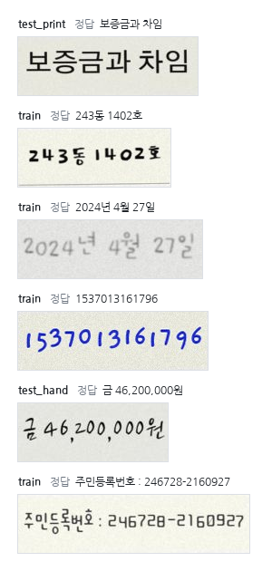

import DbDetectionDiagram from "@/materials/paddleocr-tesseract-fine-tuning/DbDetectionDiagram";
import LearningCurveDiagram from "@/materials/paddleocr-tesseract-fine-tuning/LearningCurveDiagram";
import RecoderDemo from "@/materials/paddleocr-tesseract-fine-tuning/RecoderDemo";
import SvtrLcnetDiagram from "@/materials/paddleocr-tesseract-fine-tuning/SvtrLcnetDiagram";
import TesseractLayersDiagram from "@/materials/paddleocr-tesseract-fine-tuning/TesseractLayersDiagram";

## 들어가며

지난 편에서는 OCR이 글자를 찾는 검출과 글자를 읽는 인식, 두 단계로 나뉜다는 것을 따라갔다. 그리고 CLOVA OCR로 가상 계약서의 주민등록번호를 가렸다. 글 끝에서는 로컬 OCR이 필요한 때를 세 가지 꼽았다. 원본을 외부 서비스에 한 장도 보낼 수 없을 때, 문서가 많아 호출 비용이 부담될 때, 우리 문서에만 있는 글꼴 때문에 인식률이 떨어질 때다.

이번 편은 그 로컬 OCR 이야기다. 대표적인 오픈소스 OCR인 PaddleOCR과 Tesseract를 골라 공식 한국어 모델을 그대로 돌려 봤다. 결과는 손글씨에서 크게 흔들렸다. 학습에 쓰지 않은 손글씨 글꼴로 주민등록번호 1,421개를 그려 읽혀 보니, 가림 정규식에 걸려 실제로 가려진 번호가 두 엔진 모두 24.1%였다. 넷 중 하나만 가려지는 셈이다.

공식 모델이 우리 글씨를 못 읽으면 우리 글씨로 더 가르치면 된다. 지난 편에서 본 파인튜닝이다. 그런데 막상 해 보려고 하니 두 엔진은 학습시키는 방법부터 전혀 달랐다. 준비할 파일도, 돌리는 장비도, 고를 수 있는 설정도 달랐다. 두 엔진이 안에서 글자를 읽는 방식이 다르기 때문이다.

그래서 이번 편에서는 세 가지를 따라간다.

1. 두 엔진은 안에서 글자를 어떻게 찾고 읽는가.
2. 두 엔진은 무엇을 받아 어떻게 배우는가.
3. 같은 데이터로 학습시키면 얼마나 나아지는가.

CNN과 RNN이 안에서 어떻게 계산하는지는 이 글에서 다루지 않는다. 여기서는 두 엔진이 이 부품들을 어떻게 쌓았는지에 집중한다.

<strong>이 글의 학습·시험 이미지는 모두 직접 만든 합성 이미지다.</strong> 주민등록번호 모양의 숫자는 전부 13월에서 99월 사이의 있을 수 없는 날짜로 만들어 실제 번호와 겹칠 수 없다. 실제 계약서나 실제 사람의 손글씨는 쓰지 않았다.

## PaddleOCR은 어떻게 읽나

PaddleOCR은 중국 Baidu의 딥러닝 프레임워크 PaddlePaddle 위에서 만든 OCR 도구다. 이번에 쓴 3.x 버전의 기본 파이프라인은 PP-OCRv5라는 모델 묶음이다. 기울어진 문서를 바로 세우거나 휘어진 사진을 펴는 단계를 선택으로 더 붙일 수 있지만, 뼈대는 지난 편과 같은 검출과 인식이다. 두 단계 모두 신경망이 맡는다.

### 검출 — 경계를 긋는 기준까지 배운다

지난 편에서 딥러닝 검출 모델은 픽셀마다 글자일 확률을 매긴 흑백 지도를 만든다고 했다. PP-OCRv5의 검출기는 DB(Differentiable Binarization) 알고리즘을 바탕으로 한다. 이름 그대로 "미분할 수 있는 이진화"가 핵심이다.

확률 지도를 상자로 바꾸려면 먼저 이진화를 해야 한다. 어떤 기준값보다 밝은 픽셀은 글자, 어두운 픽셀은 배경으로 나누는 것이다. 그런데 기준값 하나로 딱 자르는 계단 함수는 학습에 쓸 수 없다. 계단은 경계를 빼면 어디서나 평평해서 기울기가 0이다. 신경망은 이 기울기를 따라 가중치를 고치는데, 기울기가 0이면 어느 쪽으로 고쳐야 할지 알 수 없다.

DB는 이 문제를 두 가지로 푼다.

1. <strong>기준값도 픽셀마다 예측한다</strong> — 확률 지도 P 옆에 기준값 지도 T를 하나 더 만든다. 글자 테두리 근처는 기준값을 높여 이웃한 글자와 또렷하게 갈라지게 한다.
2. <strong>계단 대신 가파른 S자 곡선을 쓴다</strong> — 이진 지도를 B = 1 / (1 + e<sup>−k(P−T)</sup>)로 계산한다. PP-OCRv5 설정에서 k는 50이다. P가 T보다 조금만 커도 B는 1에 가까워지고, 조금만 작아도 0에 가까워진다. 모양은 계단과 거의 같지만 어디서나 기울기가 있어서 학습할 수 있다.

정답을 만드는 방식에도 요령이 있다. 글자 영역을 그대로 정답으로 주지 않고 안쪽으로 줄여서 준다. 줄이는 거리는 D = A(1 − r²) / L이다. A는 영역의 넓이, L은 둘레이고, PP-OCRv5 설정에서 r은 0.4다. 정답 영역을 가늘게 깎아 두면 위아래로 붙은 두 줄이 한 덩어리로 엉기지 않는다.

<DbDetectionDiagram />

재미있게도 학습이 끝나면 T와 B를 쓰지 않는다. 실제로 읽을 때 모델은 확률 지도 P만 내놓는다. PaddleOCR은 P를 고정값 0.3으로 잘라 영역을 얻고, 영역 안 평균 확률이 0.6보다 낮은 것은 버린다. 남은 영역은 정답을 줄일 때와 같은 식으로 다시 넓혀 상자로 돌려준다. 이번에는 1 − r² 자리에 PP-OCRv5 설정값 1.5가 들어간다. T와 B는 학습하는 동안 P가 글자 경계를 또렷하게 배우도록 돕는 장치였던 셈이다.

이번 실험에서 검출 모델은 학습시키지 않았다. 합성 이미지가 이미 한 줄씩 잘려 있어서다. 바꾼 것은 인식 모델뿐이다.

### 인식 — 40칸으로 나눠 11,945자 중에 고른다

한국어 인식 모델 `korean_PP-OCRv5_mobile_rec`의 구조 이름은 SVTR_LCNet이다. 학습 로그에 찍힌 설정을 따라가면 줄 이미지는 세 부품을 차례로 지난다.

1. <strong>PP-LCNetV3</strong> — CPU에서도 빠르게 돌도록 가볍게 만든 CNN이다. 높이 48, 폭 320으로 맞춘 컬러 줄 이미지를 받아, 높이는 한 칸까지 줄이고 가로로는 40칸을 남긴다. 지난 편에서 말한 "좁은 세로 칸"이 이 40칸이다.
2. <strong>SVTR 블록 2층</strong> — 지난 편 CRNN에서 RNN이 하던 일, 즉 앞뒤 칸의 맥락을 보는 일을 맡는다. 방식은 다르다. RNN은 왼쪽 칸부터 차례로 읽으며 맥락을 넘기지만, SVTR 블록은 자기 주의(self-attention)로 40칸이 서로를 한꺼번에 본다. 끝 칸이 첫 칸을 보려고 중간 칸을 모두 거칠 필요가 없다.
3. <strong>CTC</strong> — 칸마다 글자 11,945개와 빈칸 가운데 하나를 고르고, 지난 편의 두 규칙으로 정리한다. 같은 글자가 이어지면 합치고 빈칸을 지운다.

여기까지가 실제로 글자를 읽을 때 쓰는 모델이다. 학습할 때는 하나가 더 붙는다.

<SvtrLcnetDiagram />

학습할 때는 CNN이 낸 특징이 두 갈래로 나뉜다. 한 갈래는 위의 SVTR 블록과 CTC로 가고, 다른 갈래는 NRTR이라는 트랜스포머 디코더로 간다. NRTR은 칸을 한꺼번에 고르지 않고, 앞에서 읽은 글자를 보며 다음 글자를 하나씩 맞힌다. 글자 수만큼 계산을 되풀이해야 해서 CTC보다 느리다.

코드를 보면 이 두 갈래가 맡은 역할이 분명하다. CTC 갈래로 들어가는 입력은 기울기를 끊어 두어서, CTC가 틀려도 그 신호는 CNN까지 내려가지 않는다. CNN은 NRTR 갈래의 신호로만 배운다. 학습이 끝나면 NRTR 갈래는 떼어 내고 빠른 CTC 갈래만 남긴다. 느린 쪽이 특징을 가르치고, 빠른 쪽이 실제로 읽는 구조다. PaddleOCR은 이 방식을 GTC(Guided Training of CTC)라고 부른다.

마지막으로, PaddleOCR 인식 모델에는 단어 사전이 없다. CTC가 정리한 문자열이 곧 결과다. 뒤에서 볼 Tesseract와 가장 크게 갈리는 지점이다.

## Tesseract는 어떻게 읽나

Tesseract는 1980년대 HP에서 시작해 2005년에 오픈소스로 공개된 OCR 엔진이다. 지난 편에서 본 것처럼 3.x 버전까지는 글자를 한 자씩 떼어 맞히는 고전 OCR이었고, 2018년 4.0부터 한 줄을 통째로 읽는 LSTM 인식기가 들어왔다. 지금 버전에도 옛 엔진이 남아 있어 `--oem` 옵션으로 고를 수 있다. 다만 이번에 쓴 `tessdata_best` 모델은 LSTM 인식기용이다.

### 줄 찾기 — 아직 규칙이 맡는다

PaddleOCR이 글자 영역 찾기를 신경망에 맡긴 것과 달리, Tesseract는 지금도 규칙으로 페이지를 나눈다. 순서는 지난 편의 고전 OCR과 닮았다.

1. 이미지를 이진화한다. 기본값은 이미지 전체의 밝기 분포로 기준값을 정하는 Otsu 방식이다.
2. 서로 이어진 검은 픽셀 덩어리(연결 요소)를 찾는다.
3. 덩어리를 기준선에 맞춰 줄로 묶고, 줄을 다시 단어로 나눈다.
4. 줄과 문단, 단(段)의 배치를 분석해 읽는 순서를 정한다.

이 분석을 얼마나 할지는 `--psm`(page segmentation mode) 옵션으로 정한다. 기본값 3은 페이지 전체를 자동으로 분석하고, 7은 이미지 전체를 글자 한 줄로 보고 분석을 건너뛴다. 이번 실험의 이미지는 이미 한 줄씩 잘려 있어서 7을 썼다.

### 인식 — 한 줄로 적은 신경망

줄을 찾은 다음은 LSTM 인식기 차례다. Tesseract는 신경망 구조를 VGSL이라는 짧은 표기로 적는다. 한국어 `kor` 모델을 학습시킬 때 로그에 찍힌 층 구성을 그대로 옮기면 이렇다.

```text
1,48,0,1  C3,3 Ft16  Mp3,3  TxyLfys64  Lfx96  RxLrx96  Lfx512  Fc150
```

한 층씩 풀면 아래와 같다.

| 표기 | 하는 일 | 나오는 모양 |
| --- | --- | --- |
| `1,48,0,1` | 입력이다. 흑백 줄 이미지 한 장을 높이 48로 맞춘다. 폭(0)은 줄 길이에 따라 달라진다 | 높이 48 × 폭 W |
| `C3,3 Ft16` | 3×3 이웃 픽셀을 모아 특징 16개를 만든다. 합성곱 층이다 | 48 × W × 16 |
| `Mp3,3` | 3×3 칸마다 가장 큰 값만 남긴다 | 16 × W/3 × 16 |
| `TxyLfys64` | 세로 방향 LSTM이 열 하나를 위에서 아래로 훑어 벡터 하나로 요약한다. 높이가 1로 접힌다 | 1 × W/3 × 64 |
| `Lfx96` | 왼쪽에서 오른쪽으로 읽는 LSTM | W/3 × 96 |
| `RxLrx96` | 오른쪽에서 왼쪽으로 읽는 LSTM | W/3 × 96 |
| `Lfx512` | 다시 왼쪽에서 오른쪽으로 읽는 큰 LSTM | W/3 × 512 |
| `Fc150` | 칸마다 출력 150개의 확률을 낸다 | W/3 × 150 |

<TesseractLayersDiagram />

뼈대는 지난 편의 CRNN과 같다. 합성곱으로 모양을 보고, LSTM으로 앞뒤 맥락을 보고, CTC로 정리한다. 다른 점은 높이를 접는 방법이다. PaddleOCR의 CNN은 평균을 내서 높이를 줄이지만, Tesseract는 세로 방향 LSTM이 열을 위에서 아래로 읽으며 요약한다. 가중치는 학습시킨 모델 기준으로 모두 148만 개이고, 그중 84%가 마지막 `Lfx512` 한 층에 몰려 있다.

### 출력이 150칸뿐인 이유 — 한글을 자모로 쪼갠다

표의 마지막 줄을 다시 보자. PaddleOCR은 칸마다 11,945개 중에 고르는데, Tesseract 한국어 모델의 출력은 150개뿐이다. 원래 `kor` 모델은 144개였고, 우리 데이터로 글자 목록을 다시 만들면서 150개로 늘었다. 현대 한글로 만들 수 있는 글자만 11,172자인데 어떻게 150칸으로 읽을까?

답은 Tesseract의 recoder에 있다. Tesseract는 한글 한 글자를 초성, 중성, 종성 세 코드로 나눠 내보낸다. 초성 19개, 중성 21개, 종성 28개(받침 없음 포함)면 68개 코드로 한글 11,172자를 모두 적을 수 있다. 여기에 숫자, 영문, 문장부호 같은 나머지 글자와 CTC의 빈칸을 더한 것이 150칸이다.

예를 들어 "주민"은 이렇게 나간다.

| 글자 | 초성 | 중성 | 종성 |
| --- | --- | --- | --- |
| 주 | ㅈ | ㅜ | (없음) |
| 민 | ㅁ | ㅣ | ㄴ |

아래 그림은 "주민" 줄을 읽을 때 칸마다 나온 코드가 경로로 이어져 글자가 되기까지를 따라간다. 칸마다 고른 코드와 후보 경로는 설명을 위해 정한 값이다.

<RecoderDemo client:visible />

코드가 자모 단위라서 Tesseract는 출력을 바로 글자로 읽지 않는다. 빔 탐색이 칸마다 가능성 높은 코드 경로를 여러 개 들고 가며, 초성 다음에 중성이 오는 식으로 말이 되는 경로만 글자로 합친다. 이때 단어 사전(DAWG)도 함께 보고, 사전에 있는 단어가 되는 경로를 더 믿는다. PaddleOCR에 없던 사전이 Tesseract에는 읽는 과정 안에 들어 있다. 이 차이는 뒤의 학습 함정에서 다시 나온다.

### 두 엔진 나란히

| | PaddleOCR (PP-OCRv5 한국어) | Tesseract (`kor` LSTM) |
| --- | --- | --- |
| 줄 찾기 | DB 신경망 | 규칙 기반 페이지 분석 |
| 인식 구조 | CNN + SVTR 블록(자기 주의) + CTC | 합성곱 + 세로·가로 LSTM + CTC |
| 입력 | 컬러, 높이 48 × 폭 320 | 흑백, 높이 48 × 폭은 줄 길이대로 |
| 출력 | 글자 11,945개 | 코드 150개(한글은 자모 세 개씩) |
| 사전 | 없음 | 단어·문장부호·숫자 사전을 읽을 때 함께 씀 |
| 학습 때만 쓰는 것 | NRTR 갈래, DB의 기준값 지도 | 없음 |

## 두 엔진은 어떻게 배우나

지난 편에서 인식 모델에 넣을 것은 줄 이미지와 그 안의 정답 문자열이 전부라고 했다. 두 엔진 모두 그 원칙은 같다. 달라지는 것은 그 두 가지를 어떤 형태로 넣고 어떤 장비로 돌리는가다.

### PaddleOCR — 목록 파일 하나와 GPU

PaddleOCR은 이미지 경로와 정답을 탭으로 나눈 목록 파일 하나면 된다. jpg도 그대로 받는다.

```text
train/000123.jpg	임차인 홍길동
train/000124.jpg	금 3,500,000원
```

학습은 GPU에서 묶음 단위로 한다. 공식 설정은 한 걸음에 이미지 128장을 함께 계산한다. 학습 코드에는 데이터를 부풀리는 장치도 들어 있다. 다른 줄을 이어 붙여 긴 줄을 만들고, 일부러 비틀거나 흐리게 만들고, 줄 높이를 32·48·64로 섞어서 넣는다. 같은 이미지를 열 번 봐도 모델 눈에는 매번 조금씩 다른 이미지가 된다.

### Tesseract — 변환 세 번과 CPU

Tesseract는 학습 파일을 따로 만들어야 한다. 공식 학습 도구 tesstrain의 순서는 이렇다.

1. 줄 이미지를 png나 tif로 두고, 같은 이름의 `.gt.txt`에 정답을 적는다. jpg는 받지 않는다.
2. 이미지와 정답으로 글자 상자 파일(`.box`)을 만든다.
3. 둘을 합쳐 학습용 `.lstmf` 파일로 바꾼다.

이번 실험에서 4만 2천 줄을 이렇게 바꾸는 데만 49분이 걸렸다.

학습은 CPU로만 한다. 공식 학습 문서에 "No GPU is needed. (No support.)"라고 적혀 있다. Tesseract는 신경망을 C++로 직접 구현했고, 그 코드에 GPU로 계산하는 경로가 없다. 학습 방식도 GPU와 잘 맞지 않는다. GPU는 수십, 수백 장을 한꺼번에 계산할 때 빨라지는데, Tesseract는 길이가 제각각인 줄을 한 줄씩 넣고 곧바로 가중치를 고친다. 학습 로그의 걸음 하나가 줄 하나다.

가장 좋은 모델을 고르는 방식도 다르다. PaddleOCR은 정해진 걸음마다 검증 세트로 정확도를 재서 가장 좋은 모델을 따로 저장한다. Tesseract는 학습 데이터에서 오류율이 좋아질 때마다 저장한다. 학습 데이터에서 좋아졌다고 처음 보는 데이터에서도 좋아진다는 보장은 없어서, 저장된 모델을 검증 세트로 직접 읽혀 골라야 한다.

## 같은 조건으로 학습시키기

두 엔진을 공정하게 비교하려면 데이터와 채점을 똑같이 맞춰야 한다. 학습 방식이 다른 도구라 학습률이나 바퀴 수까지 1:1로 맞출 수는 없지만, 무엇을 보고 배우는지와 무엇으로 점수를 매기는지는 같게 둘 수 있다.

### 합성 데이터 4만 7천 줄

PaddleOCR 학습에는 GPU가 필요한데 실제 계약서를 외부 GPU 서비스에 올릴 수는 없다. 그래서 학습 데이터를 전부 만들었다. Google Fonts에서 OFL 라이선스로 공개된 한국어 글꼴로 계약서에 나올 법한 글자 줄을 그렸다.

| 묶음 | 줄 수 | 글꼴 | 쓰임 |
| --- | --- | --- | --- |
| train | 40,000 | 손글씨 12종(70%) + 인쇄체 7종(30%) | 학습 |
| val | 2,000 | train과 같은 글꼴 | 가장 좋은 시점 고르기 |
| <strong>test_hand</strong> | 3,000 | <strong>학습에서 뺀 손글씨 3종</strong> | <strong>처음 보는 글씨로 실력 재기</strong> |
| test_print | 2,000 | 인쇄체 7종 | 일반 글자를 잊지 않았는지 보기 |

가장 중요한 것은 test_hand다. 손글씨 글꼴 15종 가운데 3종을 학습에서 완전히 뺐다. 학습에 쓴 글꼴로 시험하면 모델이 글씨체를 외웠는지 글자를 읽게 됐는지 구분할 수 없다. 실제 문서의 손글씨는 학습 데이터의 어떤 글꼴과도 다를 테니, 처음 보는 글꼴에서의 점수가 실제 성능에 가장 가깝다.

줄 내용에는 주민등록번호와 그 라벨, 계약서 항목명, 가짜 이름, 금액과 날짜, 계약서 문구를 섞었다. 손글씨처럼 보이게 하려고 글자마다 높이와 간격을 조금씩 흔들고, 파란 펜과 검은 잉크 색을 섞고, 서식 칸의 선과 기울기, 흐림, 잡음, JPEG 압축 손상을 넣었다.



*모두 직접 만든 합성 이미지다. 주민등록번호 모양 숫자는 13\~99월의 있을 수 없는 날짜로 만들었다.*

학습 데이터는 외부 서비스에 올라가므로 올리기 직전에 한 번 더 검사했다. 압축 파일을 다시 열어 주민등록번호 모양의 숫자 2만 646개를 모두 확인했다. 월은 전부 13 이상이었고, 실제로 있을 수 있는 날짜는 하나도 없었다. 전화번호와 계좌번호는 처음부터 넣지 않았다.

### 학습 설정

두 엔진 모두 Kaggle의 무료 노트북에서 학습했다. PaddleOCR은 GPU, Tesseract는 CPU 세션을 썼다.

| | PaddleOCR | Tesseract |
| --- | --- | --- |
| 출발 모델 | `korean_PP-OCRv5_mobile_rec` 공식 사전학습 가중치 | `tessdata_best`의 `kor` |
| 도구 | PaddleOCR 3.7.0, PaddlePaddle 3.2.2 | Tesseract 5.3.4, tesstrain |
| 장비 | NVIDIA T4 1장 (15GB) | CPU 4코어 |
| 학습량 | 20바퀴 (80만 장, 17,400걸음) | 3바퀴 (12만 줄, 12만 걸음) |
| 학습률 | 0.0001 (공식 설정 0.0005의 1/5) | 0.0001 (tesstrain 기본값) |
| 걸린 시간 | 5시간 40분 | 5시간 31분 (순수 학습 4시간 9분) |
| 비용 | 0원 | 0원 |

PaddleOCR의 학습률을 공식 설정보다 낮춘 것은 원래 실력을 크게 흔들지 않기 위해서다. 이미 잘 학습된 모델을 조금 고치는 것이 목적이라 한 번에 고치는 폭을 줄였다.

Tesseract를 3바퀴만 돌린 것은 실행 시간 한도 때문이다. Kaggle 노트북은 한 번에 오래 돌릴 수 없고, Tesseract는 CPU에서 초당 약 8줄을 학습한다. PaddleOCR과 같은 20바퀴라면 한 번 실행으로 끝낼 수 없다. 결과를 미리 말하면, 이 차이는 결론을 바꾸지 않았다. Tesseract는 0.6바퀴 이후로 더 좋아지지 않았다.

### 채점은 한 코드로

두 엔진의 점수는 같은 채점 코드로 냈다. Tesseract는 Kaggle에서 읽은 결과만 파일로 받아, PaddleOCR을 채점한 코드에 그대로 넣었다. 인식기만 바뀌고 채점 기준은 한 줄도 바뀌지 않는다.

지표는 네 가지다.

1. <strong>줄 일치</strong> — 줄 전체를 띄어쓰기만 빼고 똑같이 읽었는가.
2. <strong>주민등록번호 13자리</strong> — 숫자 13개를 모두 맞게 읽었는가.
3. <strong>정규식으로 잡힘</strong> — 읽은 결과가 가림 정규식에 걸려 실제로 가려지는가. 숫자 사이에 하이픈이나 물결 같은 구분자 한 글자를 허용하는 정규식이다.
4. <strong>라벨 잡힘</strong> — "주민등록번호" 같은 라벨을 알아보는가. 숫자를 틀리게 읽어도 라벨을 찾으면 그 옆 칸을 통째로 가릴 수 있다.

학습 도구가 학습 중에 보여주는 정확도는 아래 결과 표에 쓰지 않았다. PaddleOCR의 학습용 평가는 폭이 320픽셀을 넘는 긴 줄을 320에 맞춰 눌러서 읽는다. 실제로 읽을 때는 줄 길이에 맞춰 폭을 정하기 때문에 숫자가 다르게 나온다. 학습 전 모델의 test_hand 줄 일치를 예로 들면, 실제로 읽은 값은 27.7%인데 학습 화면에는 20.9%로 찍혔다.

## 결과

### 처음 보는 손글씨에서는 PaddleOCR이 앞섰다

학습에 쓰지 않은 손글씨 글꼴 3종, test_hand 3,000줄의 결과다.

| 지표 | PaddleOCR 학습 전 | <strong>PaddleOCR 학습 후</strong> | Tesseract 학습 전 | <strong>Tesseract 학습 후</strong> |
| --- | --- | --- | --- | --- |
| 정규식으로 주민등록번호가 잡힘 | 24.1% | <strong>41.7%</strong> | 24.1% | <strong>33.8%</strong> |
| 주민등록번호 13자리를 맞게 읽음 | 26.0% | <strong>46.9%</strong> | 28.4% | <strong>39.6%</strong> |
| 라벨이 잡힘 | 78.7% | <strong>99.4%</strong> | 67.8% | <strong>62.6%</strong> |
| 줄 일치 | 27.7% | <strong>62.8%</strong> | 29.2% | <strong>34.3%</strong> |

주민등록번호는 1,421개, 라벨은 704개다.

학습 전에는 주민등록번호 지표가 두 엔진 모두 거의 같았다. 학습 후에는 PaddleOCR이 네 지표 모두 앞섰다. 실제로 가려지는 비율이 24.1%에서 41.7%로 두 배 가까이 올랐고, 라벨은 99.4%까지 잡혔다. Tesseract도 주민등록번호는 33.8%까지 올랐지만, 라벨은 오히려 67.8%에서 62.6%로 떨어졌다. 놓친 줄을 보면 '주민'을 '주인'이나 '수인'으로 읽은 경우가 가장 많았다.

정규식으로 잡히는 비율에는 상한이 있다. 정답 문자열을 그대로 넣어도 87.5%만 잡힌다. 합성 데이터의 일부는 숫자 사이에 공백이 낀 구분자로 그렸는데, 가림 정규식이 이런 모양을 주민등록번호로 보지 않기 때문이다. 두 엔진에 똑같이 적용되는 한계라 비교에는 영향이 없다.

### 학습에 쓴 글꼴에서는 반대였다

참고용 시험 세트의 결과도 함께 보자.

| 시험 세트 · 지표 | PaddleOCR 학습 전 | PaddleOCR 학습 후 | Tesseract 학습 전 | Tesseract 학습 후 |
| --- | --- | --- | --- | --- |
| val · 줄 일치 | 50.9% | 80.5% | 53.8% | 74.0% |
| val · 주민등록번호 13자리 | 61.0% | 73.5% | 79.2% | 88.4% |
| val · 정규식으로 잡힘 | 55.5% | 65.4% | 70.0% | 77.6% |
| val · 라벨 잡힘 | 93.5% | 100% | 79.8% | 90.7% |
| test_print · 줄 일치 | 50.8% | 94.1% | 48.1% | 66.7% |

눈에 띄는 것은 val의 주민등록번호다. 학습에 쓴 글꼴로 그린 숫자는 Tesseract가 학습 전부터 79.2% 대 61.0%로 더 잘 읽었고, 학습 후에도 88.4% 대 73.5%로 앞섰다. 그런데 처음 보는 글꼴로 가면 39.6% 대 46.9%로 순서가 뒤집혔다. Tesseract는 본 글씨체를 더 잘 외웠고, PaddleOCR은 처음 보는 글씨체에도 더 잘 통했다.

이유는 확인하지 못했다. 짐작 가는 것은 앞에서 본 데이터 부풀리기다. PaddleOCR은 같은 줄도 매번 조금씩 비틀어 봤고, 이번 Tesseract 학습은 줄 이미지를 그대로 봤다. 뒤에서 볼 학습 곡선도 같은 방향을 가리킨다.

test_print의 94.1%는 부풀려진 숫자일 수 있다. 학습 데이터의 30%가 같은 인쇄체 글꼴 7종으로 그려졌기 때문이다. 이 세트로 확실히 말할 수 있는 것은 학습 후에 일반 글자를 읽는 실력이 떨어지지 않았다는 데까지다. 인쇄체도 학습용과 시험용 글꼴을 나눴어야 했다.

### 학습 곡선 — 일찍 평평해졌다

<LearningCurveDiagram />

PaddleOCR은 검증 정확도가 36.2%에서 출발해 6,000걸음쯤 80%에 닿았다. 그 뒤로는 크게 오르지 않고 대부분 80\~85% 사이를 오르내렸다. 8,000\~11,000걸음 사이에는 네 번 80% 아래로 내려갔고, 가장 낮게는 11,000걸음의 72.2%였다. 가장 높은 85.5%는 14,000걸음과 16,000걸음에서 같게 나왔고, 16,000걸음 모델을 골랐다. 이 숫자는 앞에서 말한 학습용 평가 기준이라 위 표와는 다르다. 곡선의 모양만 보자.

Tesseract는 학습 중에 모델을 45번 저장했다. 오류율이 좋아질 때마다 저장하다 보니 초반에 몰려 있어서, 걸음 수 기준으로 고르게 10개를 뽑아 val로 읽혔다. 가장 좋은 것은 2만 3,500걸음, 약 0.6바퀴째 모델로 74.0%였다. 그 뒤로는 69.7\~71.8%로 오히려 떨어졌다. 학습 데이터의 오류율은 끝까지 줄었는데 검증 점수는 떨어졌으니, 이 시점부터는 학습 데이터를 외우기 시작한 것으로 보인다.

두 곡선이 일찍 평평해졌다는 것은 같은 데이터로 더 오래 돌려도 크게 나아지지 않는다는 뜻이다. 더 학습한다면 시간보다 데이터를 바꿔야 한다.

### 무엇을 틀렸나

학습 전 PaddleOCR은 처음 보는 손글씨에서 두 가지 실수를 자주 했다.

- '주민등록번호'를 '주인등록번'처럼 글자를 바꾸거나 빠뜨렸다.
- 같은 숫자가 이어지면 빠뜨렸다. `56,200,000원`을 `56,00,00원`으로 읽는 식이다.

두 번째 실수는 지난 편의 CTC 규칙이 그대로 드러난 경우다. CTC는 같은 글자가 이어지면 하나로 합치기 때문에, `000`을 읽으려면 0 사이마다 빈칸이 끼어야 한다. 손글씨 숫자의 간격이 고르지 않으면 모델이 빈칸을 놓치고, 0 두 개가 하나로 합쳐진다. 학습 후에는 이런 실수가 줄었지만 사라지지는 않았다. 처음 보는 손글씨에서 주민등록번호 13자리를 다 맞게 읽은 비율은 학습 후에도 46.9%다.

## 학습하며 빠졌던 함정

### 사전이 빠진 Tesseract는 한 자씩 띄어 쓴다

Tesseract를 처음 짧게 학습시켰을 때 라벨 잡힘이 0%가 됐다. 띄어쓰기를 무시하는 줄 일치는 53.8%에서 59.0%로 올랐는데 라벨만 0%였다. 결과를 열어 보니 학습한 모델이 한글을 '주 민 등 록 번 호'처럼 한 자씩 띄어 쓰고 있었다. 라벨 정규식은 이렇게 띄어 쓴 라벨을 찾지 못한다.

학습 로그에 단서가 있었다. tesstrain은 출발 모델에 들어 있던 한국어 단어·문장부호·숫자 사전을 새 모델에 넣지 않는다. 그래서 출발 모델에서 사전을 꺼내 넣었다.

```sh
dawg2wordlist kor.lstm-unicharset kor.lstm-word-dawg kor_ft.wordlist
dawg2wordlist kor.lstm-unicharset kor.lstm-punc-dawg kor_ft.punc
dawg2wordlist kor.lstm-unicharset kor.lstm-number-dawg kor_ft.numbers
```

같은 짧은 학습을 다시 돌리자 val 2,000줄 중 한 자씩 띄어 쓴 줄이 1,090줄에서 49줄로 줄었다. 사전이 왜 띄어쓰기까지 바꾸는지는 소스까지 따라가 확인하지 못했다. 다만 Tesseract의 사전이 곁가지가 아니라 읽는 과정의 일부라는 것은 분명하다. Tesseract를 파인튜닝할 때는 출발 모델의 사전을 꼭 함께 넣자.

### Tesseract는 직접 골라야 한다

앞에서 말했듯 Tesseract는 학습 데이터의 오류율로 모델을 저장한다. 마지막에 남는 모델을 그대로 쓰면 이번 실험에서는 0.6바퀴째보다 나쁜 모델을 쓰게 된다. 저장된 모델 이름에 오류율과 걸음 수가 들어 있으니, 걸음 수로 고르게 뽑아 검증 세트로 읽혀 보고 고르자.

### Kaggle GPU는 조용히 CPU가 된다

Kaggle에서 GPU를 쓰려면 휴대폰 인증을 먼저 해야 한다. 인증 전에 GPU를 요청하면 오류 없이 CPU 환경으로 뜬다. 더 곤란하게도 노트북은 첫 실행 때 받은 실행 환경에 고정된다. 인증 전에 한 번 돌렸다면 인증 뒤에도 계속 CPU로 뜬다. 노트북 설정 `kernel-metadata.json`에 `"docker_image_pinning_type": "latest"`를 넣어 풀었다.

### T4에서는 배치를 두 군데서 줄여야 한다

PaddleOCR 공식 설정의 배치 128장은 T4의 15GB 메모리를 넘었다. 64장으로 줄였는데, 설정 파일에서 배치 크기를 한 번만 고치면 소용이 없다. 높이를 섞어 넣는 샘플러가 같은 값을 따로 들고 있어서 `Train.sampler.first_bs`와 `Train.loader.batch_size_per_card`를 둘 다 내려야 한다.

## 한계

결과를 과장하지 않으려면 한계도 같이 적어야 한다.

- <strong>학습과 시험 데이터가 모두 합성이다.</strong> 실제 펜 글씨, 휴대폰으로 찍은 사진, 다양한 계약서 양식에서의 성능은 아직 모른다.
- <strong>학습 후에도 처음 보는 손글씨의 주민등록번호는 절반 넘게 틀린다.</strong> 13자리를 다 맞게 읽은 비율이 46.9%다. 지난 편에서 말한 라벨로 찾기, 즉 라벨 옆 칸을 통째로 가리는 장치와 사람이 확인하는 단계는 여전히 필요하다.
- <strong>인쇄체 시험 세트의 글꼴이 학습 데이터와 겹친다.</strong> 그래서 test_print 점수는 참고용이다.
- <strong>검출 모델은 학습시키지 않았다.</strong> 이미 잘린 줄 이미지로만 실험했다.

## 그래서 무엇을 쓸까

이번 데이터 기준으로는 PaddleOCR이다. 처음 보는 손글씨에서 네 지표 모두 앞섰고, 특히 숫자를 틀려도 가릴 수 있게 해 주는 라벨을 99.4% 잡았다. GPU를 쓸 수 있어서 학습량을 늘리기도 쉽다.

Tesseract에도 분명한 장점이 있다. GPU 없이 CPU만으로 학습하고 읽을 수 있고, 모델은 12MB 파일 하나다. 둘 다 5시간 남짓 돌리는 동안 Tesseract는 12만 줄, PaddleOCR은 80만 장을 봤지만 장비가 달라 속도를 직접 비교할 수는 없다. 다만 GPU가 없는 환경에서도 파인튜닝까지 해 볼 수 있다는 것은 Tesseract만의 장점이다.

원리로 돌아가 보면 두 엔진의 차이는 결국 무엇을 신경망에 맡겼는가의 차이다. PaddleOCR은 줄 찾기부터 신경망에 맡기고, 학습 때만 쓰는 장치인 기준값 지도와 NRTR로 실제 모델을 가르친 뒤 떼어 낸다. Tesseract는 줄 찾기를 규칙에 두고, 한글을 자모 코드로 쪼개 작은 출력으로 읽으며, 사전을 읽는 과정 안에 둔다. 이 구조를 알면 학습할 때 무엇을 챙겨야 하는지도 보인다. PaddleOCR은 데이터 부풀리기와 학습용 평가 방식을, Tesseract는 사전과 저장 시점을 챙겨야 한다.
